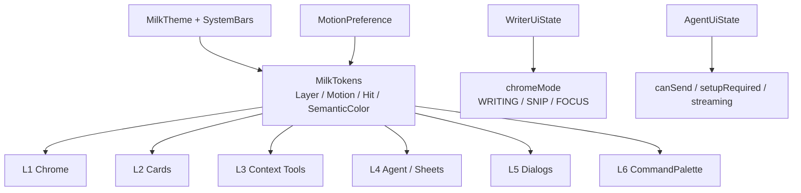

# MilkNote 优化重设计方案 —— Quiet Layers / 静纸层序

> 版本：R2.1 触控复审 + WWDC24 动画研究 · 2026-11-03 · 对应审查：`design-review/AUDIT.md`  
> 研究补充：`design-review/WWDC24-ANIMATION-NOTES.md`；共享预览/速度连续性与中断规则以该文为准。  
> 原型：`design-review/prototype/index.html`（独立 HTML，无依赖、无网络、不接入主 App）  
> 目标不是换皮，而是把现有「Codex 骨架 + 柔和纸感」变成一套可验证、可实现、可维护的层次与触控系统。  
> **输入排序：触控笔 = 手指 > 系统 BACK/手势 > 外接键盘。鼠标 hover 不属于核心反馈。**

## 1. 设计主张

**笔记是纸，工具是桌边，Agent 是夹在纸里的活页。**

- 书写中的纸张始终稳定：切页、抽屉、主题切换都不让纸面缩放或跳动；只有书架↔书写可用共享**预览层**过渡，真实画布不参与缩放。
- 层次由“与内容的距离”决定：常驻 chrome 扁平，临时编辑工具轻浮，模态才明显脱离。
- 动效只回答三件事：触点是否被接收、拖动是否跟手、抬起后状态去了哪里。
- 通用组件不做 hover 上浮/淡底；触控笔悬停只用于纸面光标、笔刷宽度与命中预览。
- 蓝色继续只表示 Agent/当前激活；封面色保留识别功能，但不直接承担暗色小字。
- 高风险视觉克制：所有“精致感”必须对应一个可读性、定位或反馈指标。

### 一个有辨识度的细节：纸缘标尺

页侧栏的当前页缩略图保留 1.5dp 蓝边，并在左缘增加 **3dp 激活脊线**；含批注的页在缩略图右缘显示 1–3 个 2dp 短刻度，位置对应批注在页面中的纵向比例。它不是装饰：用户能在一页之内识别“当前”和“有 AI 批注”，也形成 MilkNote 独有的纸张语言。无刻度、无批注时完全安静。

---

## 2. 视觉规范修订

## 2.1 层次体系表（统一 L0–L6）

> 阴影值为 Compose 可实现的目标；`paintedShadow` 仅作渲染兼容兜底，不再同时给所有层四边加暗。亮色/暗色使用不同 alpha，而非简单增加 blur。

| 层 | 使用对象 | 背景策略 | 边界 | 阴影/遮罩 | 圆角 |
|---|---|---|---|---|---|
| **L0 纸下背景** | App 根背景、书架空域 | `background` | 无 | 无 | 0 |
| **L1 常驻 chrome** | 顶栏、侧栏、状态条、设置导航 | `surfaceVariant`；书写侧栏可 50% 混合 | 相接边 1dp `outline` | 无阴影 | 0；内部控件 8/10dp |
| **L2 内容卡** | 笔记本卡、设置卡、诊断信息卡 | `surface` | 1dp `outline` | rest 3dp；spot 亮 8% / 暗 24%；无 hover 上浮 | 笔记本 20dp；设置 16dp；信息卡 10dp |
| **L3 情境工具** | 选中条、Toast、框选意图条、意图 chip 组 | 深色工具统一 `#23221E`/94%；浅色内容用 `surface` | 可选 1dp 白 8% | 8dp；只向下 | 全胶囊或 12dp |
| **L4 常驻浮层** | Agent 抽屉、模型 sheet、附件面板 | 抽屉 `surface`；子面板 `surfaceVariant` 95% | 抽屉左缘 1dp；子面板 1dp | 抽屉 12dp 向左；子面板 8dp | 抽屉 0；子面板 14dp |
| **L5 模态** | 新建、删除、新增 Provider、诊断 | `surface`，不透明 | 1dp `outline` | 16dp；scrim 黑 48% | 20dp |
| **L6 命令中心** | ⌘K | `surface`，不透明 | 1dp `outline` | 20dp；scrim 黑 32% | 18dp |
| **模式层（非 z 轴）** | Snip 遮罩 | 选区外黑 55%，选区内原样 | 选框白 2dp + 蓝角柄 | 不加外阴影 | 选框 3dp 视觉即可 |

### z 轴规则

1. Snip 是书写页的**输入模式**，不是另一个页面；它位于画布上方、L1 顶栏下方。
2. Agent 是 L4：画布右缘浮层，不盖顶栏/状态条；Snip 开启时保留 Agent，但 Agent 区域不参与选区。
3. Toast/选中条为 L3；模态与 ⌘K 在它们上方。诊断打开时取消当前未提交的 UI 按压态，但不影响已提交的笔迹。
4. 纸张本身不使用大 elevation；纸的识别依靠明度、点阵和边界，不靠悬浮。

## 2.2 尺寸、间距与命中区

| Token | 值 | 用途 |
|---|---:|---|
| `space1/2/3/4/5/6` | 4 / 8 / 12 / 16 / 24 / 32dp | 全部组件间距从阶梯取值 |
| `chromeTop` | 56dp | 书写/书架顶栏；书架可继续 64dp，二选一后全局一致 |
| `writerSidebar` | 148dp | 保持现有宽度 |
| `agentDrawer` | 360dp；分屏最小 320dp | 不随字体放大无限扩张 |
| `contentMeasure` | 560dp | 设置正文 |
| `dialogMeasure` | 600dp | 新建/新增 Provider；删除确认 440dp |
| `paletteMeasure` | 640dp | ⌘K |
| `hitTouch` | **48×48dp** | 笔与手指共用的默认目标；视觉图标仍 18–19dp |
| `hitDense` | 44dp，仅次要非破坏操作 | 只有空间不足且经触控测试才用；不得用于关闭、删除、发送、角柄 |
| `touchGap` | 4dp | 相邻命中区最小净间隔；不得用重叠透明命中区造成双触发 |
| `dragTouchRadius` | 24dp | 框选角柄/抽屉边缘的拖动命中半径或半宽，使用 dp→px 转换 |

**适配规则**：浮层统一 `widthIn(max=token).fillMaxWidth()` 后再加外部 margin；可用高度不足时内容滚动，标题与底部 CTA 可固定。密集顶栏优先把低频动作收进 48dp「更多」，不得靠缩小目标塞满。`DialogCard` 若保留 inline 形态，不得命名为 Dialog，也不使用 scrim/模态阴影。

## 2.3 字体与信息密度

| 角色 | 规格 | 用途 |
|---|---|---|
| Display/page | 20sp / 26sp / SemiBold | 设置页、弹窗标题；书写页不放大标题 |
| Section | 15sp / 21sp / SemiBold | 设置小节、Agent 小节 |
| Body | 14sp / 20sp / Regular | 设置行、输入、对话正文；Agent 可用 13/19 保持现有密度 |
| Label | 12sp / 17sp / Medium | chips、辅助动作 |
| Meta | 11sp / 15sp / Mono Regular | 页码、尺寸、token、版本 |
| Micro | 10sp / 14sp | 仅非关键补充说明；不使用 8/9sp 承载操作或错误 |

- `MonoMeta` 保持 11sp；模型 id 可 11sp，但不把整段协议说明都设成 9sp。
- 长模型名最多一行并 ellipsize；完整名在详情/工具提示可见。
- 占位文字可降 alpha，但错误、空态动作、档位说明不得用 50% 以下透明小字。

## 2.4 色彩与对比

保留 V0 主色板，新增语义而不是增加品牌色：

| Token | 亮色 | 暗色 | 说明 |
|---|---|---|---|
| `overlayScrim` | `#000000` 48% | 同 | L5 模态 |
| `paletteScrim` | `#000000` 32% | 同 | L6 ⌘K |
| `toolInverse` | `#23221E` 94% | 同 | 框选/选中/Toast 深工具 |
| `consoleBackground` | `#14161B` | `#14161B` | 永远深色的诊断终端 |
| `consoleText` | `#E8E6E0` | 同 | 终端正文 |
| `coverBlueForeground` | `#3B5BEC` | `#9DADFF` | 封面蓝上的文字；实际以对比测试为准 |
| `coverRedForeground` | `#D2483C` | `#F0958C` | 封面红文字 |
| `activeSoft` | 蓝 10% | 蓝 12% | 当前工具/导航/选项 |
| `focusRing` | 蓝 100% | `#7D92FF` | 外接键盘焦点 2dp；与触摸 pressed 分开，仅键盘使用时显示 |

**门槛**：正文/小字 ≥4.5:1；图标与控件状态 ≥3:1；禁用态可不达标但必须有语义 disabled；荧光黄不做白底上的正文色。

## 2.5 关键界面优化前后

### 书架：统一卡片框架 + 可见管理入口

```text
现状                                          优化后
┌──────────────┐  ┌──────────────┐            ┌──────────────┐  ┌──────────────┐
│ 最近          │  │              │            │ 最近       … │  │            … │
│ 点阵          │  │ 点阵          │            │ 最近页预览    │  │ 最近页预览    │
│              │  │              │            │              │  │              │
│ 名称          │  │ 名称          │            │ 名称          │  │ 名称          │
│ 页数 时间  用途│  │ 页数 时间 用途│            │ 页数 时间  用途│  │ 页数 时间 用途│
└──────────────┘  └──────────────┘            └──────────────┘  └──────────────┘
┌──────────────┐  ← 固定 236dp，底边不齐       ┌──────────────┐  ← 同一框架，仅换内容
│     新建      │                              │  ＋ 新建笔记本 │
└──────────────┘                              └──────────────┘
```

### 新建笔记本：从“通栏表单”变成“有预览的 600dp 工作台”

```text
┌──────────────────── 600dp ────────────────────┐
│ 新建笔记本                                    │
│ ┌──────────────── 名称输入 ────────────────┐ │
│ └───────────────────────────────────────────┘ │
│ ┌──────── 128dp 实时预览 ────────┐  封面色     │
│ │ 点阵 / 名称 / 用途             │  ● ● ● ● ● ● │
│ └────────────────────────────────┘  用途 chips │
│ 尺寸  [A4][A5][B5]    方向 [竖向][横向]        │
│ 纸张  [点阵][横线][方格][空白]                  │
│                              [取消] [创建 ↵]   │
└────────────────────────────────────────────────┘
```

预览仅重组已有元信息，不引入新的渲染引擎；无内容时显示点阵，不伪造笔迹。

### 书写 + Agent：纸不动，右侧活页进入

```text
┌────────────────────────── 顶栏 L1 ──────────────────────────┐
│ ‹ 牛奶笔记·章节    [撤销][工具][墨色][粗细]   [笔] [⌘K] [收起]│
├──────────┬───────────────────────────────┬──────────────────┤
│ 页侧栏    │ 纸面（位置/缩放完全不变）      │ Agent L4 360dp   │
│▎p0001  · │                               │ 空态 3 个动作     │
│ p0002    │        内容永远是主角           │ 或消息流          │
│ + 新页    │                               │ 附件 → composer   │
├──────────┴───────────────────────────────┴──────────────────┤
│ 真实笔状态 / 当前模式                            p0001 / 2 页│
└──────────────────────────────────────────────────────────────┘
```

### 框选：初始也有出口，确认后才有意图

```text
FROZEN（初始）                         CONFIRMED（松开）
┌──────────────────────────┐          ┌──────────────────────────┐
│ 遮罩淡入 120ms            │          │ [重新框选][全页][取消]    │
│                          │   拖出    │  ┌选区────────────────┐  │
│  用笔或手指拖动框选       │  ─────→  │  │ 尺寸标签不遮角柄     │  │
│  [取消]                   │          │  └────────────────────┘  │
│                          │          │ [讲解][归纳]…    [发送 ↵] │
└──────────────────────────┘          └──────────────────────────┘
```

---

## 3. 动效规范表

### 3.1 统一曲线

| Token | Compose 规格 | 用途 |
|---|---|---|
| `motionEnter` | `tween(180, easing=FastOutSlowInEasing)` | 浮层/模态进入 |
| `motionNavigate` | `spring(dampingRatio=1f, stiffness=450f)` | 仅书架预览↔纸面预览；无 overshoot，可从当前进度反向 |
| `motionExit` | `tween(140, easing=FastOutLinearInEasing)` | 浮层退出 |
| `motionState` | `tween(160, easing=LinearOutSlowInEasing)` | 工具、chip、开关、focus |
| `motionPress` | `tween(80)` | 按钮 0.98 或 6% 淡底；卡片/纸面/笔迹不缩放 |
| `motionList` | `tween(200, easing=FastOutSlowInEasing)` | 列表增删/移动 |
| `motionNone` | `snap()` | 笔迹、选框、光标、减弱动效位移 |

> 不强制所有动画同一时长；强制同一语义使用同一 token。颜色通常 160ms，空间进入 180ms，列表 200ms。当前大量 200ms 可渐进迁移，不必一次重写。

### 3.2 每个关键动效的触发与验收

| 场景 | 进入 | 退出 | 触发条件与约束 |
|---|---|---|---|
| 书架卡片按下 | 6% 淡底，80ms；不缩放、不上浮 | 100ms | 手指/笔尖按下即反馈；取消时不打开 |
| 笔记本新增 | fade + `animateItem`，200ms | 同 | 创建后直达书写，不做书架炫耀动画 |
| 书架卡 → 书写预览 | 共享预览 bounds，`motionNavigate` | 从当前值/速度反向 | 只动画缩略图；真实 InkSurfaceView 第一帧即可写；BACK 可中断 |
| Agent/批注拖动 | 拖动中无动画 | 抬起后 `spring` 继承 px/s 速度 | 再抓住时 `Animatable.stop()`；不逐 move 创建动画 |
| 页面切换 | 侧栏选中色 160ms；纸面直接换 | 同 | 不滑动/缩放纸张，不重排输入坐标 |
| 设置页切换 | 内容 0→1 fade 120ms | 无 | 导航点击；不横向滑整页 |
| 工具/墨色/粗细 | 颜色/描边 160ms | 同 | 立即更新 `InkController`，动画只表现状态 |
| 套索选中条 | fade + 下移 8dp，180ms | 140ms | 选中数 >0；不遮当前选区中心 |
| Snip 遮罩 | 0→55%，120ms | 100ms | 进入模式；选框与拖动始终零插值 |
| Snip 意图条 | fade + 上移 8dp，160ms | 120ms | 首次 `CONFIRMED`；调矩形时不重复播放 |
| Agent 抽屉 | 从右 24dp + fade，180ms；或全宽 220ms | 140/200ms | 不推挤、不缩放画布；后台流式不暂停 |
| 模型/附件面板 | expand + fade，160ms | 120ms | 保持 IME 与输入焦点；列表高超限内部滚动 |
| 新消息 | fade 120ms | — | 新 message id 只播一次 |
| 流式追加 | 无内容动画；直接维持贴底 | — | 用户上滑立即停止跟随，显示回到底部 |
| Toast | fade + 上移 8dp，160ms | 120ms | 2s/短文本，4s/长文本；相同文本合并不叠加 |
| 模态 | scrim 120ms；卡 fade+0.98→1，180ms | 140ms | 遮罩/取消/系统 BACK 一致；Esc 为外接键盘增强 |
| ⌘K | scrim 100ms；面板 fade+0.98→1，160ms | 120ms | 结果行 ≥52dp、整行点按；仅键盘导航时显示选中焦点 |
| 主题切换 | chrome 颜色 160ms | — | 笔迹/纸面立即使用新主题；系统栏同帧同步 |

### 3.3 减弱动效

- 跟随系统读取 Animator duration scale；为 0 时全部非必要动画直接完成。
- 用户可选「跟随系统 / 标准 / 减弱」。减弱模式：所有位移、缩放、expand 改为 80ms 纯 fade 或即时替换。
- 按压反馈保留即时淡底/ripple，不用缩放；不存在 hover 动效。
- **永不延迟**：`MotionEvent`、纸面悬停光标、框选矩形、出墨、撤销状态更新均不等待动画结束。

### 3.4 触控手势边界（平板核心规范）

| 手势 | 唯一归属 | 反馈与取消 |
|---|---|---|
| 单击 | 工具、命令、设置、卡片 | 48dp 目标；按下即反馈，抬起且未取消才执行；单击控件不注册空双击回调 |
| 长按 | 笔记本/页面的上下文菜单 | 不能作为唯一入口；始终另有 48dp「…」；使用系统标准长按时长 |
| 框选拖动 | Snip 画布 | pointerId 锁定；角柄半径 24dp；矩形逐帧跟手；第二触点/手掌忽略或取消 |
| 套索拖动 | InkSurfaceView | 与框选共用“无 tween”原则；不得被 chrome 的全屏手势抢走 |
| Agent 调宽 | 抽屉左缘 48dp 透明命中带 | 320–480dp 连续跟手；只在抬起后做持久化，不在拖动中重组消息 |
| Agent 滑动关闭 | 抽屉头部/把手 | 右滑关闭；不把手势扩展到纸面，避免与书写冲突 |
| 双指缩放/导航 | 纸面画布 | 仅手指双指；不用于通用 UI 导航，不与手掌写入混用 |
| 笔尖悬停 | 纸面光标/笔刷预览 | 不触发卡片、按钮或导航动画 |
| 外接键盘 | 快捷键/焦点 | 增强能力；不能让任何核心操作只能键盘完成 |

---

## 4. 功能增强清单（按优先级）

### F-01 · P0 · 修复暗色与系统栏一致性

- **动机/痛点**：诊断不可读；夜间界面被白色导航栏切开。
- **流程**：切到深色 → 所有页面/系统栏/诊断同帧可用；切回浅色无残留。
- **验收**：截图矩阵通过；日志默认文字 ≥4.5:1；系统栏图标/底色与最终主题一致；封面六色文字 ≥4.5:1。

### F-02 · P1 · 浮层尺寸与触控目标统一

- **动机**：新建/⌘K 通栏，小按钮却难点，尺度体系相反。
- **流程**：任何支持窗口打开新建、⌘K、Provider、诊断；笔与手指直接完成全部操作，键盘仅增强。
- **验收**：宽度符合 2.2；600×840dp + IME 无裁切；默认目标均 ≥48dp；无相邻命中区串触；开关整行可点。

### F-03 · P1 · 框选自解释与模式一致性

- **动机**：初始像锁屏，标签遮手柄，部分编辑控件仍可点。
- **流程**：进入 → 显示拖动提示/取消 → 拖动即隐藏提示 → 松开出意图条 → 调整/发送/取消。
- **验收**：松开到意图可交互 <100ms；角柄命中半径 24dp 且标签不遮挡；编辑组全部 disabled；取消按钮/系统 BACK/外点均恢复书写；选框无插值，第二触点不抢拖动。

### F-04 · P1 · Agent 空态与可发送状态

- **动机**：核心功能被空抽屉隐藏，空发送看似可点。
- **流程**：无消息 → 三个真实动作 → 点击即执行；无文字/附件时发送禁用；后台完成有状态点。
- **验收**：首次用户不读文档可在 1 次点击内开始；空发送不产生空气泡/网络请求；setupRequired 同时考虑可用 Key/视觉模型。

### F-05 · P1 · 命令面板触控优先，外接键盘增强

- **动机**：平板上的命令首先应被整行点中；键盘效率是附加价值，不是设计中心。
- **流程**：点 ⌘K → 点 52dp 命令整行执行；需要过滤时再点输入框/使用 IME；外接键盘可 ↑↓/Enter，Esc/系统 BACK 关闭。
- **验收**：触控行 ≥52dp；无结果显示「没有匹配命令」；只有键盘导航时出现选中焦点；执行后焦点回原来源；屏幕阅读器能朗读标题/分组/快捷键。

### F-06 · P1 · 笔记本与页面管理闭环

- **动机**：误建无法清理、创建后不可改，是日常维护的基本缺口。
- **流程**：卡/页「…」或长按 → 重命名/复制/移动/删除；删除可确认或撤销；修改后原页不跳。
- **验收**：所有操作有可见入口；非空页/笔记本删除不误触；撤销后缩略图、页数、Agent 绑定一致；不修改笔迹坐标。

### F-07 · P1 · 专注书写模式

- **动机**：实现 V0 的沉浸承诺，让 chrome 真正退后。
- **流程**：点顶栏 48dp「专注」→ 顶栏侧栏状态条退出；点明确的「退出专注」/系统 BACK 恢复；不把双击纸面作为主入口，笔继续原位置书写。
- **验收**：纸张 bounds/scale/页坐标完全不变；切换无书写延迟；Agent 在流式时保留可恢复入口；横竖屏与分屏可退出。

### F-08 · P1 · 流式阅读控制权与设置导航恢复

- **动机**：持续动画滚动抢滚动权；管理链接不工作。
- **流程**：贴底才跟随；上滑解除 → 回到底部按钮；管理模型直达设置 Agent → 返回原页/抽屉/草稿。
- **验收**：流式中上滑 500ms 内不被拉回；返回后输入文本/附件/滚动位置保留；无重复消息/重复扣费。

### F-09 · P2 · 附件视觉化与批量确认

- **动机**：只有 `p0001` 无法识别内容；多次点按容易重复。
- **流程**：📎 → 页缩略图多选 → 显示张数/≈tok →「附加 N 页」；草稿卡真实缩略图可移除。
- **验收**：已附加页有 ✓ 且不可重复；顺序即发送顺序；超模型图片上限前先提示，不静默截断；隐私说明仍准确。

### F-10 · P2 · 保存/导出/更新的真实反馈

- **动机**：导出无进度，更新/连接失败无法定位。
- **流程**：点击导出 → 原按钮变进度 → 成功 toast 含「打开/分享」；失败给一行原因 + 技术详情；网络恢复可重试。
- **验收**：整本 PDF 有页进度，按钮防重复；MediaStore 写入异常不显示成功；详情不泄露 Key/笔记内容；长 toast 不被 2s 截断阅读。

### F-11 · P2 · 减弱动效与压感可理解性

- **动机**：可访问性缺失；γ 数值不面向普通用户。
- **流程**：外观选减弱即全局生效；书写曲线展开显示三档笔画剖面对比。
- **验收**：系统 Animator=0 自动尊重；减弱无位移/缩放；压感三档预览与实际曲线参数一致；预览不创建额外输入管线。

### F-12 · P1 · 可中断的共享预览与速度连续手势

- **动机**：书架到书写目前瞬切；触控拖动若抬手即停会损失连贯感。WWDC24 对大型单元格缩放、稳定来源身份和手势速度继承提供了直接参考。
- **流程**：点笔记本 → 最近页预览平滑变为纸面预览，真实画布立即可写；BACK 可从当前进度返回。Agent/批注再抓住即接管，抬起按速度吸附/关闭。
- **验收**：来源键为 `notebookId+pageId`，不持有 View；转场不锁输入；删除来源降级 fade；拖动无 tween，抬起位置/速度连续；减弱模式无共享缩放。详见 `WWDC24-ANIMATION-NOTES.md`。

---

## 5. 可落地结构建议（不要求本次改主 App）



### 最小迁移顺序

1. 先加语义 token 与系统栏同步，修 A-01/A-02/A-03。
2. 用共享 `MilkDialogFrame` / `MilkOverlayFrame` 收敛新建、⌘K、诊断、Provider；不改业务 ViewModel。
3. 引入 `chromeMode` 和 `motionPreference`，修框选、减弱动效、专注模式。
4. 修 Agent 导航/空态/canSend/流式滚动；附件缩略图随后。
5. 最后加入笔记本/页面管理、真实封面预览与纸缘标尺。
6. 在真机验证输入不锁定后，再加入书架共享预览与 Agent 速度继承；若影响画布，优先撤掉动画而不是牺牲书写。

### 测试与性能预算

- 纯 JVM：设置/映射/状态机逻辑；Compose UI：笔/手指单击、长按、pointerCancel、多触点、BACK、禁用态、空发送、Provider 取消/删除恢复；外接键盘另测。
- 截图：亮暗 × 3:2/分屏 × 长模型名/12 Provider/七档思考/无附件/八页附件。
- 宏基准：流式+书写并行、12 Provider 展开、8 页附件渲染；目标仍为流畅交互，不在笔迹路径做 Compose 动画。
- 真机：Pad 8 Pro 检查阴影实际叠加、导航栏厂商行为、front-buffer 与浮层合成；AVD 的结论不外推为笔延迟数值。

---

## 6. 原型演示范围

`prototype/index.html` 用同一套奶白/墨/蓝 token 演示：

- 书架卡片等高、真实内容预览、可见 48dp「…」与纸缘标尺；按下淡底而非 hover 上浮；
- 600dp 新建弹窗、名称预览、完整取消/创建；
- 书写页、真实笔状态、显式专注按钮、触控框选与确认意图条；
- Agent 空态/有回答、附件选择、可发送状态、模型面板；
- ⌘K 的大行点按，以及外接键盘 ↑↓/Enter/Esc 增强；
- 暗色与减弱动效切换。

原型中的内容均为本地静态示例，不读取、不上传真实笔记；视觉与交互规格以本文为准。
