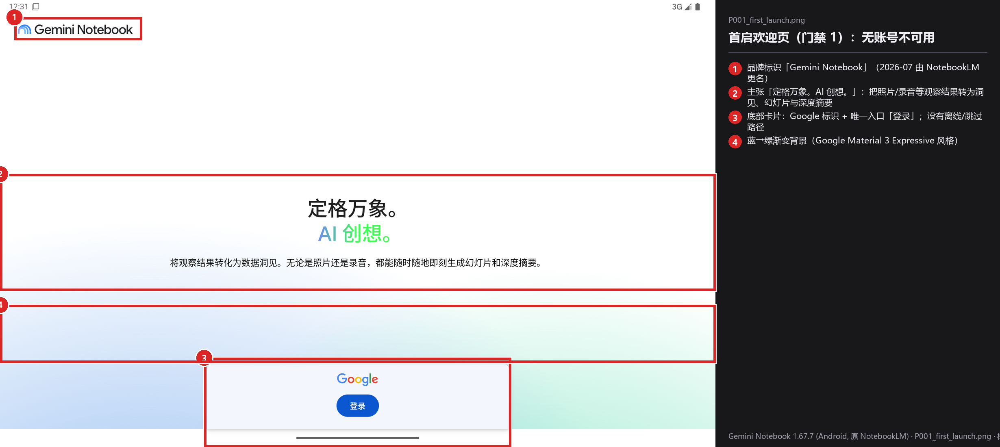
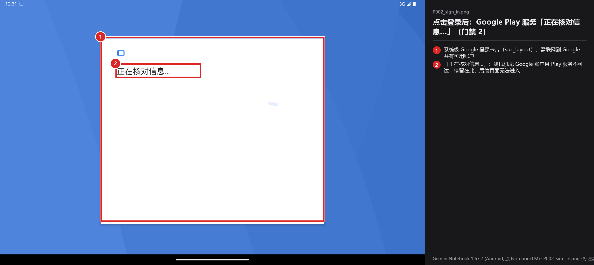

# Gemini Notebook 1.67.7 (Android, 原 NotebookLM) · 逐页截图与功能标注

每页先放带编号的标注图（`annotated/`），再列出图例。原始截图在 `screenshots/`，UI Automator 层级在 `ui/`，控件坐标表在 `controls.csv`。坐标均为 2560×1600 原始像素。

## 1. 首启欢迎页（门禁 1）：无账号不可用

- 原始截图：`screenshots/P001_first_launch.png` · UI 层级：`ui/P001_first_launch.xml`

1. 品牌标识「Gemini Notebook」（2026-07 由 NotebookLM 更名）  `[x1,y1][x2,y2] = [60,70][500,135]`
2. 主张「定格万象。AI 创想。」：把照片/录音等观察结果转为洞见、幻灯片与深度摘要  `[x1,y1][x2,y2] = [0,632][2560,1032]`
3. 底部卡片：Google 标识 + 唯一入口「登录」；没有离线/跳过路径  `[x1,y1][x2,y2] = [740,1290][1820,1600]`
4. 蓝→绿渐变背景（Google Material 3 Expressive 风格）  `[x1,y1][x2,y2] = [0,1100][2560,1290]`

## 2. 点击登录后：Google Play 服务「正在核对信息…」（门禁 2）

- 原始截图：`screenshots/P002_sign_in.png` · UI 层级：`ui/P002_sign_in.xml`

1. 系统级 Google 登录卡片（suc_layout），需联网到 Google 并有可用账户  `[x1,y1][x2,y2] = [615,230][1945,1330]`
2. 「正在核对信息…」：测试机无 Google 账户且 Play 服务不可达，停留在此，后续页面无法进入  `[x1,y1][x2,y2] = [704,392][1204,462]`
