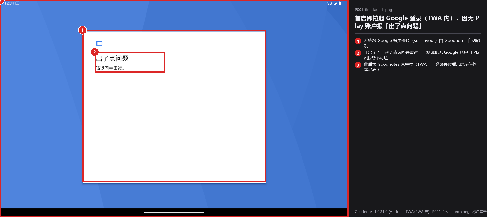
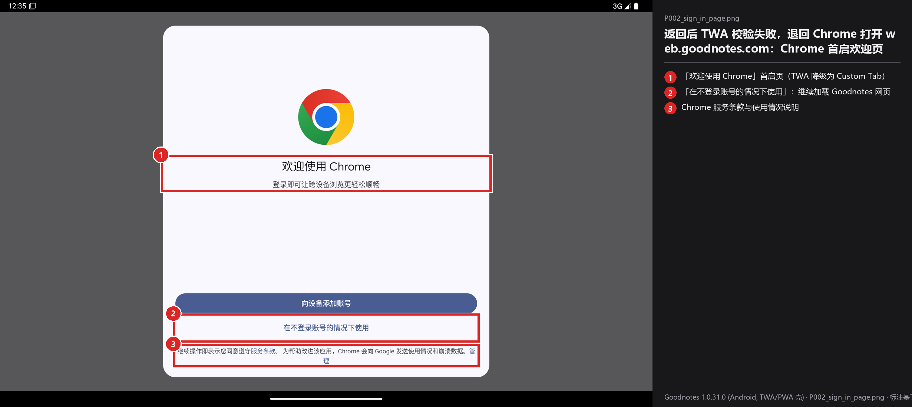
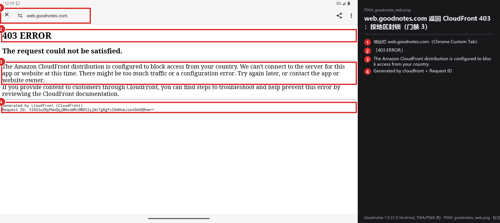

# Goodnotes 1.0.31.0 (Android, TWA/PWA 壳) · 逐页截图与功能标注

每页先放带编号的标注图（`annotated/`），再列出图例。原始截图在 `screenshots/`，UI Automator 层级在 `ui/`，控件坐标表在 `controls.csv`。坐标均为 2560×1600 原始像素。

## 1. 首启即拉起 Google 登录（TWA 内），因无 Play 账户报「出了点问题」

- 原始截图：`screenshots/P001_first_launch.png` · UI 层级：`ui/P001_first_launch.xml`

1. 系统级 Google 登录卡片（suc_layout）由 Goodnotes 自动触发  `[x1,y1][x2,y2] = [615,230][1945,1330]`
2. 「出了点问题 / 请返回并重试」：测试机无 Google 账户且 Play 服务不可达  `[x1,y1][x2,y2] = [704,392][1204,526]`
3. 背后为 Goodnotes 原生壳（TWA），登录失败后未展示任何本地界面  `[x1,y1][x2,y2] = [0,0][2560,1600]`

## 2. 返回后 TWA 校验失败，退回 Chrome 打开 web.goodnotes.com：Chrome 首启欢迎页

- 原始截图：`screenshots/P002_sign_in_page.png` · UI 层级：`ui/P002_sign_in_page.xml`

1. 「欢迎使用 Chrome」首启页（TWA 降级为 Custom Tab）  `[x1,y1][x2,y2] = [640,618][1920,745]`
2. 「在不登录账号的情况下使用」：继续加载 Goodnotes 网页  `[x1,y1][x2,y2] = [688,1241][1872,1337]`
3. Chrome 服务条款与使用情况说明  `[x1,y1][x2,y2] = [688,1361][1872,1435]`

## 3. web.goodnotes.com 返回 CloudFront 403：按地区封锁（门禁 3）

- 原始截图：`screenshots/P004_goodnotes_web.png` · UI 层级：`ui/P004_goodnotes_web.xml`

1. 地址栏 web.goodnotes.com（Chrome Custom Tab）  `[x1,y1][x2,y2] = [0,64][640,160]`
2. 「403 ERROR」  `[x1,y1][x2,y2] = [16,218][2544,294]`
3. The Amazon CloudFront distribution is configured to block access from your country.  `[x1,y1][x2,y2] = [16,452][2544,600]`
4. Generated by cloudfront + Request ID  `[x1,y1][x2,y2] = [16,740][2544,802]`
