# Obsidian 1.15.1 (Android) · 逐页截图与功能标注

每页先放带编号的标注图（`annotated/`），再列出图例。原始截图在 `screenshots/`，UI Automator 层级在 `ui/`，控件坐标表在 `controls.csv`。坐标均为 2560×1600 原始像素。

## 1. 首启：仓库选择页（无账户体系，先选本地仓库）

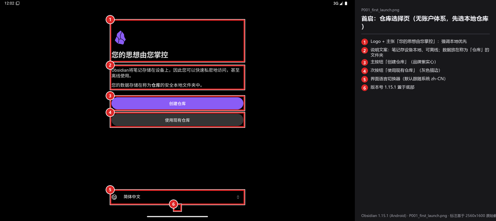

- 原始截图：`screenshots/P001_first_launch.png` · UI 层级：`ui/P001_first_launch.xml`

1. Logo + 主张「您的思想由您掌控」：强调本地优先  `[x1,y1][x2,y2] = [804,150][1756,440]`
2. 说明文案：笔记存设备本地，可离线；数据放在称为「仓库」的文件夹  `[x1,y1][x2,y2] = [804,480][1756,640]`
3. 主按钮「创建仓库」（品牌紫实心）  `[x1,y1][x2,y2] = [804,702][1756,792]`
4. 次按钮「使用现有仓库」（灰色描边）  `[x1,y1][x2,y2] = [804,822][1756,912]`
5. 界面语言切换器（默认跟随系统 zh-CN）  `[x1,y1][x2,y2] = [804,1382][1756,1472]`
6. 版本号 1.15.1 置于底部  `[x1,y1][x2,y2] = [1260,1486][1300,1520]`

## 2. 创建仓库第 1 步：先问是否连接同步（可跳过）

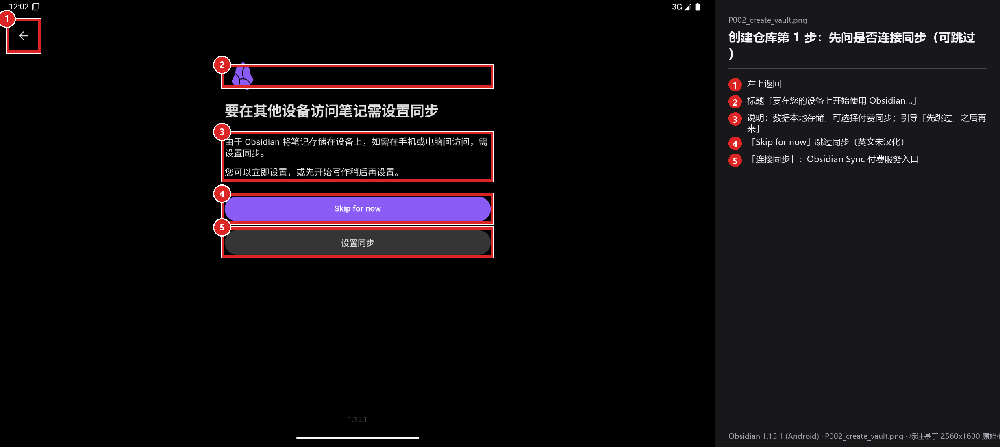

- 原始截图：`screenshots/P002_create_vault.png` · UI 层级：`ui/P002_create_vault.xml`

1. 左上返回  `[x1,y1][x2,y2] = [32,76][136,180]`
2. 标题「要在您的设备上开始使用 Obsidian…」  `[x1,y1][x2,y2] = [804,240][1756,304]`
3. 说明：数据本地存储，可选择付费同步；引导「先跳过，之后再来」  `[x1,y1][x2,y2] = [804,480][1756,640]`
4. 「Skip for now」跳过同步（英文未汉化）  `[x1,y1][x2,y2] = [804,702][1756,792]`
5. 「连接同步」：Obsidian Sync 付费服务入口  `[x1,y1][x2,y2] = [804,822][1756,912]`

## 3. 创建仓库第 2 步：命名 + 选择存储位置

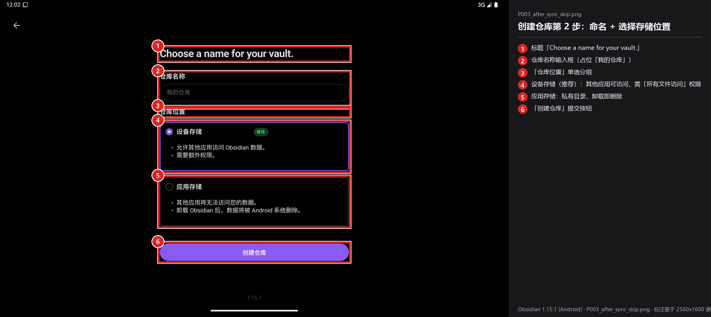

- 原始截图：`screenshots/P003_after_sync_skip.png` · UI 层级：`ui/P003_after_sync_skip.xml`

1. 标题「Choose a name for your vault.」  `[x1,y1][x2,y2] = [804,240][1756,304]`
2. 仓库名称输入框（占位「我的仓库」）  `[x1,y1][x2,y2] = [804,366][1756,540]`
3. 「仓库位置」单选分组  `[x1,y1][x2,y2] = [804,542][1756,586]`
4. 设备存储（推荐）：其他应用可访问，需「所有文件访问」权限  `[x1,y1][x2,y2] = [804,616][1756,864]`
5. 应用存储：私有目录，卸载即删除  `[x1,y1][x2,y2] = [804,894][1756,1142]`
6. 「创建仓库」提交按钮  `[x1,y1][x2,y2] = [804,1228][1756,1318]`

## 4. 应用内权限理由页：允许文件访问

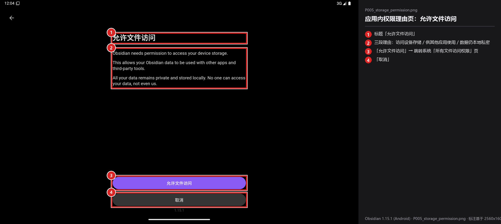

- 原始截图：`screenshots/P005_storage_permission.png` · UI 层级：`ui/P005_storage_permission.xml`

1. 标题「允许文件访问」  `[x1,y1][x2,y2] = [804,240][1756,304]`
2. 三段理由：访问设备存储 / 供其他应用使用 / 数据仍本地私密  `[x1,y1][x2,y2] = [804,350][1756,625]`
3. 「允许文件访问」→ 跳转系统「所有文件访问权限」页  `[x1,y1][x2,y2] = [804,1262][1756,1352]`
4. 「取消」  `[x1,y1][x2,y2] = [804,1382][1756,1472]`

## 5. 系统设置页：所有文件访问权限（MANAGE_EXTERNAL_STORAGE）

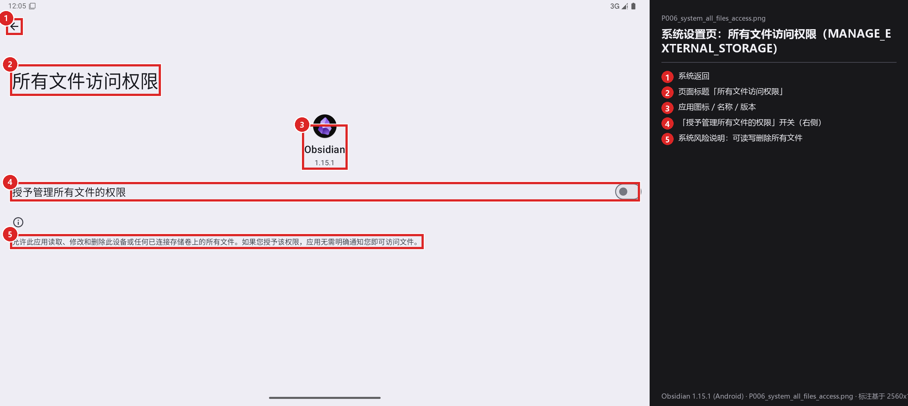

- 原始截图：`screenshots/P006_system_all_files_access.png` · UI 层级：`ui/P006_system_all_files_access.xml`

1. 系统返回  `[x1,y1][x2,y2] = [32,80][80,128]`
2. 页面标题「所有文件访问权限」  `[x1,y1][x2,y2] = [48,262][624,368]`
3. 应用图标 / 名称 / 版本  `[x1,y1][x2,y2] = [1199,500][1361,660]`
4. 「授予管理所有文件的权限」开关（右侧）  `[x1,y1][x2,y2] = [48,726][2512,784]`
5. 系统风险说明：可读写删除所有文件  `[x1,y1][x2,y2] = [48,932][1661,972]`

## 6. 系统文件选择器（SAF）：选择仓库所在文件夹

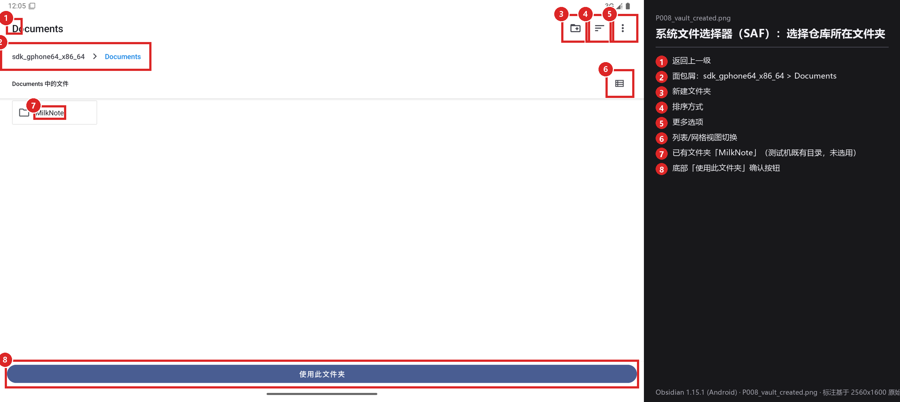

- 原始截图：`screenshots/P008_vault_created.png` · UI 层级：`ui/P008_vault_created.xml`

1. 返回上一级  `[x1,y1][x2,y2] = [32,80][80,128]`
2. 面包屑：sdk_gphone64_x86_64 > Documents  `[x1,y1][x2,y2] = [0,176][592,272]`
3. 新建文件夹  `[x1,y1][x2,y2] = [2240,64][2336,160]`
4. 排序方式  `[x1,y1][x2,y2] = [2336,64][2432,160]`
5. 更多选项  `[x1,y1][x2,y2] = [2432,64][2528,160]`
6. 列表/网格视图切换  `[x1,y1][x2,y2] = [2416,284][2512,380]`
7. 已有文件夹「MilkNote」（测试机既有目录，未选用）  `[x1,y1][x2,y2] = [142,429][254,467]`
8. 底部「使用此文件夹」确认按钮  `[x1,y1][x2,y2] = [28,1440][2532,1536]`

## 7. SAF 确认弹窗：授权 Obsidian 访问 Documents

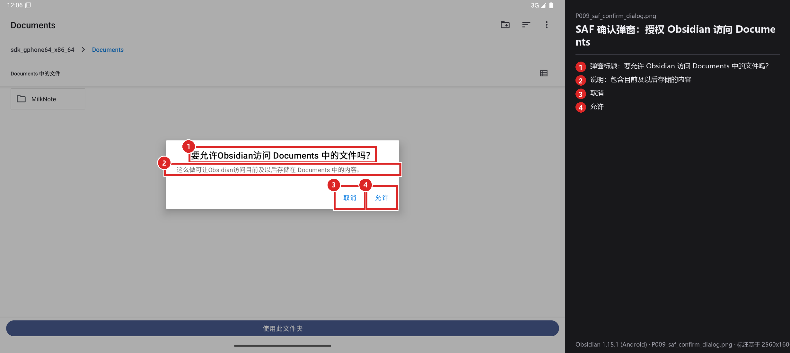

- 原始截图：`screenshots/P009_saf_confirm_dialog.png` · UI 层级：`ui/P009_saf_confirm_dialog.xml`

1. 弹窗标题：要允许 Obsidian 访问 Documents 中的文件吗？  `[x1,y1][x2,y2] = [863,672][1696,731]`
2. 说明：包含目前及以后存储的内容  `[x1,y1][x2,y2] = [752,747][1808,789]`
3. 取消  `[x1,y1][x2,y2] = [1520,847][1648,943]`
4. 允许  `[x1,y1][x2,y2] = [1664,847][1792,943]`

## 8. 仓库主界面：浏览器式「新标签页」

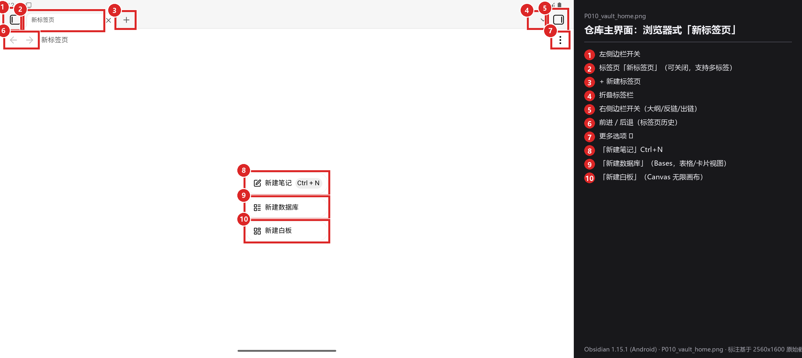

- 原始截图：`screenshots/P010_vault_home.png` · UI 层级：`ui/P010_vault_home.xml`

1. 左侧边栏开关  `[x1,y1][x2,y2] = [20,40][100,130]`
2. 标签页「新标签页」（可关闭，支持多标签）  `[x1,y1][x2,y2] = [100,50][460,135]`
3. + 新建标签页  `[x1,y1][x2,y2] = [520,55][600,125]`
4. 折叠标签栏  `[x1,y1][x2,y2] = [2360,55][2440,125]`
5. 右侧边栏开关（大纲/反链/出链）  `[x1,y1][x2,y2] = [2440,45][2530,135]`
6. 前进 / 后退（标签页历史）  `[x1,y1][x2,y2] = [24,146][168,212]`
7. 更多选项 ⋮  `[x1,y1][x2,y2] = [2464,146][2536,212]`
8. 「新建笔记」Ctrl+N  `[x1,y1][x2,y2] = [1096,770][1464,868]`
9. 「新建数据库」（Bases，表格/卡片视图）  `[x1,y1][x2,y2] = [1096,882][1464,974]`
10. 「新建白板」（Canvas 无限画布）  `[x1,y1][x2,y2] = [1096,988][1464,1078]`

## 9. 左侧边栏：文件列表与搜索/标签/属性/书签页签

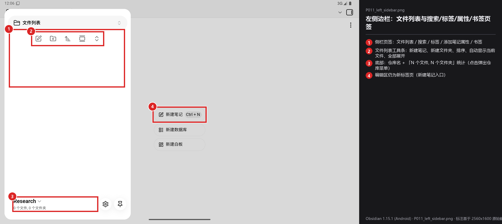

- 原始截图：`screenshots/P011_left_sidebar.png` · UI 层级：`ui/P011_left_sidebar.xml`

1. 侧栏页签：文件列表 / 搜索 / 标签 / 添加笔记属性 / 书签  `[x1,y1][x2,y2] = [72,216][882,616]`
2. 文件列表工具条：新建笔记、新建文件夹、排序、自动显示当前文件、全部展开  `[x1,y1][x2,y2] = [230,232][734,320]`
3. 底部：仓库名 + 「N 个文件, N 个文件夹」统计（点击弹出仓库菜单）  `[x1,y1][x2,y2] = [96,1412][692,1504]`
4. 编辑区仍为新标签页（新建笔记入口）  `[x1,y1][x2,y2] = [1096,770][1464,868]`

## 10. 新建笔记：编辑视图（内联标题自动聚焦选中）

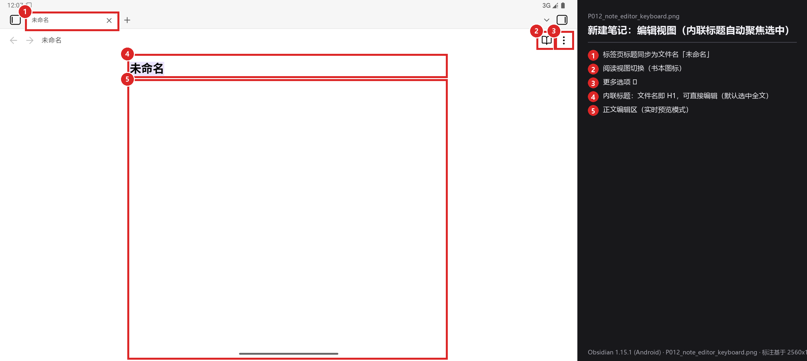

- 原始截图：`screenshots/P012_note_editor_keyboard.png` · UI 层级：`ui/P012_note_editor_keyboard.xml`

1. 标签页标题同步为文件名「未命名」  `[x1,y1][x2,y2] = [120,60][520,128]`
2. 阅读视图切换（书本图标）  `[x1,y1][x2,y2] = [2388,146][2460,212]`
3. 更多选项 ⋮  `[x1,y1][x2,y2] = [2464,146][2536,212]`
4. 内联标题：文件名即 H1，可直接编辑（默认选中全文）  `[x1,y1][x2,y2] = [574,248][1976,336]`
5. 正文编辑区（实时预览模式）  `[x1,y1][x2,y2] = [574,360][1976,1584]`

## 11. 编辑器 + 键盘上方格式工具栏（移动端核心交互）

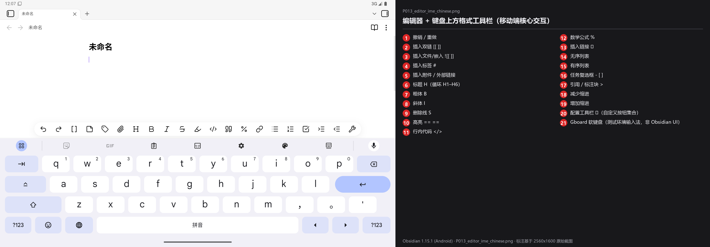

- 原始截图：`screenshots/P013_editor_ime_chinese.png` · UI 层级：`ui/P013_editor_ime_chinese.xml`

1. 撤销 / 重做  `[x1,y1][x2,y2] = [240,800][415,870]`
2. 插入双链 [[ ]]  `[x1,y1][x2,y2] = [445,800][515,870]`
3. 插入文件/嵌入 ![[ ]]  `[x1,y1][x2,y2] = [545,800][615,870]`
4. 插入标签 #  `[x1,y1][x2,y2] = [645,800][715,870]`
5. 插入附件 / 外部链接  `[x1,y1][x2,y2] = [745,800][815,870]`
6. 标题 H（循环 H1–H6）  `[x1,y1][x2,y2] = [845,800][915,870]`
7. 粗体 B  `[x1,y1][x2,y2] = [945,800][1015,870]`
8. 斜体 I  `[x1,y1][x2,y2] = [1045,800][1115,870]`
9. 删除线 S  `[x1,y1][x2,y2] = [1145,800][1215,870]`
10. 高亮 == ==  `[x1,y1][x2,y2] = [1245,800][1315,870]`
11. 行内代码 </>  `[x1,y1][x2,y2] = [1345,800][1415,870]`
12. 数学公式 %  `[x1,y1][x2,y2] = [1445,800][1515,870]`
13. 插入链接 🔗  `[x1,y1][x2,y2] = [1545,800][1615,870]`
14. 无序列表  `[x1,y1][x2,y2] = [1645,800][1715,870]`
15. 有序列表  `[x1,y1][x2,y2] = [1745,800][1815,870]`
16. 任务复选框 - [ ]  `[x1,y1][x2,y2] = [1845,800][1915,870]`
17. 引用 / 标注块 >  `[x1,y1][x2,y2] = [1945,800][2015,870]`
18. 减少缩进  `[x1,y1][x2,y2] = [2045,800][2115,870]`
19. 增加缩进  `[x1,y1][x2,y2] = [2145,800][2215,870]`
20. 配置工具栏 🔧（自定义按钮集合）  `[x1,y1][x2,y2] = [2240,800][2310,870]`
21. Gboard 软键盘（测试环境输入法，非 Obsidian UI）  `[x1,y1][x2,y2] = [0,883][2560,1600]`

## 12. 实时预览（Live Preview）渲染效果；键盘收起后工具栏停靠底部

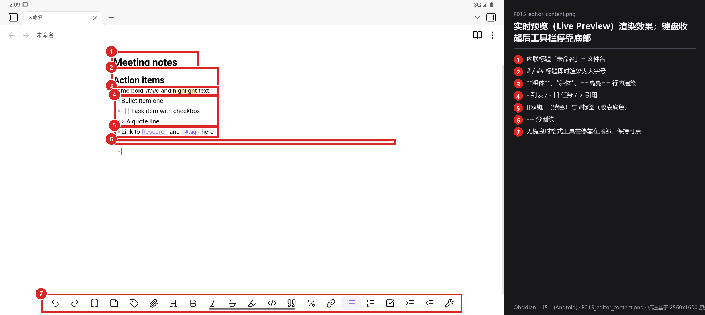

- 原始截图：`screenshots/P015_editor_content.png` · UI 层级：`ui/P015_editor_content.xml`

1. 内联标题「未命名」= 文件名  `[x1,y1][x2,y2] = [574,270][1000,340]`
2. # / ## 标题即时渲染为大字号  `[x1,y1][x2,y2] = [574,350][1100,440]`
3. **粗体**、*斜体*、==高亮== 行内渲染  `[x1,y1][x2,y2] = [574,445][1100,480]`
4. - 列表 / - [ ] 任务 / > 引用  `[x1,y1][x2,y2] = [590,490][1100,640]`
5. [[双链]]（紫色）与 #标签（胶囊底色）  `[x1,y1][x2,y2] = [590,645][1100,690]`
6. --- 分割线  `[x1,y1][x2,y2] = [574,715][2000,725]`
7. 无键盘时格式工具栏停靠在底部，保持可点  `[x1,y1][x2,y2] = [218,1500][2336,1580]`

## 13. 「更多选项」菜单：视图、分屏与文件操作

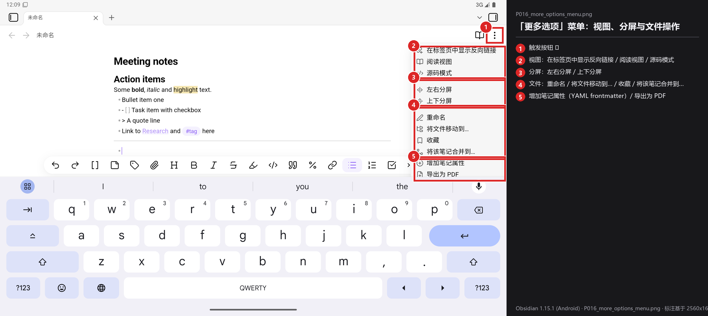

- 原始截图：`screenshots/P016_more_options_menu.png` · UI 层级：`ui/P016_more_options_menu.xml`

1. 触发按钮 ⋮  `[x1,y1][x2,y2] = [2464,146][2536,212]`
2. 视图：在标签页中显示反向链接 / 阅读视图 / 源码模式  `[x1,y1][x2,y2] = [2100,240][2548,400]`
3. 分屏：左右分屏 / 上下分屏  `[x1,y1][x2,y2] = [2100,400][2548,540]`
4. 文件：重命名 / 将文件移动到… / 收藏 / 将该笔记合并到…  `[x1,y1][x2,y2] = [2100,540][2548,800]`
5. 增加笔记属性（YAML frontmatter）/ 导出为 PDF  `[x1,y1][x2,y2] = [2100,800][2548,910]`

## 14. 右侧浮动面板：反向链接

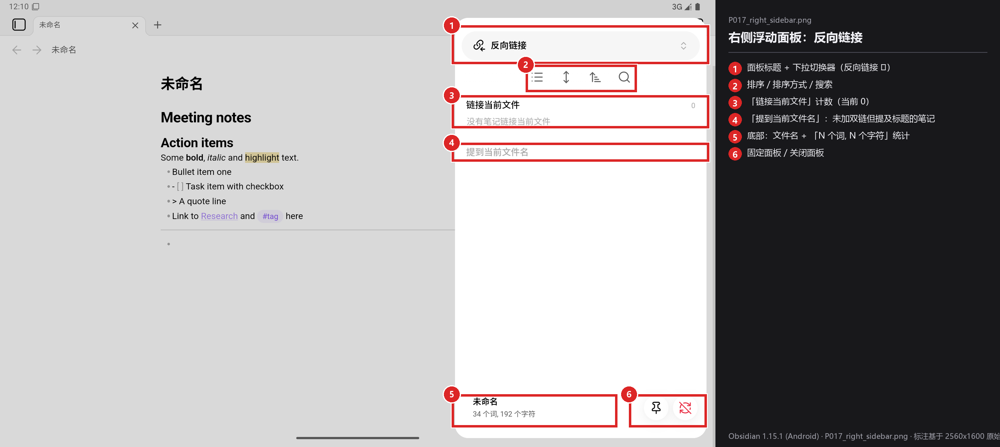

- 原始截图：`screenshots/P017_right_sidebar.png` · UI 层级：`ui/P017_right_sidebar.xml`

1. 面板标题 + 下拉切换器（反向链接 ⇕）  `[x1,y1][x2,y2] = [1626,100][2528,220]`
2. 排序 / 排序方式 / 搜索  `[x1,y1][x2,y2] = [1890,240][2270,320]`
3. 「链接当前文件」计数（当前 0）  `[x1,y1][x2,y2] = [1626,350][2528,450]`
4. 「提到当前文件名」：未加双链但提及标题的笔记  `[x1,y1][x2,y2] = [1626,520][2528,570]`
5. 底部：文件名 + 「N 个词, N 个字符」统计  `[x1,y1][x2,y2] = [1626,1420][2200,1520]`
6. 固定面板 / 关闭面板  `[x1,y1][x2,y2] = [2260,1420][2520,1520]`

## 15. 右侧面板切换器：反向链接 / 出链 / 大纲

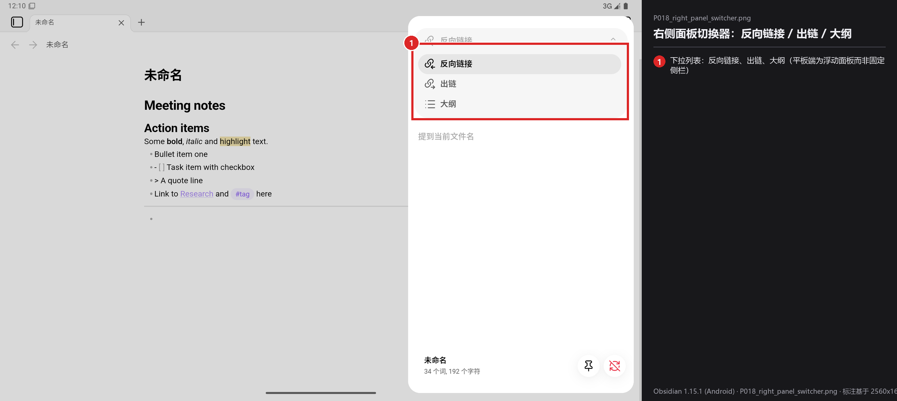

- 原始截图：`screenshots/P018_right_panel_switcher.png` · UI 层级：`ui/P018_right_panel_switcher.xml`

1. 下拉列表：反向链接、出链、大纲（平板端为浮动面板而非固定侧栏）  `[x1,y1][x2,y2] = [1650,180][2500,470]`

## 16. 右侧浮动面板：大纲

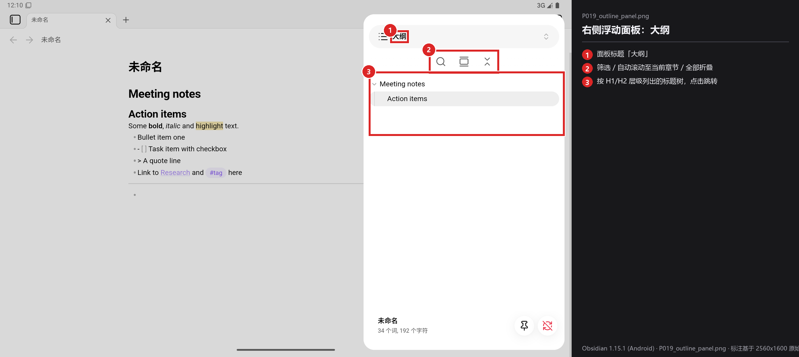

- 原始截图：`screenshots/P019_outline_panel.png` · UI 层级：`ui/P019_outline_panel.xml`

1. 面板标题「大纲」  `[x1,y1][x2,y2] = [1756,144][1822,184]`
2. 筛选 / 自动滚动至当前章节 / 全部折叠  `[x1,y1][x2,y2] = [1930,232][2226,320]`
3. 按 H1/H2 层级列出的标题树，点击跳转  `[x1,y1][x2,y2] = [1660,330][2520,600]`

## 17. 仓库菜单：管理仓库 / 设置 / 固定侧栏

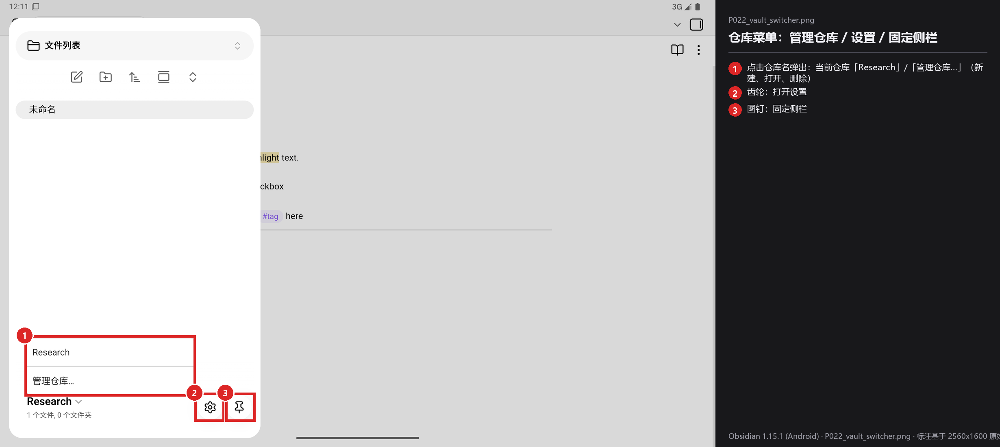

- 原始截图：`screenshots/P022_vault_switcher.png` · UI 层级：`ui/P022_vault_switcher.xml`

1. 点击仓库名弹出：当前仓库「Research」/「管理仓库…」（新建、打开、删除）  `[x1,y1][x2,y2] = [96,1210][691,1410]`
2. 齿轮：打开设置  `[x1,y1][x2,y2] = [705,1415][795,1500]`
3. 图钉：固定侧栏  `[x1,y1][x2,y2] = [815,1415][905,1500]`

## 18. 设置：模态双栏布局，关于页

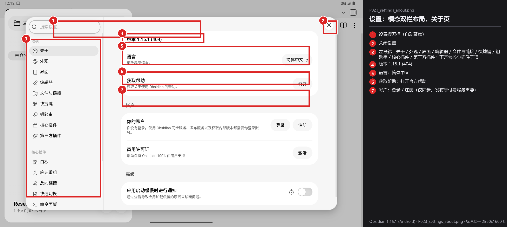

- 原始截图：`screenshots/P023_settings_about.png` · UI 层级：`ui/P023_settings_about.xml`

1. 设置搜索框（自动聚焦）  `[x1,y1][x2,y2] = [384,154][1408,256]`
2. 关闭设置  `[x1,y1][x2,y2] = [2290,154][2370,230]`
3. 左导航：关于 / 外观 / 界面 / 编辑器 / 文件与链接 / 快捷键 / 钥匙串 / 核心插件 / 第三方插件；下方为核心插件子项  `[x1,y1][x2,y2] = [192,282][704,1382]`
4. 版本 1.15.1 (404)  `[x1,y1][x2,y2] = [870,243][1434,294]`
5. 语言：简体中文  `[x1,y1][x2,y2] = [870,333][2176,448]`
6. 获取帮助：打开官方帮助  `[x1,y1][x2,y2] = [870,512][2176,589]`
7. 帐户：登录 / 注册（仅同步、发布等付费服务需要）  `[x1,y1][x2,y2] = [870,640][2176,742]`

## 19. 设置：编辑器

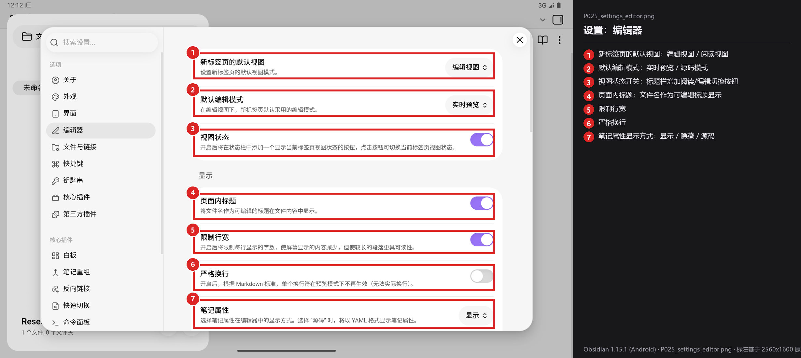

- 原始截图：`screenshots/P025_settings_editor.png` · UI 层级：`ui/P025_settings_editor.xml`

1. 新标签页的默认视图：编辑视图 / 阅读视图  `[x1,y1][x2,y2] = [870,243][2202,346]`
2. 默认编辑模式：实时预览 / 源码模式  `[x1,y1][x2,y2] = [870,410][2202,512]`
3. 视图状态开关：标题栏增加阅读/编辑切换按钮  `[x1,y1][x2,y2] = [870,584][2202,691]`
4. 页面内标题：文件名作为可编辑标题显示  `[x1,y1][x2,y2] = [870,870][2202,973]`
5. 限制行宽  `[x1,y1][x2,y2] = [870,1037][2202,1126]`
6. 严格换行  `[x1,y1][x2,y2] = [870,1190][2202,1293]`
7. 笔记属性显示方式：显示 / 隐藏 / 源码  `[x1,y1][x2,y2] = [870,1344][2202,1459]`

## 20. 设置：外观

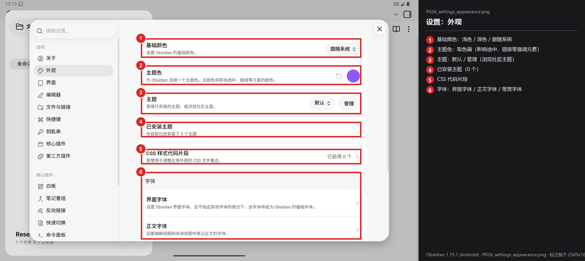

- 原始截图：`screenshots/P026_settings_appearance.png` · UI 层级：`ui/P026_settings_appearance.xml`

1. 基础颜色：浅色 / 深色 / 跟随系统  `[x1,y1][x2,y2] = [870,243][2202,346]`
2. 主题色：取色器（影响选中、链接等强调元素）  `[x1,y1][x2,y2] = [870,410][2202,512]`
3. 主题：默认 / 管理（浏览社区主题）  `[x1,y1][x2,y2] = [870,576][2202,691]`
4. 已安装主题（0 个）  `[x1,y1][x2,y2] = [870,755][2202,832]`
5. CSS 代码片段  `[x1,y1][x2,y2] = [870,922][2202,998]`
6. 字体：界面字体 / 正文字体 / 等宽字体  `[x1,y1][x2,y2] = [870,1062][2202,1459]`

## 21. 设置：界面

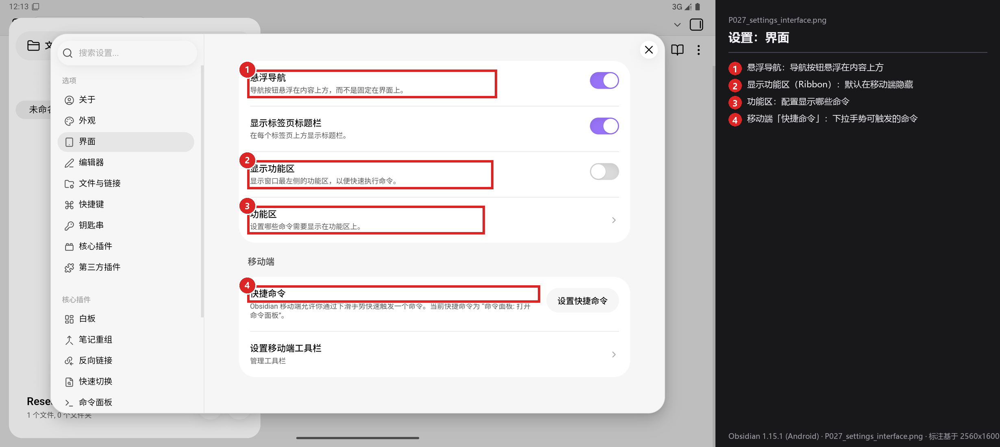

- 原始截图：`screenshots/P027_settings_interface.png` · UI 层级：`ui/P027_settings_interface.xml`

1. 悬浮导航：导航按钮悬浮在内容上方  `[x1,y1][x2,y2] = [894,258][1770,342]`
2. 显示功能区（Ribbon）：默认在移动端隐藏  `[x1,y1][x2,y2] = [894,582][1756,668]`
3. 功能区：配置显示哪些命令  `[x1,y1][x2,y2] = [894,746][1726,830]`
4. 移动端「快捷命令」：下拉手势可触发的命令  `[x1,y1][x2,y2] = [894,1030][1924,1074]`

## 22. 阅读视图：Markdown 完全渲染

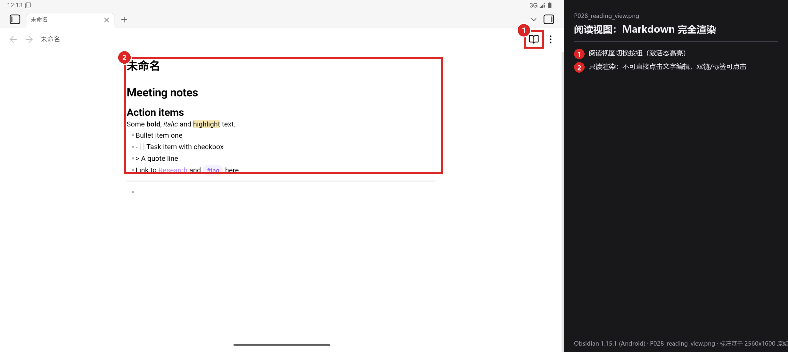

- 原始截图：`screenshots/P028_reading_view.png` · UI 层级：`ui/P028_reading_view.xml`

1. 阅读视图切换按钮（激活态高亮）  `[x1,y1][x2,y2] = [2388,146][2460,212]`
2. 只读渲染：不可直接点击文字编辑，双链/标签可点击  `[x1,y1][x2,y2] = [574,270][2000,780]`
