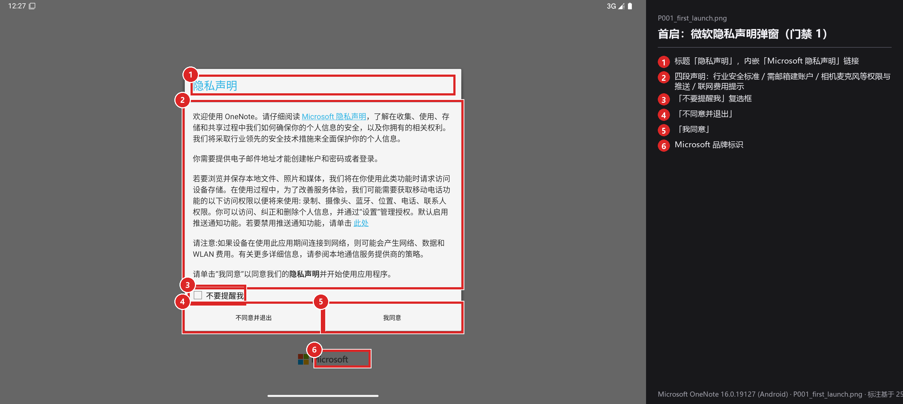
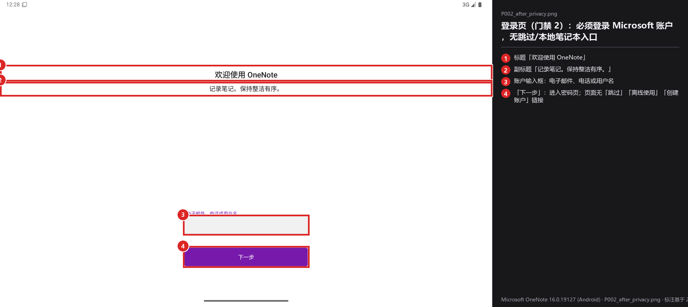

# Microsoft OneNote 16.0.19127 (Android) · 逐页截图与功能标注

每页先放带编号的标注图（`annotated/`），再列出图例。原始截图在 `screenshots/`，UI Automator 层级在 `ui/`，控件坐标表在 `controls.csv`。坐标均为 2560×1600 原始像素。

## 1. 首启：微软隐私声明弹窗（门禁 1）

- 原始截图：`screenshots/P001_first_launch.png` · UI 层级：`ui/P001_first_launch.xml`

1. 标题「隐私声明」，内嵌「Microsoft 隐私声明」链接  `[x1,y1][x2,y2] = [764,304][1796,369]`
2. 四段声明：行业安全标准 / 需邮箱建账户 / 相机麦克风等权限与推送 / 联网费用提示  `[x1,y1][x2,y2] = [732,405][1828,1137]`
3. 「不要提醒我」复选框  `[x1,y1][x2,y2] = [752,1137][966,1201]`
4. 「不同意并退出」  `[x1,y1][x2,y2] = [732,1203][1279,1311]`
5. 「我同意」  `[x1,y1][x2,y2] = [1281,1203][1828,1311]`
6. Microsoft 品牌标识  `[x1,y1][x2,y2] = [1254,1394][1459,1446]`

## 2. 登录页（门禁 2）：必须登录 Microsoft 账户，无跳过/本地笔记本入口

- 原始截图：`screenshots/P002_after_privacy.png` · UI 层级：`ui/P002_after_privacy.xml`

1. 标题「欢迎使用 OneNote」  `[x1,y1][x2,y2] = [0,347][2560,426]`
2. 副标题「记录笔记。保持整洁有序。」  `[x1,y1][x2,y2] = [0,426][2560,494]`
3. 账户输入框：电子邮件、电话或用户名  `[x1,y1][x2,y2] = [960,1128][1600,1218]`
4. 「下一步」：进入密码页；页面无「跳过」「离线使用」「创建账户」链接  `[x1,y1][x2,y2] = [960,1291][1600,1387]`
