# SpeedyNote 1.6.3 / 极疾记 (Android, Qt 6.9.3) · 逐页截图与功能标注

每页先放带编号的标注图（`annotated/`），再列出图例。原始截图在 `screenshots/`，UI Automator 层级在 `ui/`，控件坐标表在 `controls.csv`。坐标均为 2560×1600 原始像素。

## 1. 首页：左侧三入口 + 右下悬浮新建（无账号、无引导页）

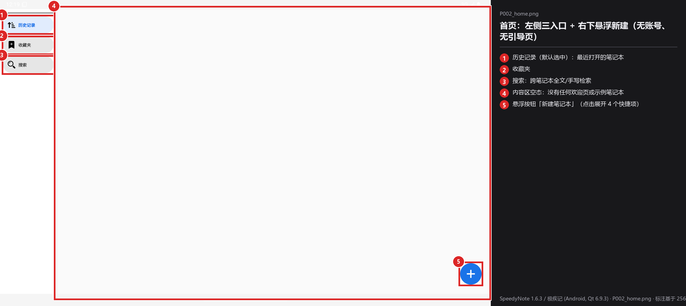

- 原始截图：`screenshots/P002_home.png` · UI 层级：`ui/P002_home.xml`

1. 历史记录（默认选中）：最近打开的笔记本  `[x1,y1][x2,y2] = [18,87][280,173]`
2. 收藏夹  `[x1,y1][x2,y2] = [18,195][280,278]`
3. 搜索：跨笔记本全文/手写检索  `[x1,y1][x2,y2] = [18,297][280,382]`
4. 内容区空态：没有任何欢迎页或示例笔记本  `[x1,y1][x2,y2] = [290,40][2560,1560]`
5. 悬浮按钮「新建笔记本」（点击展开 4 个快捷项）  `[x1,y1][x2,y2] = [2400,1376][2511,1487]`

## 2. 新建快捷项：导入 / 注释 PDF / 分页笔记本 / 无边笔记

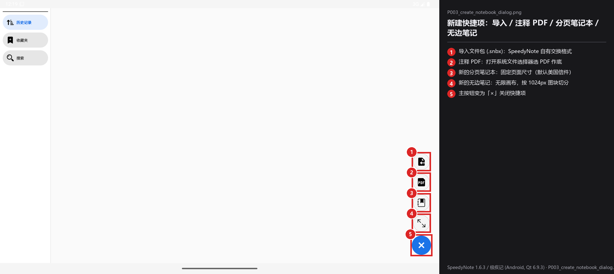

- 原始截图：`screenshots/P003_create_notebook_dialog.png` · UI 层级：`ui/P003_create_notebook_dialog.xml`

1. 导入文件包 (.snbx)：SpeedyNote 自有交换格式  `[x1,y1][x2,y2] = [2408,896][2503,991]`
2. 注释 PDF：打开系统文件选择器选 PDF 作底  `[x1,y1][x2,y2] = [2408,1016][2503,1111]`
3. 新的分页笔记本：固定页面尺寸（默认美国信件）  `[x1,y1][x2,y2] = [2408,1136][2503,1231]`
4. 新的无边笔记：无限画布，按 1024px 图块切分  `[x1,y1][x2,y2] = [2408,1256][2503,1351]`
5. 主按钮变为「×」关闭快捷项  `[x1,y1][x2,y2] = [2400,1376][2511,1487]`

## 3. 编辑器：青色导航栏 + 单行工具栏 + 网格纸画布

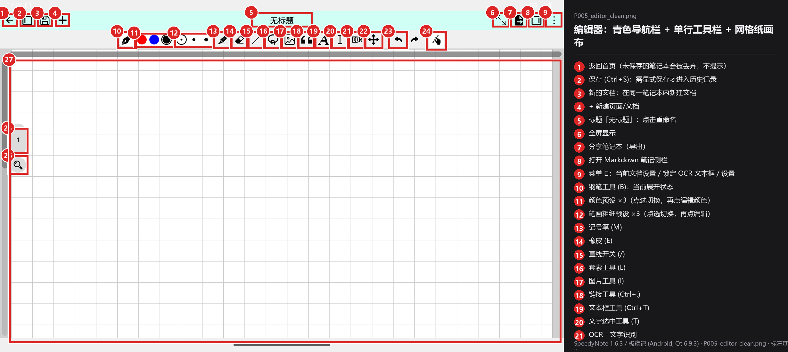

- 原始截图：`screenshots/P005_editor_clean.png` · UI 层级：`ui/P005_editor_clean.xml`

1. 返回首页（未保存的笔记本会被丢弃，不提示）  `[x1,y1][x2,y2] = [20,68][72,112]`
2. 保存 (Ctrl+S)：需显式保存才进入历史记录  `[x1,y1][x2,y2] = [98,68][152,112]`
3. 新的文档：在同一笔记本内新建文档  `[x1,y1][x2,y2] = [178,68][232,112]`
4. + 新建页面/文档  `[x1,y1][x2,y2] = [258,68][308,112]`
5. 标题「无标题」：点击重命名  `[x1,y1][x2,y2] = [1150,65][1410,115]`
6. 全屏显示  `[x1,y1][x2,y2] = [2245,65][2306,115]`
7. 分享笔记本（导出）  `[x1,y1][x2,y2] = [2325,65][2386,115]`
8. 打开 Markdown 笔记侧栏  `[x1,y1][x2,y2] = [2405,65][2465,115]`
9. 菜单 ⋮：当前文档设置 / 锁定 OCR 文本框 / 设置  `[x1,y1][x2,y2] = [2485,65][2545,115]`
10. 钢笔工具 (B)：当前展开状态  `[x1,y1][x2,y2] = [540,150][611,215]`
11. 颜色预设 ×3（点选切换，再点编辑颜色）  `[x1,y1][x2,y2] = [618,158][790,207]`
12. 笔画粗细预设 ×3（点选切换，再点编辑）  `[x1,y1][x2,y2] = [798,158][962,207]`
13. 记号笔 (M)  `[x1,y1][x2,y2] = [976,150][1047,215]`
14. 橡皮 (E)  `[x1,y1][x2,y2] = [1052,150][1123,215]`
15. 直线开关 (/)  `[x1,y1][x2,y2] = [1128,150][1199,215]`
16. 套索工具 (L)  `[x1,y1][x2,y2] = [1204,150][1275,215]`
17. 图片工具 (I)  `[x1,y1][x2,y2] = [1280,150][1351,215]`
18. 链接工具 (Ctrl+.)  `[x1,y1][x2,y2] = [1356,150][1427,215]`
19. 文本框工具 (Ctrl+T)  `[x1,y1][x2,y2] = [1432,150][1503,215]`
20. 文字选中工具 (T)  `[x1,y1][x2,y2] = [1508,150][1579,215]`
21. OCR - 文字识别  `[x1,y1][x2,y2] = [1584,150][1655,215]`
22. 手形工具 (H)  `[x1,y1][x2,y2] = [1660,150][1731,215]`
23. 撤销 (Ctrl+Z) / 重做 (Ctrl+Shift+Z)  `[x1,y1][x2,y2] = [1772,150][1843,215]`
24. 手势模式三态：关 / 仅纵向滚动 / 开  `[x1,y1][x2,y2] = [1944,150][2019,220]`
25. 页码胶囊「1」  `[x1,y1][x2,y2] = [45,590][120,690]`
26. 放大镜：打开搜索条（PDF 文本/手写识别检索）  `[x1,y1][x2,y2] = [45,715][120,785]`
27. 画布：默认 32px 网格纸，四周可滚动  `[x1,y1][x2,y2] = [50,280][2540,1550]`

## 4. 编辑器「⋮」菜单

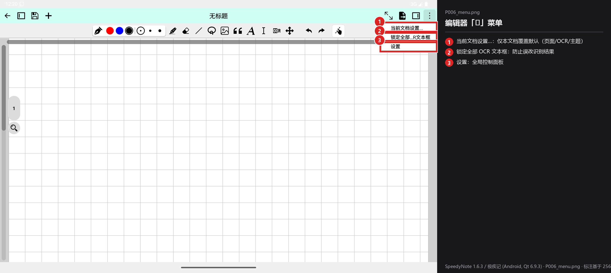

- 原始截图：`screenshots/P006_menu.png` · UI 层级：`ui/P006_menu.xml`

1. 当前文档设置…：仅本文档覆盖默认（页面/OCR/主题）  `[x1,y1][x2,y2] = [2232,136][2559,189]`
2. 锁定全部 OCR 文本框：防止误改识别结果  `[x1,y1][x2,y2] = [2232,190][2559,243]`
3. 设置：全局控制面板  `[x1,y1][x2,y2] = [2232,244][2559,297]`

## 5. 当前文档设置 · 页面页签：纸张尺寸与背景网格

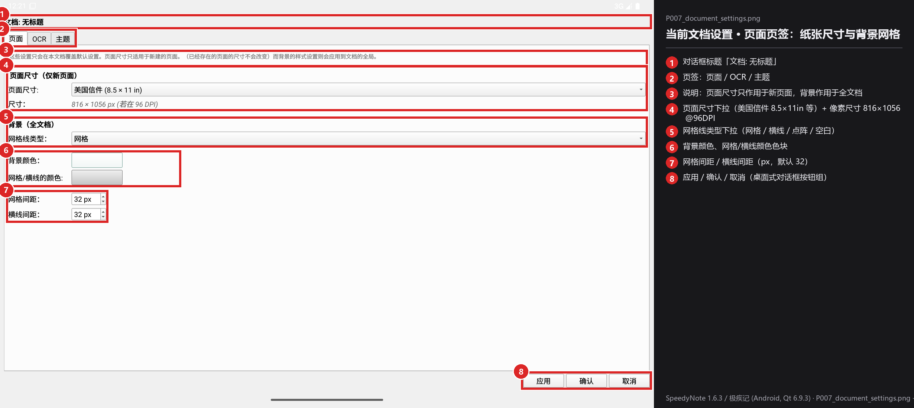

- 原始截图：`screenshots/P007_document_settings.png` · UI 层级：`ui/P007_document_settings.xml`

1. 对话框标题「文档: 无标题」  `[x1,y1][x2,y2] = [16,64][2543,105]`
2. 页签：页面 / OCR / 主题  `[x1,y1][x2,y2] = [16,122][291,177]`
3. 说明：页面尺寸只作用于新页面，背景作用于全文档  `[x1,y1][x2,y2] = [32,204][2527,255]`
4. 页面尺寸下拉（美国信件 8.5×11in 等）+ 像素尺寸 816×1056 @96DPI  `[x1,y1][x2,y2] = [32,264][2527,427]`
5. 网格线类型下拉（网格 / 横线 / 点阵 / 空白）  `[x1,y1][x2,y2] = [32,466][2527,569]`
6. 背景颜色、网格/横线颜色色块  `[x1,y1][x2,y2] = [32,598][700,725]`
7. 网格间距 / 横线间距（px，默认 32）  `[x1,y1][x2,y2] = [32,754][415,865]`
8. 应用 / 确认 / 取消（桌面式对话框按钮组）  `[x1,y1][x2,y2] = [2048,1466][2543,1519]`

## 6. 当前文档设置 · 主题页签：暗黑模式下 PDF 反色

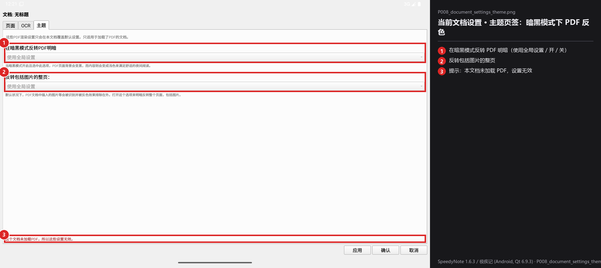

- 原始截图：`screenshots/P008_document_settings_theme.png` · UI 层级：`ui/P008_document_settings_theme.xml`

1. 在暗黑模式反转 PDF 明暗（使用全局设置 / 开 / 关）  `[x1,y1][x2,y2] = [32,264][2527,367]`
2. 反转包括图片的整页  `[x1,y1][x2,y2] = [32,438][2527,541]`
3. 提示：本文档未加载 PDF，设置无效  `[x1,y1][x2,y2] = [32,1410][2527,1441]`

## 7. 当前文档设置 · OCR 页签：手写识别语言与逐格识别

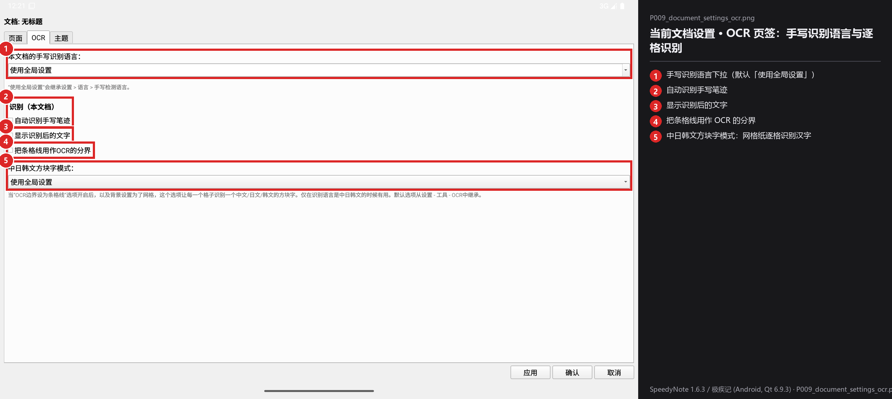

- 原始截图：`screenshots/P009_document_settings_ocr.png` · UI 层级：`ui/P009_document_settings_ocr.xml`

1. 手写识别语言下拉（默认「使用全局设置」）  `[x1,y1][x2,y2] = [32,204][2527,307]`
2. 自动识别手写笔迹  `[x1,y1][x2,y2] = [32,396][287,507]`
3. 显示识别后的文字  `[x1,y1][x2,y2] = [32,516][287,567]`
4. 把条格线用作 OCR 的分界  `[x1,y1][x2,y2] = [32,576][371,627]`
5. 中日韩文方块字模式：网格纸逐格识别汉字  `[x1,y1][x2,y2] = [32,652][2527,755]`

## 8. 全局设置（控制面板）· 页面页签

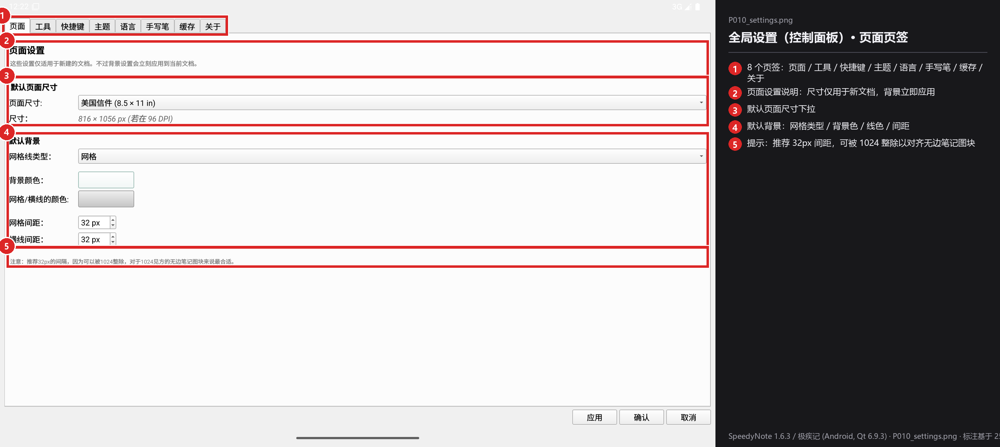

- 原始截图：`screenshots/P010_settings.png` · UI 层级：`ui/P010_settings.xml`

1. 8 个页签：页面 / 工具 / 快捷键 / 主题 / 语言 / 手写笔 / 缓存 / 关于  `[x1,y1][x2,y2] = [16,64][807,119]`
2. 页面设置说明：尺寸仅用于新文档，背景立即应用  `[x1,y1][x2,y2] = [32,154][2527,271]`
3. 默认页面尺寸下拉  `[x1,y1][x2,y2] = [32,280][2527,443]`
4. 默认背景：网格类型 / 背景色 / 线色 / 间距  `[x1,y1][x2,y2] = [32,482][2527,881]`
5. 提示：推荐 32px 间距，可被 1024 整除以对齐无边笔记图块  `[x1,y1][x2,y2] = [32,890][2527,949]`

## 9. 全局设置 · 工具页签：滚动、平移与 OCR 行为

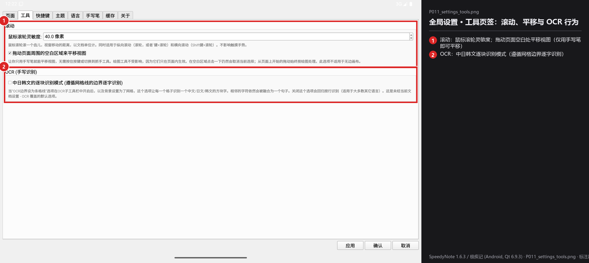

- 原始截图：`screenshots/P011_settings_tools.png` · UI 层级：`ui/P011_settings_tools.xml`

1. 滚动：鼠标滚轮灵敏度；拖动页面空白处平移视图（仅用手写笔即可平移）  `[x1,y1][x2,y2] = [32,134][2527,405]`
2. OCR：中日韩文逐块识别模式（遵循网格边界逐字识别）  `[x1,y1][x2,y2] = [32,414][2527,617]`

## 10. 全局设置 · 快捷键页签：可编辑的树形快捷键表（面向键盘用户）

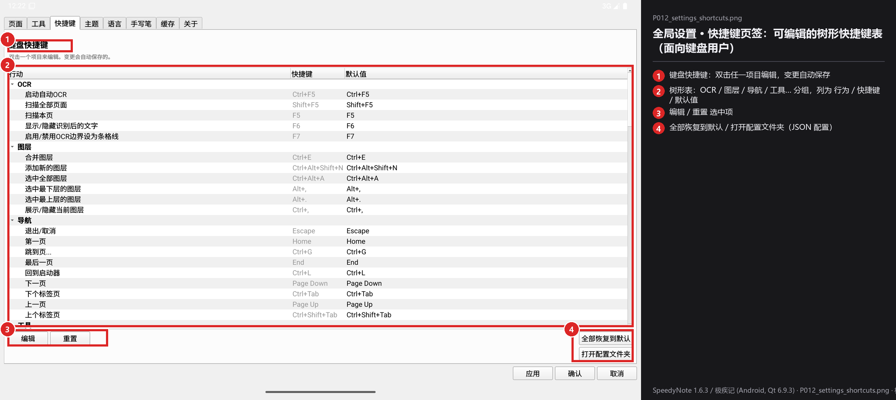

- 原始截图：`screenshots/P012_settings_shortcuts.png` · UI 层级：`ui/P012_settings_shortcuts.xml`

1. 键盘快捷键：双击任一项目编辑，变更自动保存  `[x1,y1][x2,y2] = [38,166][282,200]`
2. 树形表：OCR / 图层 / 导航 / 工具… 分组，列为 行为 / 快捷键 / 默认值  `[x1,y1][x2,y2] = [38,269][2522,1300]`
3. 编辑 / 重置 选中项  `[x1,y1][x2,y2] = [38,1326][422,1377]`
4. 全部恢复到默认 / 打开配置文件夹（JSON 配置）  `[x1,y1][x2,y2] = [2291,1326][2522,1439]`

## 11. 全局设置 · 手写笔页签：防误触

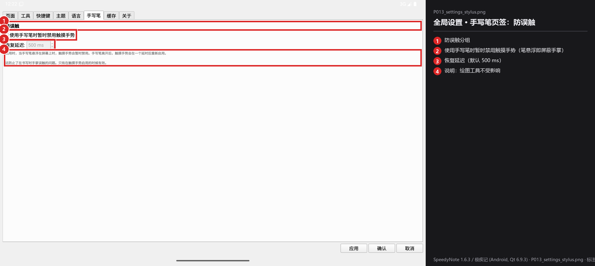

- 原始截图：`screenshots/P013_settings_stylus.png` · UI 层级：`ui/P013_settings_stylus.xml`

1. 防误触分组  `[x1,y1][x2,y2] = [32,134][2527,175]`
2. 使用手写笔时暂时禁用触摸手势（笔悬浮即屏蔽手掌）  `[x1,y1][x2,y2] = [32,184][455,235]`
3. 恢复延迟（默认 500 ms）  `[x1,y1][x2,y2] = [32,244][325,295]`
4. 说明：绘图工具不受影响  `[x1,y1][x2,y2] = [32,304][2527,391]`

## 12. 全局设置 · 关于页签

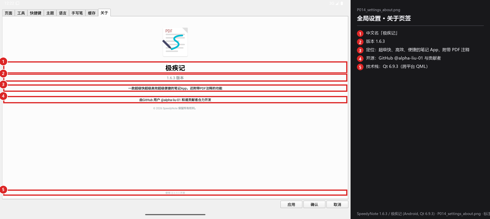

- 原始截图：`screenshots/P014_settings_about.png` · UI 层级：`ui/P014_settings_about.xml`

1. 中文名「极疾记」  `[x1,y1][x2,y2] = [32,458][2527,527]`
2. 版本 1.6.3  `[x1,y1][x2,y2] = [32,546][2527,587]`
3. 定位：超级快、高效、便捷的笔记 App，附带 PDF 注释  `[x1,y1][x2,y2] = [32,626][2527,661]`
4. 开源：GitHub @alpha-liu-01 与贡献者  `[x1,y1][x2,y2] = [32,710][2527,745]`
5. 技术栈：Qt 6.9.3（跨平台 QML）  `[x1,y1][x2,y2] = [32,1394][2527,1421]`

## 13. Markdown 笔记侧栏：与手写页面并排的文字笔记

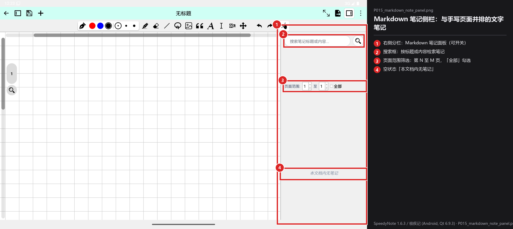

- 原始截图：`screenshots/P015_markdown_note_panel.png` · UI 层级：`ui/P015_markdown_note_panel.xml`

1. 右侧分栏：Markdown 笔记面板（可开关）  `[x1,y1][x2,y2] = [1940,180][2560,1560]`
2. 搜索框：按标题或内容检索笔记  `[x1,y1][x2,y2] = [1984,248][2535,323]`
3. 页面范围筛选：第 N 至 M 页，「全部」勾选  `[x1,y1][x2,y2] = [1980,570][2550,635]`
4. 空状态「本文档内无笔记」  `[x1,y1][x2,y2] = [1960,1180][2559,1250]`

## 14. 颜色预设编辑器：Qt 标准 QColorDialog（桌面风格）

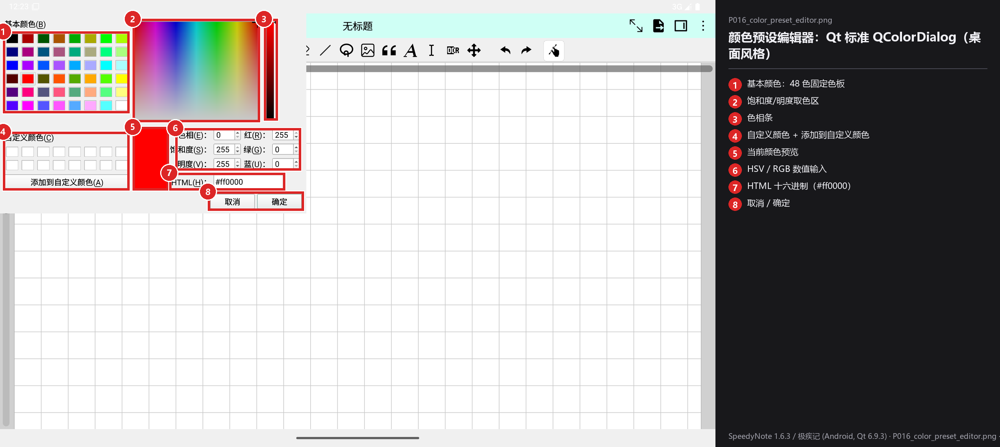

- 原始截图：`screenshots/P016_color_preset_editor.png` · UI 层级：`ui/P016_color_preset_editor.xml`

1. 基本颜色：48 色固定色板  `[x1,y1][x2,y2] = [19,122][454,397]`
2. 饱和度/明度取色区  `[x1,y1][x2,y2] = [483,77][922,429]`
3. 色相条  `[x1,y1][x2,y2] = [954,77][986,422]`
4. 自定义颜色 + 添加到自定义颜色  `[x1,y1][x2,y2] = [19,480][454,672]`
5. 当前颜色预览  `[x1,y1][x2,y2] = [483,463][595,672]`
6. HSV / RGB 数值输入  `[x1,y1][x2,y2] = [636,467][1069,602]`
7. HTML 十六进制（#ff0000）  `[x1,y1][x2,y2] = [614,627][1011,672]`
8. 取消 / 确定  `[x1,y1][x2,y2] = [753,695][1079,746]`

## 15. 搜索条：画布内浮动，检索 PDF 文本与识别后的手写

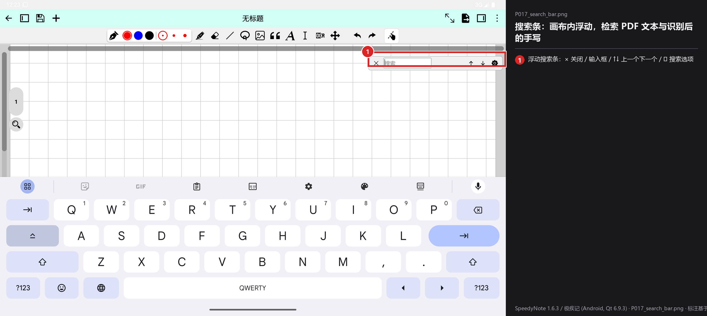

- 原始截图：`screenshots/P017_search_bar.png` · UI 层级：`ui/P017_search_bar.xml`

1. 浮动搜索条：× 关闭 / 输入框 / ↑↓ 上一个下一个 / ⚙ 搜索选项  `[x1,y1][x2,y2] = [1870,270][2560,330]`

## 16. 返回首页：导航栏出现「返回」；未保存的笔记本未入库

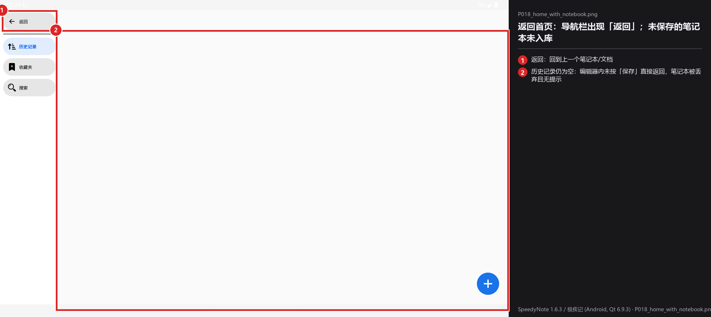

- 原始截图：`screenshots/P018_home_with_notebook.png` · UI 层级：`ui/P018_home_with_notebook.xml`

1. 返回：回到上一个笔记本/文档  `[x1,y1][x2,y2] = [18,60][280,150]`
2. 历史记录仍为空：编辑器内未按「保存」直接返回，笔记本被丢弃且无提示  `[x1,y1][x2,y2] = [290,160][2560,1560]`
