# StarNote 1.5.4.1 / StarNote笔记 (Android, ONYX) · 逐页截图与功能标注

每页先放带编号的标注图（`annotated/`），再列出图例。原始截图在 `screenshots/`，UI Automator 层级在 `ui/`，控件坐标表在 `controls.csv`。坐标均为 2560×1600 原始像素。

## 1. 首启：用户服务协议 / 隐私政策弹窗（沉浸式全屏，无状态栏）

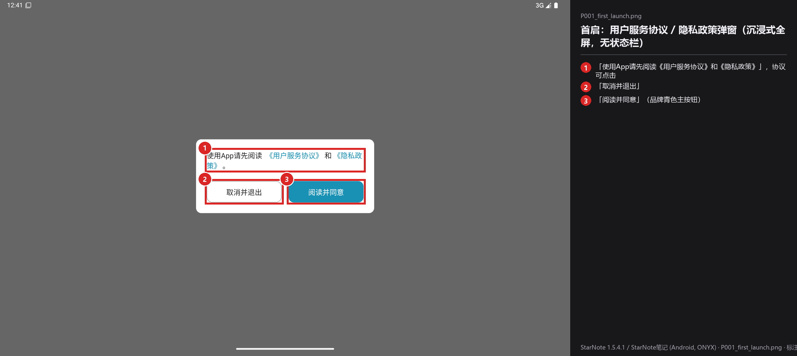

- 原始截图：`screenshots/P001_first_launch.png` · UI 层级：`ui/P001_first_launch.xml`

1. 「使用App请先阅读《用户服务协议》和《隐私政策》」，协议可点击  `[x1,y1][x2,y2] = [928,674][1632,766]`
2. 「取消并退出」  `[x1,y1][x2,y2] = [928,814][1264,910]`
3. 「阅读并同意」（品牌青色主按钮）  `[x1,y1][x2,y2] = [1296,814][1632,910]`

## 2. 同意后直接进入沉浸式主界面，系统提示「全屏模式」

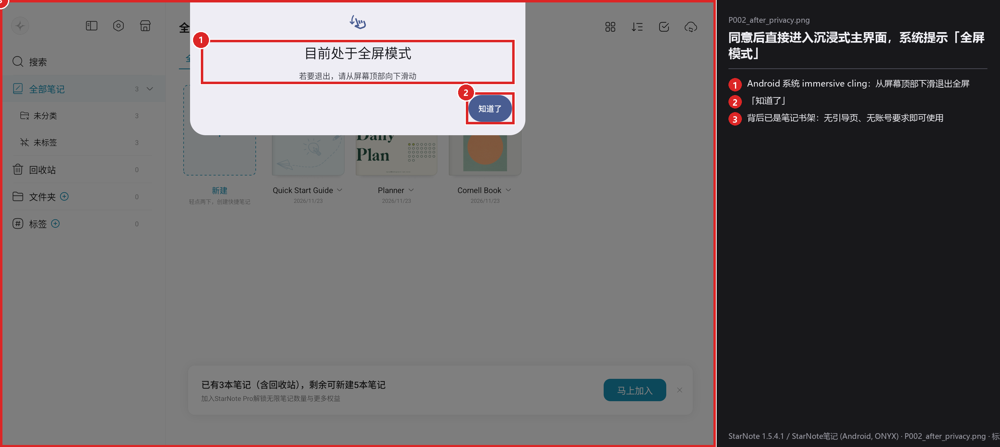

- 原始截图：`screenshots/P002_after_privacy.png` · UI 层级：`ui/P002_after_privacy.xml`

1. Android 系统 immersive cling：从屏幕顶部下滑退出全屏  `[x1,y1][x2,y2] = [728,152][1832,292]`
2. 「知道了」  `[x1,y1][x2,y2] = [1676,340][1832,436]`
3. 背后已是笔记书架：无引导页、无账号要求即可使用  `[x1,y1][x2,y2] = [0,0][2560,1600]`

## 3. 书架（全部笔记）：左侧分类树 + 封面卡片网格

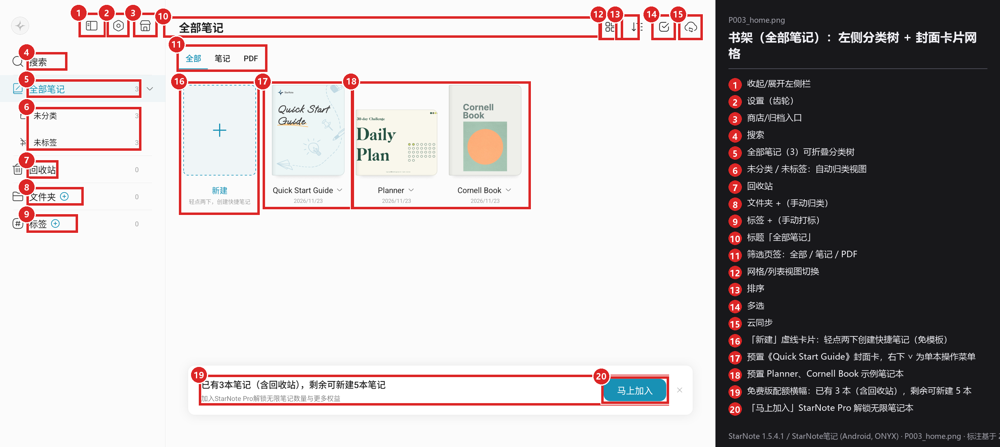

- 原始截图：`screenshots/P003_home.png` · UI 层级：`ui/P003_home.xml`

1. 收起/展开左侧栏  `[x1,y1][x2,y2] = [290,55][370,125]`
2. 设置（齿轮）  `[x1,y1][x2,y2] = [390,55][455,125]`
3. 商店/归档入口  `[x1,y1][x2,y2] = [485,55][555,125]`
4. 搜索  `[x1,y1][x2,y2] = [104,196][232,244]`
5. 全部笔记（3）可折叠分类树  `[x1,y1][x2,y2] = [104,293][496,341]`
6. 未分类 / 未标签：自动归类视图  `[x1,y1][x2,y2] = [104,392][496,530]`
7. 回收站  `[x1,y1][x2,y2] = [104,582][200,630]`
8. 文件夹 +（手动归类）  `[x1,y1][x2,y2] = [104,679][290,727]`
9. 标签 +（手动打标）  `[x1,y1][x2,y2] = [104,776][270,824]`
10. 标题「全部笔记」  `[x1,y1][x2,y2] = [592,67][2144,126]`
11. 筛选页签：全部 / 笔记 / PDF  `[x1,y1][x2,y2] = [640,168][947,248]`
12. 网格/列表视图切换  `[x1,y1][x2,y2] = [2150,60][2220,135]`
13. 排序  `[x1,y1][x2,y2] = [2210,60][2280,135]`
14. 多选  `[x1,y1][x2,y2] = [2340,60][2410,135]`
15. 云同步  `[x1,y1][x2,y2] = [2435,60][2505,135]`
16. 「新建」虚线卡片：轻点两下创建快捷笔记（免模板）  `[x1,y1][x2,y2] = [650,300][920,760]`
17. 预置《Quick Start Guide》封面卡，右下 ∨ 为单本操作菜单  `[x1,y1][x2,y2] = [949,300][1257,740]`
18. 预置 Planner、Cornell Book 示例笔记本  `[x1,y1][x2,y2] = [1265,300][1890,740]`
19. 免费版配额横幅：已有 3 本（含回收站），剩余可新建 5 本  `[x1,y1][x2,y2] = [720,1351][2384,1442]`
20. 「马上加入」StarNote Pro 解锁无限笔记本  `[x1,y1][x2,y2] = [2160,1356][2384,1436]`

## 4. 编辑器：顶栏 12 个入口 + 可拖拽单行工具栏（画布为自绘，图标语义按外观推断）

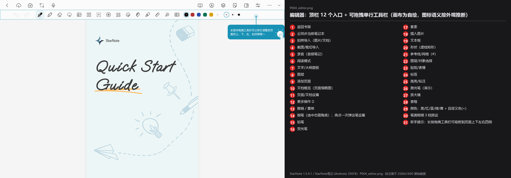

- 原始截图：`screenshots/P004_editor.png` · UI 层级：`ui/P004_editor.xml`

1. 返回书架  `[x1,y1][x2,y2] = [40,20][95,80]`
2. 云同步当前笔记本  `[x1,y1][x2,y2] = [140,20][195,80]`
3. 拍照导入（图片/文档）  `[x1,y1][x2,y2] = [240,20][300,80]`
4. 截图/裁切导入  `[x1,y1][x2,y2] = [340,20][400,80]`
5. 录音（音频笔记）  `[x1,y1][x2,y2] = [445,20][510,80]`
6. 阅读模式  `[x1,y1][x2,y2] = [1770,20][1830,80]`
7. 文字/大纲面板  `[x1,y1][x2,y2] = [1870,20][1935,80]`
8. 图层  `[x1,y1][x2,y2] = [1975,20][2035,80]`
9. 添加页面  `[x1,y1][x2,y2] = [2080,20][2140,80]`
10. 文档概览（页面缩略图）  `[x1,y1][x2,y2] = [2185,20][2245,80]`
11. 页面/文档设置  `[x1,y1][x2,y2] = [2255,20][2315,80]`
12. 更多操作 ⋯  `[x1,y1][x2,y2] = [2355,20][2415,80]`
13. 撤销 / 重做  `[x1,y1][x2,y2] = [120,105][270,160]`
14. 钢笔（选中态圆角底）；再点一次弹出笔设置  `[x1,y1][x2,y2] = [325,100][395,165]`
15. 铅笔  `[x1,y1][x2,y2] = [420,105][485,160]`
16. 荧光笔  `[x1,y1][x2,y2] = [500,105][570,160]`
17. 套索  `[x1,y1][x2,y2] = [590,105][655,160]`
18. 插入图片  `[x1,y1][x2,y2] = [680,105][745,160]`
19. 文本框  `[x1,y1][x2,y2] = [765,105][835,160]`
20. 形状（虚线矩形）  `[x1,y1][x2,y2] = [850,105][920,160]`
21. 参考线/网格（#）  `[x1,y1][x2,y2] = [940,105][1010,160]`
22. 图层/对象选择  `[x1,y1][x2,y2] = [1030,105][1095,160]`
23. 贴纸/表情  `[x1,y1][x2,y2] = [1115,105][1185,160]`
24. 标签  `[x1,y1][x2,y2] = [1205,105][1270,160]`
25. 高亮/标注  `[x1,y1][x2,y2] = [1290,105][1360,160]`
26. 激光笔（演示）  `[x1,y1][x2,y2] = [1380,105][1450,160]`
27. 放大镜  `[x1,y1][x2,y2] = [1440,105][1500,160]`
28. 表格  `[x1,y1][x2,y2] = [1555,105][1625,160]`
29. 颜色：黑/红/蓝/绿/黄 + 自定义色(+)  `[x1,y1][x2,y2] = [1640,105][1940,160]`
30. 笔画粗细 3 档预设  `[x1,y1][x2,y2] = [1955,105][2160,160]`
31. 新手提示：长按拖拽工具栏可吸附到页面上下左右四侧  `[x1,y1][x2,y2] = [1990,220][2560,350]`

## 5. 钢笔设置面板：笔头预览 + 压感 / 粗细 / 稳定 / 颜色 / 笔盒

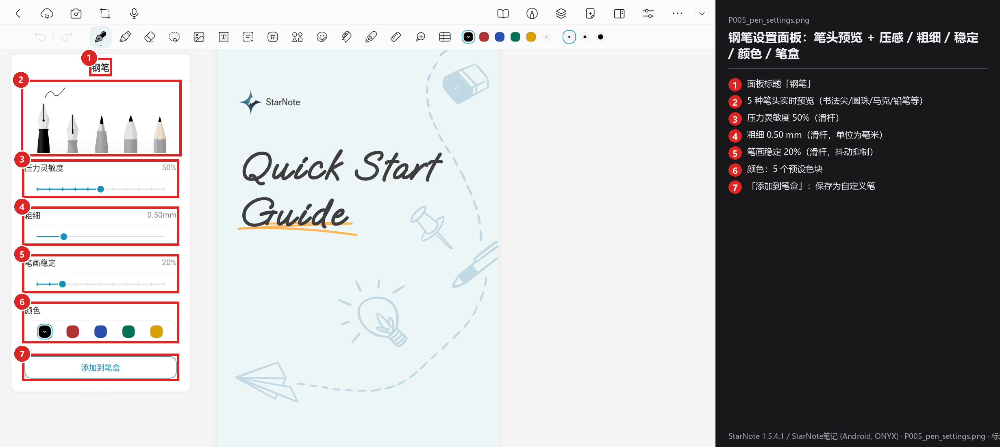

- 原始截图：`screenshots/P005_pen_settings.png` · UI 层级：`ui/P005_pen_settings.xml`

1. 面板标题「钢笔」  `[x1,y1][x2,y2] = [328,216][392,264]`
2. 5 种笔头实时预览（书法尖/圆珠/马克/铅笔等）  `[x1,y1][x2,y2] = [83,294][640,550]`
3. 压力灵敏度 50%（滑杆）  `[x1,y1][x2,y2] = [88,579][632,700]`
4. 粗细 0.50 mm（滑杆，单位为毫米）  `[x1,y1][x2,y2] = [88,749][632,870]`
5. 笔画稳定 20%（滑杆，抖动抑制）  `[x1,y1][x2,y2] = [88,919][632,1040]`
6. 颜色：5 个预设色块  `[x1,y1][x2,y2] = [88,1089][632,1220]`
7. 「添加到笔盒」：保存为自定义笔  `[x1,y1][x2,y2] = [88,1275][632,1355]`

## 6. 编辑器「更多操作」面板

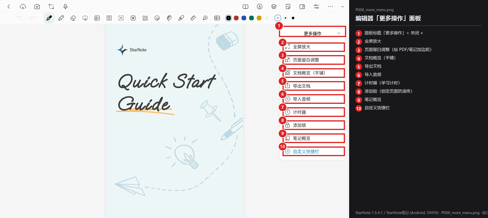

- 原始截图：`screenshots/P006_more_menu.png` · UI 层级：`ui/P006_more_menu.xml`

1. 面板标题「更多操作」+ 关闭 ×  `[x1,y1][x2,y2] = [2055,198][2528,262]`
2. 全屏放大  `[x1,y1][x2,y2] = [2080,320][2520,372]`
3. 页面留白调整（给 PDF/笔记加边距）  `[x1,y1][x2,y2] = [2080,414][2520,466]`
4. 文档概览（平铺）  `[x1,y1][x2,y2] = [2080,510][2520,562]`
5. 导出文档  `[x1,y1][x2,y2] = [2080,604][2520,656]`
6. 导入音频  `[x1,y1][x2,y2] = [2080,700][2520,752]`
7. 计时器（学习计时）  `[x1,y1][x2,y2] = [2080,796][2520,848]`
8. 添加锁（锁定页面防误改）  `[x1,y1][x2,y2] = [2080,892][2520,944]`
9. 笔记概览  `[x1,y1][x2,y2] = [2080,988][2520,1040]`
10. 自定义快捷栏  `[x1,y1][x2,y2] = [2080,1084][2520,1136]`

## 7. 文档概览侧栏：缩略图网格、视图模式与页码搜索（截图时更多菜单仍开启）

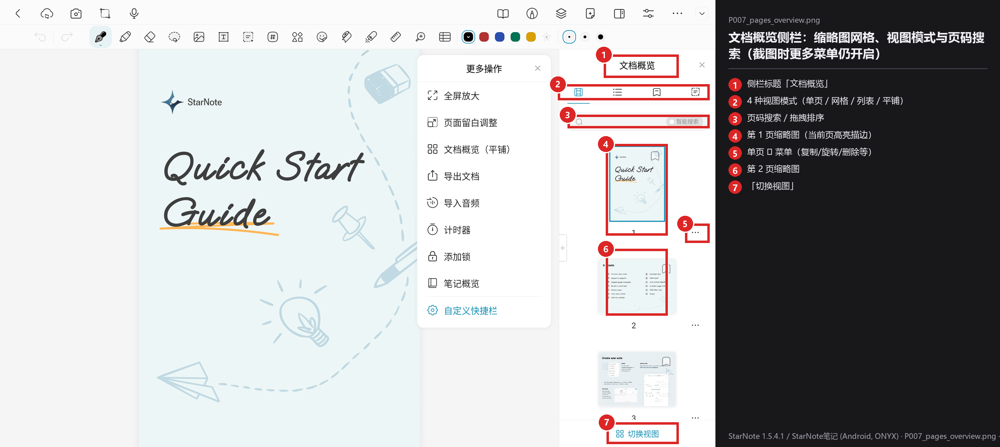

- 原始截图：`screenshots/P007_pages_overview.png` · UI 层级：`ui/P007_pages_overview.xml`

1. 侧栏标题「文档概览」  `[x1,y1][x2,y2] = [2170,205][2420,270]`
2. 4 种视图模式（单页 / 网格 / 列表 / 平铺）  `[x1,y1][x2,y2] = [2005,310][2530,350]`
3. 页码搜索 / 拖拽排序  `[x1,y1][x2,y2] = [2040,420][2530,450]`
4. 第 1 页缩略图（当前页高亮描边）  `[x1,y1][x2,y2] = [2176,525][2380,834]`
5. 单页 ⋯ 菜单（复制/旋转/删除等）  `[x1,y1][x2,y2] = [2460,810][2530,860]`
6. 第 2 页缩略图  `[x1,y1][x2,y2] = [2176,900][2380,1120]`
7. 「切换视图」  `[x1,y1][x2,y2] = [2180,1520][2420,1580]`

## 8. 编辑器「其他设置」面板：文档属性与页面操作

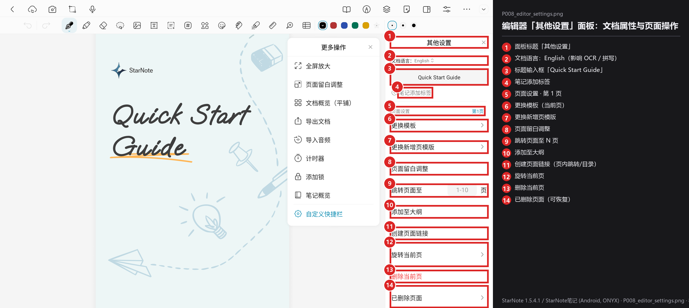

- 原始截图：`screenshots/P008_editor_settings.png` · UI 层级：`ui/P008_editor_settings.xml`

1. 面板标题「其他设置」  `[x1,y1][x2,y2] = [2032,196][2528,244]`
2. 文档语言：English（影响 OCR / 拼写）  `[x1,y1][x2,y2] = [2032,297][2528,332]`
3. 标题输入框「Quick Start Guide」  `[x1,y1][x2,y2] = [2032,364][2528,436]`
4. 笔记添加标签  `[x1,y1][x2,y2] = [2072,460][2240,502]`
5. 页面设置 · 第 1 页  `[x1,y1][x2,y2] = [2032,559][2512,594]`
6. 更换模板（当前页）  `[x1,y1][x2,y2] = [2032,626][2528,678]`
7. 更换新增页模版  `[x1,y1][x2,y2] = [2032,738][2528,790]`
8. 页面留白调整  `[x1,y1][x2,y2] = [2032,850][2528,902]`
9. 跳转页面至 N 页  `[x1,y1][x2,y2] = [2032,962][2528,1018]`
10. 添加至大纲  `[x1,y1][x2,y2] = [2032,1074][2528,1126]`
11. 创建页面链接（页内跳转/目录）  `[x1,y1][x2,y2] = [2032,1186][2528,1238]`
12. 旋转当前页  `[x1,y1][x2,y2] = [2032,1266][2528,1378]`
13. 删除当前页  `[x1,y1][x2,y2] = [2032,1410][2528,1462]`
14. 已删除页面（可恢复）  `[x1,y1][x2,y2] = [2032,1490][2528,1600]`

## 9. 全局设置：左侧 10 个分类，右侧「云同步」

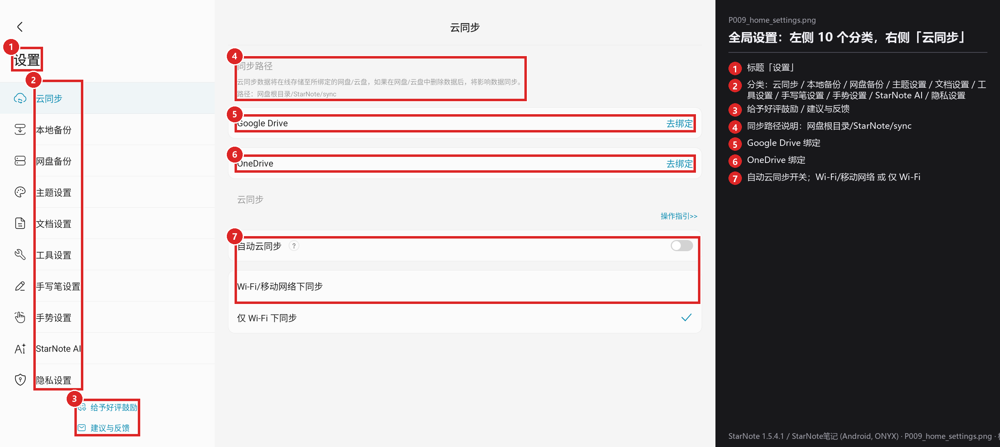

- 原始截图：`screenshots/P009_home_settings.png` · UI 层级：`ui/P009_home_settings.xml`

1. 标题「设置」  `[x1,y1][x2,y2] = [48,176][144,246]`
2. 分类：云同步 / 本地备份 / 网盘备份 / 主题设置 / 文档设置 / 工具设置 / 手写笔设置 / 手势设置 / StarNote AI / 隐私设置  `[x1,y1][x2,y2] = [128,295][288,1388]`
3. 给予好评鼓励 / 建议与反馈  `[x1,y1][x2,y2] = [276,1436][492,1552]`
4. 同步路径说明：网盘根目录/StarNote/sync  `[x1,y1][x2,y2] = [848,210][1876,352]`
5. Google Drive 绑定  `[x1,y1][x2,y2] = [848,418][2480,464]`
6. OneDrive 绑定  `[x1,y1][x2,y2] = [848,562][2480,608]`
7. 自动云同步开关；Wi-Fi/移动网络 或 仅 Wi-Fi  `[x1,y1][x2,y2] = [848,855][2496,1079]`

## 10. 全局设置 · 工具设置

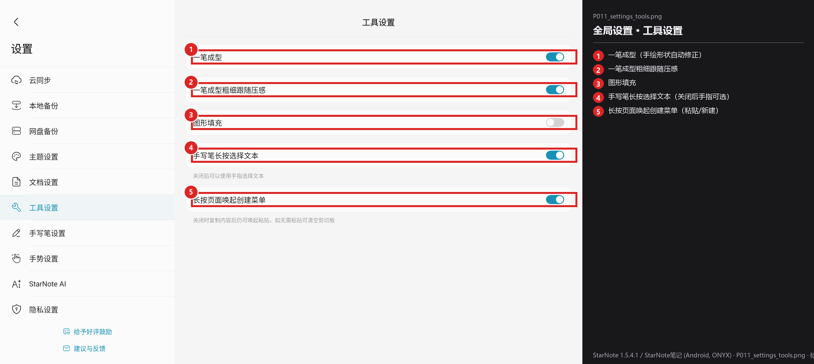

- 原始截图：`screenshots/P011_settings_tools.png` · UI 层级：`ui/P011_settings_tools.xml`

1. 一笔成型（手绘形状自动修正）  `[x1,y1][x2,y2] = [848,226][2528,274]`
2. 一笔成型粗细跟随压感  `[x1,y1][x2,y2] = [848,370][2528,418]`
3. 图形填充  `[x1,y1][x2,y2] = [848,514][2528,562]`
4. 手写笔长按选择文本（关闭后手指可选）  `[x1,y1][x2,y2] = [848,658][2528,706]`
5. 长按页面唤起创建菜单（粘贴/新建）  `[x1,y1][x2,y2] = [848,853][2528,901]`

## 11. 全局设置 · 手写笔设置：按厂商逐项映射笔身按键与手势

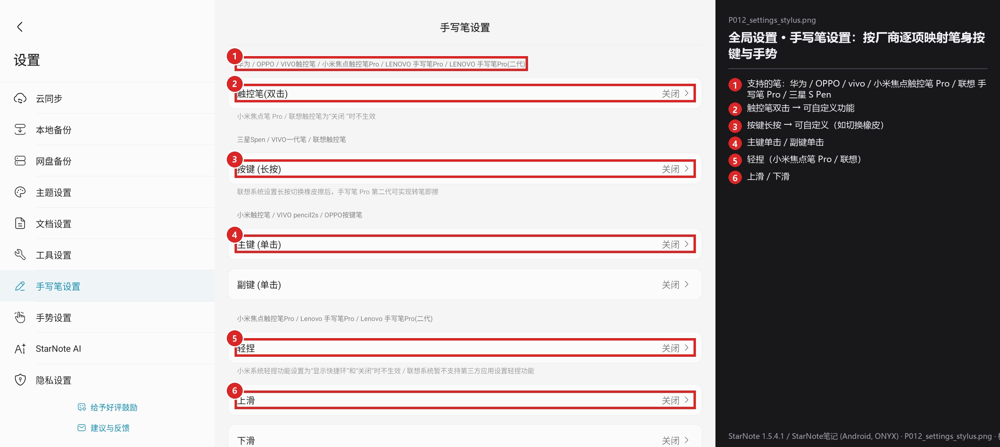

- 原始截图：`screenshots/P012_settings_stylus.png` · UI 层级：`ui/P012_settings_stylus.xml`

1. 支持的笔：华为 / OPPO / vivo / 小米焦点触控笔 Pro / 联想 手写笔 Pro / 三星 S Pen  `[x1,y1][x2,y2] = [848,210][1880,245]`
2. 触控笔双击 → 可自定义功能  `[x1,y1][x2,y2] = [848,309][2480,357]`
3. 按键长按 → 可自定义（如切换橡皮）  `[x1,y1][x2,y2] = [848,579][2480,627]`
4. 主键单击 / 副键单击  `[x1,y1][x2,y2] = [848,849][2480,897]`
5. 轻捏（小米焦点笔 Pro / 联想）  `[x1,y1][x2,y2] = [848,1220][2480,1268]`
6. 上滑 / 下滑  `[x1,y1][x2,y2] = [848,1407][2480,1455]`

## 12. 全局设置 · 手势设置

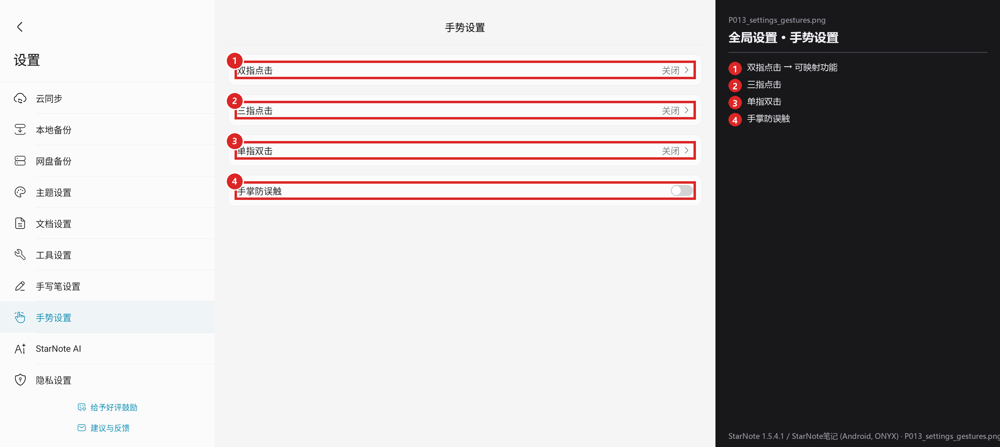

- 原始截图：`screenshots/P013_settings_gestures.png` · UI 层级：`ui/P013_settings_gestures.xml`

1. 双指点击 → 可映射功能  `[x1,y1][x2,y2] = [848,226][2480,274]`
2. 三指点击  `[x1,y1][x2,y2] = [848,370][2480,418]`
3. 单指双击  `[x1,y1][x2,y2] = [848,514][2480,562]`
4. 手掌防误触  `[x1,y1][x2,y2] = [848,658][2480,706]`

## 13. 书架笔记本卡片「∨」菜单（单本操作）

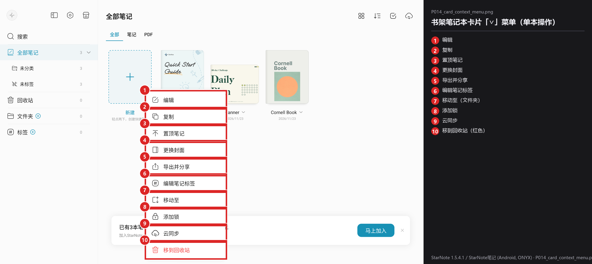

- 原始截图：`screenshots/P014_card_context_menu.png` · UI 层级：`ui/P014_card_context_menu.xml`

1. 编辑  `[x1,y1][x2,y2] = [883,555][1363,655]`
2. 复制  `[x1,y1][x2,y2] = [883,656][1363,756]`
3. 置顶笔记  `[x1,y1][x2,y2] = [883,757][1363,857]`
4. 更换封面  `[x1,y1][x2,y2] = [883,858][1363,958]`
5. 导出并分享  `[x1,y1][x2,y2] = [883,959][1363,1059]`
6. 编辑笔记标签  `[x1,y1][x2,y2] = [883,1060][1363,1160]`
7. 移动至（文件夹）  `[x1,y1][x2,y2] = [883,1161][1363,1261]`
8. 添加锁  `[x1,y1][x2,y2] = [883,1262][1363,1362]`
9. 云同步  `[x1,y1][x2,y2] = [883,1363][1363,1463]`
10. 移到回收站（红色）  `[x1,y1][x2,y2] = [883,1464][1363,1564]`

## 14. 首次新建：软性注册提示（可关闭，不阻断）

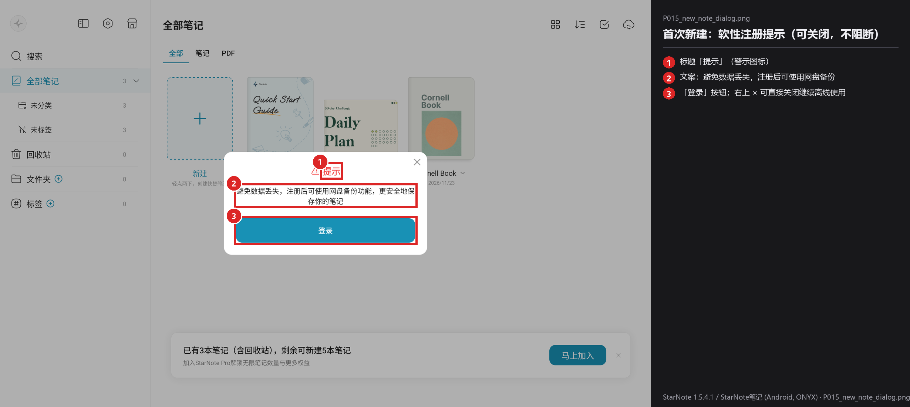

- 原始截图：`screenshots/P015_new_note_dialog.png` · UI 层级：`ui/P015_new_note_dialog.xml`

1. 标题「提示」（警示图标）  `[x1,y1][x2,y2] = [1268,645][1340,698]`
2. 文案：避免数据丢失，注册后可使用网盘备份  `[x1,y1][x2,y2] = [928,730][1632,810]`
3. 「登录」按钮；右上 × 可直接关闭继续离线使用  `[x1,y1][x2,y2] = [928,858][1632,954]`

## 15. 双击新建后：创建「快捷笔记」并自动双开（左右分屏）

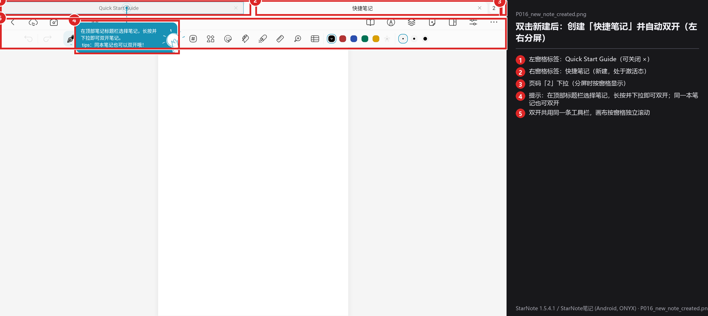

- 原始截图：`screenshots/P016_new_note_created.png` · UI 层级：`ui/P016_new_note_created.xml`

1. 左窗格标签：Quick Start Guide（可关闭 ×）  `[x1,y1][x2,y2] = [0,10][1260,70]`
2. 右窗格标签：快捷笔记（新建，处于激活态）  `[x1,y1][x2,y2] = [1300,10][2530,70]`
3. 页码「2」下拉（分屏时按窗格显示）  `[x1,y1][x2,y2] = [2535,15][2560,70]`
4. 提示：在顶部标题栏选择笔记，长按并下拉即可双开；同一本笔记也可双开  `[x1,y1][x2,y2] = [385,110][900,265]`
5. 双开共用同一条工具栏，画布按窗格独立滚动  `[x1,y1][x2,y2] = [0,100][2560,240]`
