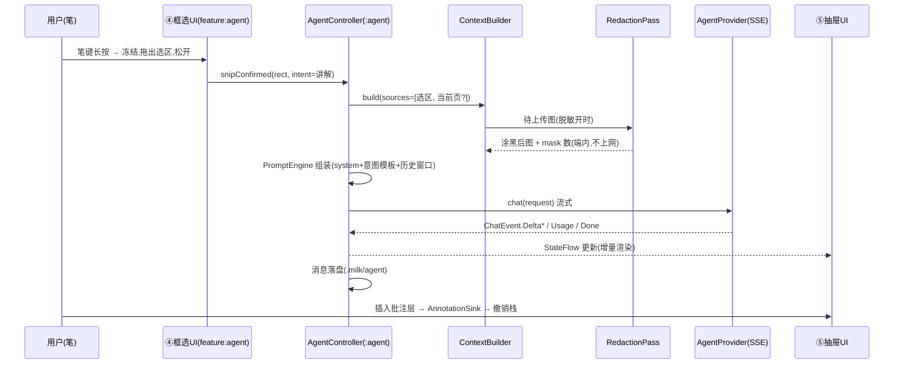

# Agent 后端开发文档(框选 → 意图 → 对话 → 贴回)

> **定位**:`agent` 模块与 `feature:agent` UI 的后端实现规格 —— 框选截图采集、上下文组装、意图与提示词、Provider 抽象(用户自填 Key / 自选模型,**仅限视觉模型**)、流式对话、会话持久化、结果动作(插入批注层等)。对应 DESIGN-V0 §4「Agent 框选截图」与 §2.2 agent 层(K/L/M),M2 交付项的实现依据;⑤ Agent 抽屉 / ④ 框选 两屏 UI 已定稿(2026-10-31 视觉验收),本文定义其背后的全部后端行为。
>
> - 版本:A2(2026-11-02;A2.1 同日增补:对照 deepseek-harness / opencode 审计流式管线,§3.5/§11 落地 stream_options 自适应、max_tokens 策略、302 不跟随、Retry-After、EmptyResponse、帧间 180s;A2 变更:新增 §3.7 Anthropic Messages 原生协议 —— 部分模型/中转站仅有该格式,Protocol 随 profile 可选,原计划 M3 提前落地;A1 变更:§3.3 厂商注册表按各家官方文档全量核验重写,覆盖 9 家厂商 + 中转站)
> - 状态:设计定稿 → M2 开发依据;「待验证」项见 §14
> - 关联:[DESIGN-V0.md](./DESIGN-V0.md) §2.2 / §4 / §5.4 / §6 · [PEN-ADAPTATION.md](./PEN-ADAPTATION.md) §4.3(笔键长按=框选入口)

---

## 1. 范围、原则与 UI 契约总表

### 1.1 M2 范围

| 项 | 内容 | 备注 |
|---|---|---|
| ✅ 应用内框选截图 | 冻结画布 → 选区 → 离屏渲染裁剪(纸面+笔迹+批注全层) | 跨应用 MediaProjection 为 **M3**(§4.4 预留端口) |
| ✅ 意图条 | 讲解/归纳/翻译/出题/续写/转LaTeX 六意图 + 发送 | ④ 屏底部意图条 |
| ✅ Agent 抽屉对话 | 流式 Markdown、上下文 chips、追问、附件、模型切换 | ⑤ 屏 |
| ✅ 批注插入 | 结果贴回批注层(文本卡),进撤销栈 | |
| ✅ Provider 设置 | 用户自填 Key + 自选厂商/模型;**强制视觉模型** | §3.4 |
| ✅ 命令面板联动 | ⌘K:框选讲解 / 讲解本页 / 归纳本章 | 归纳本章=多页图,有预算上限 |
| ✅ 脱敏开关 | 端内检测疑似个人信息并涂黑后再上传 | §10.2 |
| ⬜ 端侧模型 | 仅预留 `OnDeviceProvider` 接口位,M3+ 评估 | |
| ⬜ 记忆卡生成 | ⑤ 屏「生成记忆卡」按钮 M3 接通,现为置灰 stub | |

**三条产品原则**(后端一切取舍的依据):

1. **视觉模型强制**:整个 Agent 只在「多模态视觉模型」上工作。无可用 Provider/模型时,抽屉显示配置引导卡而非空对话框;非视觉模型在 UI 层拦截 + 运行时错误兜底(§3.4)。
2. **最小上传**:默认只上传选区图;当前页/整章等更大上下文一律用户显式勾选,且显示预估规模(§5.3)。
3. **书写不被打断**:Agent 全流程不阻塞书写引擎;流式与渲染在后台,结果贴回走批注层 + 撤销栈。

### 1.2 UI 已定稿要素 → 后端能力映射

⑤ Agent 抽屉与 ④ 框选屏每个交互元素对应的后端能力(实现验收清单):

| UI 要素(定稿稿) | 后端能力 | 章节 |
|---|---|---|
| ④ 冻结画布 + 压暗遮罩 | 书写引擎暂停落墨,进入 `SnipSession` | §4.2 |
| ④ 选框 + 四角手柄 + `1246 × 742 px · 选区已冻结` | 选区矩形状态 + 尺寸标签(px,画布坐标系) | §4.2 |
| ④ 重新框选 / 全页 / 取消 | 选区重置 / 扩为整页 / 退出 Snip 模式 | §4.2 |
| ④ 意图条 6 chips + 发送 ↵ | `IntentRegistry`,默认「讲解」 | §6 |
| ④ 状态条「选区将连同手写层一起送入 Agent」 | 渲染源=全层(纸面+墨迹+批注),非屏幕截图 | §4.1 |
| ⑤ 模型胶囊(稿中示意 `glm-4.6v`,实际取注册表) | `ProviderRegistry` 模型列表 + 切换(仅视觉) | §3.4 |
| ⑤ 上下文 chips:选区·例2 / 当前页 p.12 / + 整章 | `ContextBuilder` 三个来源 + 追加交互 | §5 |
| ⑤ 用户消息附件卡 `snip_1246×742.png · 已含手写层与批注` | `Attachment`(文件引用+逻辑名+meta) | §4.3/§7 |
| ⑤ 助手消息 Markdown(有序表/小节/`#标签`/公式 span) | 流式增量 Markdown 渲染(受控子集) | §6.3/§8 |
| ⑤ 操作 chips:生成记忆卡×3 / 已插入批注层 / 复制 | 结果动作 `ResultActions`(stub/插入/剪贴板) | §9 |
| ⑤ 输入框「继续追问,或输入 / 唤起命令…」+ 回形针 + 发送 | 追问会话 + slash 命令 + 附加附件 | §6.4/§8 |
| ⑤ hint「笔键长按 再次框选」 | 抽屉保持打开时再次进入 Snip,产物并入草稿附件 | §4.2 |
| ⑤ hint「结果可贴回批注层」+ 状态条 | §9 插入批注动作 | §9 |
| 顶栏 Agent 按钮 / ⌥A / ⌘K | 无选区直接开抽屉(带当前页上下文) | §8.3 |

---

## 2. 总体架构

### 2.1 模块与依赖

```
:feature:agent   Compose UI:④ 框选遮罩/意图条、⑤ 抽屉、设置页 Agent 区
      │ 依赖(单向)
:agent           纯后端:Provider / 上下文 / 意图 / 会话 / 脱敏 / 动作
      │ 依赖
(okhttp, okhttp-sse, kotlinx-serialization, datastore, ML Kit 文本+条码)
```

- `:agent` **不依赖** note-domain / ink-engine —— 需要「页面渲染」与「批注层写入」的地方,一律走端口接口(与 `PenInputPort` 同款思路):
  - `SnipSource`:把选区渲染成图(M2 实现类在 app 装配层,调 ink-engine 离屏渲染;M3 加 `ProjectionSnipSource`);
  - `AnnotationSink`:把结果卡插入页面批注层(实现类写 note-domain,§9)。
- `:feature:agent` 只依赖 `:agent` 的门面 `AgentController`(§8.2),不触碰 Provider/存储细节。

### 2.2 数据流(一次「框选讲解」的完整链路)



### 2.3 核心类型速览

```kotlin
// :agent 模块对外门面(§8.2 展开 UI 契约)
interface AgentController {
    val state: StateFlow<AgentUiState>          // 抽屉+会话全量状态
    val snip: StateFlow<SnipUiState>            // ④ 框选模式状态
    fun openDrawer(pageRef: PageRef)            // ⑤ 打开(恢复会话)
    fun closeDrawer(keepStream: Boolean)
    fun snipConfirmed(rectPx: Rect, intent: IntentId)
    fun send() / fun stop() / fun retry()
    fun toggleContext(source: ContextSourceId)
    fun selectModel(providerId: String, modelId: String)
    fun action(msgId: String, action: ResultAction)
}
```

---

## 3. Provider 层:抽象、视觉约束与流式协议

### 3.1 `AgentProvider` 接口

```kotlin
interface AgentProvider {
    val id: String                       // profile 唯一 id
    val protocol: Protocol               // OPENAI_COMPATIBLE / ANTHROPIC(§3.7,A2 起)
    suspend fun models(): List<ModelInfo>          // 已配置模型的可见列表
    fun chat(req: ChatRequest): Flow<ChatEvent>    // 流式对话(§3.5)
    suspend fun cancel(msgId: String)              // 取消在途请求
}

data class ModelInfo(
    val id: String,                      // 如 "glm-4.6v"
    val displayName: String,
    val vision: Boolean,                 // 预设=已验证 true;自定义=true(声明式,§3.4)
    val maxImages: Int,                  // 单请求图上限
    val priceIn: BigDecimal?, val priceOut: BigDecimal?,   // ¥/1M tokens,可空
)

sealed interface ChatEvent {
    data class Delta(val text: String) : ChatEvent           // 增量文本
    data class Usage(val promptTokens: Int, val completionTokens: Int) : ChatEvent
    data class Done(val finishReason: String?) : ChatEvent
    data class Error(val error: AgentError) : ChatEvent      // 结构化错误(§11)
}
```

### 3.2 `ProviderProfile`:用户自填的配置单元

```kotlin
@Serializable
data class ProviderProfile(
    val id: String,                          // uuid
    val presetId: String?,                   // 预设来源(自定义=null)
    val title: String,                       // 显示名,如「智谱 GLM」
    val baseUrl: String,                     // 如 https://open.bigmodel.cn/api/paas/v4
    val apiKeyAlias: String,                 // KeyVault 引用(明文 Key 不落此表,§3.6)
    val models: List<ModelInfo>,             // 该 profile 下的候选模型(用户可增删)
    val activeModelId: String,
    val imageStyle: ImageStyle,              // base64 前缀/格式偏好(§3.5)
)

enum class ImageStyle { DATA_URI, RAW_BASE64 }   // GLM=RAW,OpenAI/Gemini/Qwen=DATA_URI
```

- 一个 profile = 一家厂商端点 + 一个 Key + N 个模型;可建多个 profile 并存,抽屉模型胶囊里跨 profile 切换。
- `models` 初始来自预设;用户可**手动增删任意 modelId**(如厂商新出的视觉模型),也可点「拉取模型列表」走 `GET {baseUrl}/models` 尽力而为(拉不到不影响手填)。

### 3.3 厂商注册表(快照 2026-10-31,全部经各家官方文档核验;连接测试仅验证鉴权)

| 预设 | baseUrl(OpenAI 兼容) | 前沿视觉模型 | imageStyle | 适配要点 |
|---|---|---|---|---|
| 智谱 GLM | `https://open.bigmodel.cn/api/paas/v4` | `glm-5.3-flash`、`glm-5.3-flashx` | RAW_BASE64 | GLM-5 系**首个原生多模态**(图/视频/文件,1M ctx,输出 128K);文本旗舰 GLM-5/5.1 **无视觉**,不预置;`glm-4.6v` 等旧视觉 id 已不在文档,以拉取列表为准 |
| DeepSeek | `https://api.deepseek.com/v1` | `deepseek-flash` | DATA_URI | V4.1-Flash,**官方唯一视觉模型**(1M ctx,默认思考可关);峰谷计费非高峰半价;`deepseek-v4-pro` 无视觉不预置 |
| Kimi(月之暗面) | `https://api.moonshot.cn/v1` | `kimi-k3.1-pro`、`kimi-k3.1-pro-highspeed`、`kimi-k3` | DATA_URI | K3 系原生视觉(1M ctx);**图片仅接受 base64 data URI,不支持公网 URL**(本设计从不传公网 URL,天然兼容);K2 系 2026-12 底下线;平台已更名 platform.kimi.com,API 域名不变 |
| MiniMax | 国内 `https://api.minimaxi.com/v1` / 国际 `https://api.minimax.io/v1` | `MiniMax-M3.1-Flash`、`MiniMax-M3` | DATA_URI | 多模态 1M ctx,M3.1 可调思考深度;国内/国际账号与端点不互通,预置两个 profile 二选一 |
| MiMo(小米) | `https://api.xiaomimimo.com/v1` | `mimo-v2.6-pro`、`mimo-v2.6-flash` | DATA_URI | V2.5 系已于 2026-10-21 下线;V2.6 系全模态(文档含图片理解章节),具体可视觉 id 以平台「模型列表」页实测核验(§14-A8);另提供 Anthropic 兼容端点 |
| 通义 Qwen | `https://dashscope.aliyuncs.com/compatible-mode/v1` | `qwen3.8-max`、`qwen3-vl-plus`、`qwen3-vl-flash` | DATA_URI | 旗舰 qwen3.8-max 视觉全面(单图 ≤20MB、图列表 8000 张);新工作空间为专属域名形态(`{ws}.cn-beijing.maas.aliyuncs.com/compatible-mode/v1`,以百炼控制台为准);旧 `qwen-vl-max` 快照 2026 年陆续下线 |
| OpenAI | `https://api.openai.com/v1` | `gpt-6.1-terra` | DATA_URI | 2026-10-26 发布,视觉推理;GPT-5.5/5.1/4o/4.1 已从 ChatGPT 退役(API 兼容保留但不再预置);Chat Completions 端点持续可用 |
| Anthropic Claude | `https://api.anthropic.com/v1`(**原生 /v1/messages**,A2 起) | `claude-opus-5-5`、`claude-sonnet-5-5`、`claude-fable-5-1`、`claude-haiku-5-5` | DATA_URI(原生路径无关) | 全系图片输入(1M ctx);走 §3.7 原生协议;Claude 系中转站(如 `…/anthropic` 前缀)选「自定义 + Anthropic 协议」,baseUrl 三种写法自动归一 |
| xAI Grok | `https://api.x.ai/v1` | `grok-4.7`、`grok-4.6` | DATA_URI | 视觉内置于文本模型(无独立 vision id),jpg/png ≤20MiB;grok-4.7 500k ctx |
| Google Gemini | `https://generativelanguage.googleapis.com/v1beta/openai/` | `gemini-4-argon`、`gemini-3.8-flash` | DATA_URI | 旗舰 Gemini 4 Argon(统一 1M ctx,推理旗舰),Gemini 系原生多模态输入;兼容层支持 `image_url`(data URI)/流式/`stream_options.include_usage`(用量精确);整体 beta;2.5 系仅限既有用户,不再预置 |
| 中转站 · OpenRouter | `https://openrouter.ai/api/v1` | `厂商/模型`(如 `anthropic/claude-opus-5-5`、`z-ai/glm-5.3-flash`、`deepseek/deepseek-flash`) | DATA_URI | **`GET /models` 返回 `architecture.input_modalities`,含 `"image"` 即可自动标记 vision(§3.4 优待)**;一个 Key 通吃全部厂商,DeepSeek/Kimi/MiMo 等均已上架 |
| 中转站 · 其他(opencode 及任意兼容代理) | 用户填写 | 用户手填 | DATA_URI(自动回退 RAW,§3.5) | 视觉=用户声明 + 运行时兜底(§3.4);未列厂商同走此路 |

- 预设仅为「省事的默认值」,**不做厂商绑定**(DESIGN-V0 §2.1「不绑定厂商」)。预设的 baseUrl/模型同样可改。
- **快照会过期**(Kimi 平台更名、MiMo V2.5 下线均发生在一月内):注册表标注日期,运行时以「拉取模型列表 + 手填」为准;预设里的死 id 由 §11 `404/ModelNotVision` 错误兜底提示更新。
- 「测试连接」按钮:发送一个纯文本 1-token 请求(`max_tokens=1`),验证 baseUrl+Key 鉴权可达。**不做视觉探测**(用户决策 2026-10-31:无视觉自检)。

### 3.4 视觉模型强制(声明式约束,无自检)

约束分三层,**没有任何一步是"发一张探测图试答"**:

1. **入口即视觉**:预设列表只含已验证视觉模型;`ModelInfo.vision=false` 的模型在 UI 中不可选为 Agent 模型(预设内不存在此情况,仅防御)。
2. **自定义模型 = 用户声明**:添加自定义 modelId 时,表单顶部固定警示文案:
   > 「MilkNote 的全部能力依赖**多模态视觉模型**(图片输入)。请确认你填写的模型支持图片输入;纯文本模型将无法使用框选讲解。」
   并以复选框「我已确认该模型支持图片输入」作为保存前提(记录在 `ModelInfo.vision=true` 的来源 `DECLARED`)。
3. **中转站元数据加成(OpenRouter)**:拉取模型列表时读取 `architecture.input_modalities`,含 `"image"` 的模型自动标记 vision(来源 `METADATA`),优于用户声明、无成本零误判。
4. **运行时兜底**:请求返回图片相关错误(HTTP 400 且错误文案含 `image`/`multimodal`/`not support` 等,或 `invalid_content`)→ 映射为 `AgentError.ModelNotVision`,UI 明确提示「当前模型疑似不支持图片输入,请更换视觉模型」并直达模型切换;连续 2 次后自动把该模型标记 `vision=false`(仅本地标记,可手动恢复)。

> 依据:用户要求「自填 Key + 自选厂商模型,严格必须有视觉能力」且「不需要视觉自检」。以声明 + 错误兜底替代主动探测,代价是自定义模型填错时**第一次发送才发现**——由错误信息引导修正,可接受。

### 3.5 OpenAI 兼容协议与 SSE 流式

请求(`POST {baseUrl}/chat/completions`,`stream=true`):

```json
{
  "model": "glm-4.6v",
  "stream": true,
  "messages": [
    { "role": "system", "content": "…" },
    { "role": "user", "content": [
        { "type": "text", "text": "…" },
        { "type": "image_url", "image_url": { "url": "<DATA_URI 或 纯 base64,按 imageStyle>" } }
    ]}
  ],
  "temperature": 0.3
}
```

实现要点:

- **SSE 解析**:用 `okhttp-sse`(`EventSource`)收 `data:` 行;`[DONE]` 结束;逐帧取 `choices[0].delta.content`;末帧 `usage`(若厂商在流尾返回,如智谱)映射为 `ChatEvent.Usage`,拿不到则本地估算(§7.3)。
- **image_url 自适应**:按 profile 的 `imageStyle` 组 url;若首个图片请求 400 且错误指向图片格式,自动换另一种 style 重试一次并**记住**(写回 profile),后续不再抖动。GLM 预设直接配 `RAW_BASE64`(智谱端点 base64 不带 `data:` 前缀的已知差异)。
- **厂商适配注记(2026-10-31 核验)**:§3.3 全部预设厂商均支持 SSE 流式;Kimi 仅接受 base64(本设计从不发送公网 URL,天然兼容);Anthropic 官方兼容层完整支持 `stream`/`image_url`(本项目不使用其受限参数);Grok 视觉内置于文本模型,无需特殊分支。
- **图片编码预算**(见 §5.3):长边 ≤1568px;PNG 优先(笔迹线条锐利、纸面平色压缩率高),编码后 >2MB 自动降 JPEG q88;硬上限 5MB(base64 前)。预算常量集中在 `ImageBudget` 一处,厂商有更严限制时按 profile 覆写。
- **超时**:连接 10s / 帧间空闲 180s(整章长 prefill 无心跳可静默超 60s;harness 普遍 300s 看门狗);models 拉取 30s、测试连接 20s 短超时。
- **A2.1 对照 deepseek-harness/opencode 增补**:
  - `stream_options:{"include_usage":true}` **仅流式路径携带**(非流式发会被部分网关 400),端点拒识(400 文案含 stream_options)→ 自适应去参重试一次并回写 profile(`streamOptionsEnabled=false`),精确 usage 覆盖 OpenAI/Gemini/GLM 等;
  - OpenAI 路径**不发送 max_tokens**(gpt-6.x/o 系推理模型只认 max_completion_tokens,发错字段直接 400;不限制走厂商默认);
  - 中转站 302 **不静默跟随**(`instanceFollowRedirects=false`,跟随会以 GET 丢请求体);
  - 429 读取 `retry-after-ms`(ms)/`Retry-After`(s)随错误上抛,控制器退避优先采信(≤120s 才采信,≤30s 直接用作 sleep);
  - 空响应(流结束无终止帧且零内容)= 可重试错误 `EmptyResponse`(自动重试 1 次),**不落空气泡**;有内容无终止帧 = StreamBroken 半截保留(harness STREAM_CLOSED 语义;opencode 中途重试会造成文本重复,已避开);
  - `content:null`/`reasoning_content` 等帧的 JsonNull 显式排除(kotlinx JsonNull.content 会返回字面量 "null",真机实证曾拼入 32 个)。
- **多图**:content 中按顺序排 `[图1][图2]…[文]`,图序即语义序(选区在前,补充页在后);`maxImages` 由 `ModelInfo` 声明(预设多为 4–10,取保守值),`ContextBuilder` 超出时自动截断并提示。

### 3.7 Anthropic Messages 原生协议(A2 增补,2026-11-02)

部分模型/端点**只有 Anthropic 格式**(Claude 官方原生 API、各家 Claude 系中转站、DeepSeek 等 `/anthropic` 端点)——`ProviderProfile.protocol = ANTHROPIC` 时走本协议,请求/流式/错误与 OpenAI 路径差异如下:

- **端点**:`POST {baseUrl}/v1/messages`(baseUrl 以 `/v1` 结尾、裸域、`…/anthropic` 中转前缀三种写法自动归一);模型列表 `GET {baseUrl}/v1/models`(同样 `{data:[{id}]}` 形状)。
- **请求头**:`x-api-key` + `anthropic-version: 2023-06-01`,并同时携带 `Authorization: Bearer`(中转站普遍只认 Bearer,官方两者皆收)。
- **请求体**:`system` 为顶层字符串;**`max_tokens` 必填**(缺省 8192:归纳整章长回答不截断,Claude 3+ 全支持;测试连接 =1);图片为 content block:
  `{type:"image", source:{type:"base64", media_type:"image/png|image/jpeg", data:"<base64>"}}`,图先文后语义序不变;`media_type` 跟随真实编码字节(JPEG 降级后不再错报 png)。
- **流式帧**:每帧 data 载荷自带 `type` 字段(`event:` 行天然被 SSE 解析器丢弃):`content_block_delta.delta.text_delta` → Delta;`message_start.usage.input_tokens` + `message_delta.usage.output_tokens` 拼合 → Usage;`message_stop` → Done;`ping`/内容块起止帧忽略;`error` 帧按 `error.type` 映射(overloaded→Server、rate_limit→RateLimit、authentication→Auth)。
- **错误码**:401/403 Auth、429 RateLimit、**529(Overloaded)→ Server**、5xx Server、400 图片文案 → ModelNotVision(§3.4 兜底同款)。
- **imageStyle 自适应不适用**(原生路径图片恒为 base64 块,无前缀差异)。
- 实现共享 `BaseHttpProvider` 公共管道(连接生命周期/SSE 循环/取消),OpenAI 与 Anthropic 仅差端点/头/体/帧解析四个钩子;`ProviderFactory` 按 profile.protocol 分发。

### 3.6 Key 与敏感配置存储(`KeyVault`)

- API Key **不进** `ProviderProfile` 明文;profile 只存 `apiKeyAlias`。
- `KeyVault`:Android Keystore 内生成 AES-256-GCM 密钥,对每个 alias 的 Key 做**信封加密**后存 DataStore(`agent/keys.pb`);运行时解密仅驻内存。
- 备份排除:DataStore 文件位于 `filesDir`,不在 `.milk` 目录内 → 笔记本备份/导出不携带 Key。
- 明文 Key 仅两处出现:设置页输入框(显示尾 4 位)与请求头 `Authorization: Bearer`。

---

## 4. 框选截图采集(SnipSource)

### 4.1 端口与实现

```kotlin
interface SnipSource {
    /** 把页面坐标系下的矩形渲染成位图(纸面+墨迹+批注全层,M2 应用内源) */
    suspend fun capture(page: PageRef, rectPx: Rect, scale: Float): Result<SnipBitmap>
}

data class SnipBitmap(
    val bitmap: Bitmap,          // 已按预算缩放
    val logicalName: String,     // "snip_1246×742.png"(UI 附件卡显示名,§1.2)
    val srcRect: Rect,           // 页面坐标原矩形
)
```

- **M2 实现 `InAppSnipSource`**(装配于 app 层):调 ink-engine/note-domain 的离屏软件渲染(`PageSnapshotter`),**矢量重绘**而非截屏——所得图与「屏幕上看到的一致」(含批注红笔、荧光笔层),但不依赖 GL 上下文、无状态栏/暗角/系统 UI 污染,旋转与 DPR 无关,可确定性测试。
- 冻结语义:进入 Snip 模式时书写引擎 `pauseInk()`(拒收新笔迹,④ 状态条「书写已暂停 · 截图模式」),退出即恢复;**不复制页面数据**——渲染时才读当前模型,全页渲染同理。

### 4.2 选区交互状态(④ 屏)

```kotlin
data class SnipUiState(
    val phase: SnipPhase,            // IDLE / FROZEN(拖选中) / CONFIRMED(松开待发)
    val rect: Rect?,                 // 画布 px
    val minSize: Int = 48px,         // 小于则视为误触,不确认
    val intent: IntentId = EXPLAIN,  // 意图条当前选中(默认讲解,↵ 直发)
)

sealed interface SnipEvent {
    data class Opened(val entry: PenTrigger|Hotkey|Toolbar) : SnipEvent()   // 长按/⌥A/⌘K/顶栏
    data class Dragged(val rect: Rect) : SnipEvent()
    object Confirmed : SnipEvent()      // 松开 → CONFIRMED,意图条浮出
    object RectChanged / FullPage / Reset / Cancelled : SnipEvent()   // 重选/全页/取消(笔双击)
    data class IntentPicked(val id: IntentId) : SnipEvent()
    object Send : SnipEvent()           // 发送 ↵ → 自动开抽屉,进入 §2.2 链路
}
```

- **抽屉开着时再次长按**:抽屉不关,新选区确认后作为**新附件并入草稿**(⑤ hint「笔键长按 再次框选」),意图条仍可用——连续圈多题再一并发送。
- 取消:笔身双击 / ✕ / 遮罩外点按,`resumeInk()`,无残留状态。

### 4.3 附件落地(`Attachment`)

```kotlin
@Serializable
data class Attachment(
    val id: String,
    val file: String,             // notebooks/<nb>/xxx.milk/agent/att/<sha1>.png(§7.2)
    val sha1: String,             // 内容寻址,重复选区自动去重
    val widthPx: Int, val heightPx: Int,
    val source: Source,           // SNIP(rect) / FULL_PAGE / EXTRA_PAGE(pageId) / PROJECTION(M3)
    val logicalName: String,      // snip_1246×742.png
    val redacted: Int,            // 脱敏涂抹处数(0=未启用),§10.2
)
```

落盘时机:发送时(编码后、上传前)——没发送的草稿附件只驻内存,不产生文件。

### 4.4 M3 预留:跨应用 `ProjectionSnipSource`

接口不变;实现走 MediaProjection 虚拟屏截取→同一条 `Attachment` 通道,会话绑定变为 `PageRef.Global`(§7.1)。M2 不实现,但 `Source` 枚举与存储 schema 先留位,避免 M3 迁移。

---

## 5. 上下文组装(ContextBuilder)

### 5.1 来源模型

```kotlin
sealed interface ContextSource {
    val id: ContextSourceId        // SNIP / CURRENT_PAGE / CHAPTER / EXTRA_IMAGE
    val label: String              // chips 文案:「选区 · 例2」「当前页 p.12」「整章」
}

data class AgentContext(
    val images: List<Attachment>,       // 有序:选区 → 补充页
    val pageText: String?,              // M3:ML Kit 识别文本(M2 恒 null,§5.4)
    val notebookMeta: NotebookMeta,     // 笔记本名/科目用途标签(纯文本,进 system)
    val estTokens: Int,                 // 预估,UI 显示「≈ N tok」
)
```

### 5.2 组装规则(与 ⑤ chips 一一对应)

| Chip | 默认 | 组装行为 |
|---|---|---|
| `选区 · <识别标题>` | **必有**(来自框选) | 1 张选区图;标题取自意图+尺寸,不做图像理解 |
| `当前页 p.N` | 默认**开** | 追加整页渲染图(长边同预算);供模型看选区上下文 |
| `+ 整章` | 默认**关** | 追加本章其余页(按页序,截 `maxImages-已用` 张,封顶 8);开时提示「将上传 N 页」 |
| 回形针附加 | — | 从缩略图侧栏/相册追加任意页图 |

- 每会话记住上次勾选,下批同款;`toggleContext` 即时重算 `estTokens` 与预估张数。
- 「讲解本页」(⌘K):无选区,`CURRENT_PAGE` 独占;「归纳本章」:`CHAPTER` 独占(截断规则同上)。

### 5.3 `ContextBudget`(常量集中,可按 profile 覆写)

| 参数 | 值 | 说明 |
|---|---|---|
| `maxImagesPerRequest` | min(profile.activeModel.maxImages, 10) | 超出截断+提示 |
| `imageLongEdgePx` | 1568 | 笔迹清晰度与 token 成本平衡;各家单图上限普遍 ≥5–20MB / ≥4K,1568px 全兼容且保守 |
| `imageTargetBytes` | ≤2MB(PNG 超限降 JPEG q88) | 硬上限 5MB(base64 前) |
| `historyWindow` | 近 8 条消息,system 不折叠 | §6.4 |
| `estTokensPerImage` | ≈ 1.1k(按 1568px 经验值) | 仅 UI 展示用 |

### 5.4 M3 挂点:识别文本

`pageText` 通道 M2 建好但恒 null;M3 接 ML Kit 识别结果后,整章文本可替代部分整章图(降 token),届时仅改 `ContextBuilder` 内部策略,上层不动。

---

## 6. 意图系统与提示词

### 6.1 `IntentRegistry`(六意图,可扩展)

```kotlin
data class IntentSpec(
    val id: IntentId,                // EXPLAIN/SUMMARIZE/TRANSLATE/QUIZ/CONTINUE/LATEX
    val label: String, val icon: LucideIcon,    // ④ 意图条 chip
    val systemPrompt: String,        // 角色+输出契约(§6.2)
    val userTemplate: String,        // "{{TEXT}}" 用户补充文字可空
    val attachFullPageDefault: Boolean,          // 该意图默认是否带当前页
    val pasteAction: ResultAction,               // 贴回默认动作(§9)
)
```

| 意图 | system 要点(输出契约) | 默认带当前页 | 贴回动作 |
|---|---|---|---|
| 讲解 | 分步思路;关键概念首次出现加粗;公式 `$…$`;结尾 3–6 个 `#标签`;**不用表格** | ✅ | 插入批注层 |
| 归纳 | 结构化要点列表+考点标签;`####` 小节 | ✅(可升整章) | 插入批注层 |
| 翻译 | 中英对照两栏列表;保留公式原样 | ❌ | 插入批注层 |
| 出题 | 3 道递进(选择/填空/解答),末尾统一给答案(便于先自测) | ✅ | 插入批注层 |
| 续写 | 按笔记条目风格续写大纲(短句、①②③),不编造已写内容 | ✅ | 插入批注层 |
| 转 LaTeX | **只输出** `$$…$$` 代码块,无解释 | ❌ | 插入公式卡/复制 |

六意图共用同一段**基础 system 前缀**:「你在平板手写笔记 App 内工作;用户发来的是手写笔记截图,可能含公式/图示/中文;语气简洁,面向大学生;严格 Markdown 子集:标题/列表/加粗/行内代码/`$公式$`/`#标签`,禁用表格与图片」——子集约束与 UI 渲染器能力(§8.4)对齐。

### 6.2 PromptEngine

- 输入:`IntentSpec` + `AgentContext` + 会话历史窗口 + 用户补充文字。
- 输出:§3.5 的 messages。图片放**最后一条 user 消息**内(图先文后),历史消息中的图**不重发**(大多数厂商重复计费/部分不支持),追问轮只带文字历史 + 新图。
- 历史 token 估算超 `historyWindow` 时从最旧截断,并保留首条 user(题目本体)不丢。

### 6.3 输出契约 → UI 渲染约定

助手输出按声明只用 Markdown 子集;UI 侧约定:`#标签` 行内高亮为 chip 胶囊(⑤ 稿 `mn-tag`)、`$…$` 渲染为 mono 公式 span(M3 升级真实公式排版)、`$$…$$` 渲染为公式卡。渲染器是**容错子集解析器**(遇到超集语法按纯文本降级),不要求模型 100% 守约。

### 6.4 追问与 slash 命令

- 追问 = 同会话继续 `send()`,意图上下文保留(system 不变);用户可只发文字(无新图)。
- 输入框 `/` 唤起:映射到 `IntentRegistry`(六意图)+ 会话命令 `/清空` `/复制全部` `/换模型`。解析为首 token 前缀匹配,不做模糊匹配。

---

## 7. 会话模型与持久化

### 7.1 `AgentSession`

```kotlin
data class AgentSession(
    val id: String,
    val bind: PageRef,              // PageBound(notebookId, pageId) / Global(M3)
    val createdAt: Long, val updatedAt: Long,
    val providerId: String, val modelId: String,     // 每条消息另有快照(§7.3)
    val messages: List<AgentMessage>,
)

data class AgentMessage(
    val id: String, val role: Role, val sentAt: Long,
    val text: String,               // 用户补充文字 / 助手累积文本
    val attachments: List<Attachment>,           // 用户侧
    val intent: IntentId?,                       // 首条用户消息记录
    val modelId: String?,                        // 助手侧:实际使用的模型
    val usage: Usage?,                           // pt/ct tokens(§7.3)
    val phase: ExchangePhase,                    // SENDING/STREAMING/DONE/FAILED/INTERRUPTED
)
```

**生命周期**:一个 `(notebook, page)` 同时只有一个活动会话;开抽屉恢复该页最近会话;「+」/`/清空` 开新会话;翻页不自动切(用户在 ⑤ 内点「移到 p.N」手动关联,M3)。

### 7.2 存储:跟随 `.milk` 目录(本地优先,可整本备份)

```
<notebook>.milk/
  agent/
    sessions/<sessionId>.json      # kotlinx-serialization,单会话单文件
    att/<sha1>.png|jpg             # 附件内容寻址,自动去重
```

- **写策略**:消息完成(Done/Failed)时整文件重写(会话消息数 ≤ 数百,JSON 足够);流式过程**不落盘**(崩溃只丢在途轮次,重开抽屉可见上一完整轮 + 草稿)。附件在发送时落盘(§4.3)。
- 草稿(输入框文字+待发附件引用):DataStore 按 pageRef 键存,进抽屉即恢复。
- 删除会话:级联删附件(引用计数=0 才删文件);导出笔记本时 `agent/` 一并带走——笔记与讲解共存。

### 7.3 用量与成本

- 每条助手消息记录 `usage`(厂商流尾返回则用之;否则估算:prompt≈图 `estTokensPerImage`×N + 文本 chars/1.6,completion=chars/1.6)。
- ⑤ 消息 meta 行显示 `glm-4.6v · 1.2k→0.8k tok`(mono,合 Codex 风);设置页聚合「本月按模型 token/估算费用」(费率来自 `ModelInfo.price*`,用户可改)。

---

## 8. UI ↔ 后端契约(`AgentController` / 状态机)

### 8.1 状态定义(⑤ 抽屉全量状态)

```kotlin
data class AgentUiState(
    val drawer: DrawerState,            // CLOSED / OPEN
    val setupRequired: Boolean,         // 无可用视觉模型 → 引导卡(§3.4/§12)
    val activeModel: ModelInfo?,
    val contextChips: List<ContextChipState>,   // 来源+选中+预估规模
    val messages: List<UiMessage>,              // 含附件卡/操作 chips/流式光标
    val draft: DraftState,                      // 文字+附件+slash 面板
    val exchangePhase: ExchangePhase,           // 本轮:IDLE/SENDING/STREAMING/INTERRUPTED/DONE/FAILED
    val streamCursor: Int?,                     // 流式渲染游标(增量追加)
)
```

### 8.2 事件全表(定稿 UI 的每个可交互点)

| UI 交互 | 事件 | 后端行为 |
|---|---|---|
| 顶栏 Agent / ⌥A / ⌘K | `openDrawer(page)` | 恢复会话或建空会话;无模型→引导卡 |
| 模型胶囊 `›` | `selectModel(p, m)` | 切 `activeModel`,下次发送生效(不重发历史) |
| chips 点选/整章 | `toggleContext(id)` | 重算 images/estTokens,提示规模 |
| 意图 chip(④) | `IntentPicked` | 仅本地状态,Send 才消费 |
| 发送 ↵ / 按钮 | `send()` | §2.2 链路;抽屉内=追问 |
| 停止(流式时发送键变停止) | `stop()` | 取消在途请求,保留已收文本,置 `INTERRUPTED` |
| 失败条幅「重试」 | `retry()` | 重发本轮(替换半截消息);指数退避由后端管(§11) |
| 操作 chip 复制 | `action(COPY)` | 纯文本(含公式源码)入剪贴板 |
| 操作 chip 插入批注层 | `action(INSERT_ANNOTATION)` | §9;成功后 chip 变「已插入」done 态 |
| 生成记忆卡 | `action(MAKE_CARDS)` | M2:置灰+「M3 开放」toast |
| 回形针 | `attach(pageId\|image)` | 并入草稿附件 |
| 收起(顶栏)/ ✕(抽屉) | `closeDrawer(keepStream=true)` | **流不中断**:后台收完落盘,Agent 按钮呼吸态,点开看结果 |
| 再次长按框选(抽屉开) | §4.2 | 新附件并入草稿 |

### 8.3 入口矩阵

| 入口 | 路径 | 初始上下文 |
|---|---|---|
| 笔键长按(主) | ④ 框选 → 意图 → 发送 | 选区(+当前页按意图默认) |
| ⌥A / 顶栏 Agent | 直接 ⑤ | 当前页,无选区,草稿空 |
| ⌘K 框选讲解 | 进 ④ | 同笔键 |
| ⌘K 讲解本页 | 直接 ⑤ 并自动发送 | CURRENT_PAGE 独占 |
| ⌘K 归纳本章 | 直接 ⑤ 并自动发送 | CHAPTER(截断提示) |

从框选到出结果 ≤3 次交互(长按框选→松开→↵)满足 DESIGN-V0 §1 设计原则 4。

### 8.4 流式渲染(⑤ 消息区)

- `ChatEvent.Delta` 进 `Channel`,UI 侧 `conflate` + 每 ~50ms 批量提交 `UiMessage.text` —— 避免每 token 重组;
- 增量 Markdown:对**已稳定前缀**(上次提交后的不变部分)缓存解析结果,仅重解析尾部未闭合片段;
- 自动滚动:贴底时跟随,用户上滑即解除(流结束出现「回到底部」);
- 停止/中断:保留半截 + 尾部「已中断 · 重试」条幅。

---

## 9. 结果动作(`AnnotationSink` 端口)

```kotlin
interface AnnotationSink {
    /** 在页面批注层插入结果卡;返回可撤销操作句柄 */
    suspend fun insertCard(page: PageRef, anchor: Rect?, content: AnnotationCard): UndoHandle
}
```

- **插入批注层**(讲解/归纳/翻译/出题/续写):生成 V0 Layer 体系中的**文本层**卡片(`AnnotationCard`:markdown-lite → 样式文本),锚定策略:优先选区正下方最大空白带 → 否则右缘批注列 → 否则页面底部追加;进入页面 undo 栈(`UndoHandle`),点卡可展开完整消息。LaTeX 意图 → 公式卡(`$$…$$` 原文,M3 升级渲染)。
- **复制**:纯文本(含公式源码)→ 剪贴板,toast 确认。
- **记忆卡**:M3(stub 现状 §1.1)。
- 动作幂等:插入成功后消息记录 `insertedAnnotationId`,重复点击不再插(⑤ 稿 done 态)。

---

## 10. 隐私与安全

### 10.1 上传最小化

默认仅选区图(+按意图默认的当前页);整章/附加页全显式;图片编码在本机完成后才进网络栈;无任何遥测/崩溃上报带笔记内容(崩溃上报仅堆栈,需用户开启)。

### 10.2 脱敏管线(`RedactionPass`,设置开关,默认关)

开启后,每张待上传图先过端内两道检测,命中区域涂黑:

1. **ML Kit Barcode Scanning**:二维码/条码(常编码微信/身份/票据信息)→ 整码区涂黑;
2. **ML Kit Text Recognition(中文+拉丁)**:识别文本块 → 规则分类:手机号、身份证 18 位、邮箱、银行卡(Luhn 校验)、`学号/工号` 自定义正则(设置可增)→ 命中框涂黑。

- 输出:涂黑后图 + `maskCount`(附件卡显示「已涂黑 N 处」,⑤ 附件卡 meta);原**未涂黑**图仍存本地 `att/`(本机数据完整,上传版仅内存中转换,不落盘)。
- 依赖说明:文本识别中文模型需首次联网下载(离线后可用);模型未就绪时发送前提示「脱敏组件未下载,本次不脱敏」按用户选择继续/中止。
- 性能预算:单图 ≤300ms(Pixel-level 涂黑是 Canvas 矩形填充,可忽略)。

### 10.3 Key 安全

见 §3.6:Keystore 信封加密 + 不入 `.milk` 备份 + 界面只显示尾 4 位;「清除所有 Key」入口在设置。

---

## 11. 错误矩阵与重试/取消

| 错误(`AgentError`) | 识别 | UI 呈现 | 策略 |
|---|---|---|---|
| `NoProvider` / `NotVisionOnly` | 入口检查 | 抽屉引导卡「配置视觉模型」 | 直达设置 |
| `Auth`(401/403) | HTTP | 「Key 无效或额度不足」+ 设置链接 | 不重试 |
| `RateLimit`(429) | HTTP | 「请求过快」 | 服务端 Retry-After 优先(≤120s 采信);否则自动退避 2s/8s/30s,共 3 次 |
| `EmptyResponse`(A2.1) | 流尾零内容 | 空气泡即错误 | 自动重试 1 次(1s);仍空则失败提示 |
| `Server`(5xx) | HTTP | 「服务方故障」 | 自动重试 2 次(1s/5s) |
| `Network`(IOException/离线) | 异常 | 「网络不可用」 | 不自动重试(监听恢复后提示一键重发) |
| `Timeout`(连接/帧间) | OkHttp | 同 Network | 同上 |
| `ModelNotVision`(§3.4) | 400 文案 | 「该模型疑似不支持图片,请换视觉模型」 | 引导切换;2 次后本地标 `vision=false` |
| `ContextTooLarge`(413/图片超限) | HTTP/本地预算 | 「上下文过大」 | 自动缩图一档重试一次;再失败提示减页 |
| `StreamBroken`(中途断) | SSE 异常 | 半截保留 + 「已中断 · 续写/重试」 | 重试=整轮重发替换;「续写」=带半截历史发「继续」 |
| `Cancelled`(用户 stop) | — | 半截保留,标 INTERRUPTED | — |

- 自动重试仅发生在**首 token 之前**;已有内容后一律走 StreamBroken 路径(不重复计费)。
- 所有失败轮次也落盘(`phase=FAILED/INTERRUPTED`),重开抽屉可续。

---

## 12. 设置页规格(设置 → Agent)

| 区块 | 内容 |
|---|---|
| Provider 列表 | profile 卡片(名称/baseUrl/尾 4 位 Key/模型数);新增(§3.3 注册表 12 选 1 或自定义);删除(确认;关联会话保留仅离线可读) |
| 模型管理 | 每 profile 模型列表:增(手填 modelId+视觉声明复选框,§3.4)/删/设为默认;「拉取模型列表」尽力而为;价格 ¥/1M tok 可编辑 |
| 连接测试 | 1-token 纯文本请求,显示延迟 ms 与结果(仅鉴权可达性) |
| 脱敏 | 开关(默认关)+ 自定义正则管理 + 「中文识别模型:已下载/未下载」 |
| 用量 | 按模型/按月聚合 token 与估算费用 |
| 高级 | 历史窗口条数(4/8/12)、图片长边(1024/1568/2048)、流式帧间超时 |

---

## 13. 性能指标(验收线)

| 指标 | 目标 |
|---|---|
| 松开笔 → 意图条可交互 | <100ms(仅状态切换,无 IO) |
| 发送 → 选区图编码落盘完成 | <400ms(1568px,中端平板) |
| 发送 → 首 token(良好网络) | <2.5s(受厂商主导,仅监控) |
| 流式渲染 | 60fps 会话列表不卡顿(conflate 批量提交,§8.4) |
| 抽屉开关 | <150ms(状态恢复本地读) |
| 整章(8 页)组装 | <1.5s(离屏渲染并行 2 路) |

---

## 14. 测试与验收计划

**单元测试(:agent,pure JVM)**
- SSE 解析器:正常帧/`[DONE]`/半行/多 choice/`usage` 缺失(粘包用 okio 伪造 source);
- PromptEngine:意图模板、历史窗口截断保首条、图不重发、token 估算单调性;
- ContextBudget:多图截断顺序、缩图/JPEG 降级决策、estTokens 与张数提示;
- Redaction:合成位图 fixture(画手机号/二维码图)→ 期望 mask 数与区域;
- KeyVault:加解密 roundtrip、alias 隔离(Robolectric);
- 错误映射:HTTP code/文案矩阵 → `AgentError` 全覆盖。

**FakeAgentProvider(脚本化)**:注入预设脚本(立即完成/慢流 50 chunk/中途断/429),驱动 `AgentController` 全状态机与 UI 测试(④→⑤ 全链路 Compose 测试不依赖网络)。

**真机验收(Pad 7 + 焦点笔,M2 末)**
| # | 用例 | 判定 |
|---|---|---|
| A1 | 长按→框选例题→讲解↵:流式出结果→插入批注层→撤销/重做 | §13 指标达成;批注可撤销 |
| A2 | 抽屉开着再框选 3 个选区一并发送 | 多图顺序正确(图序=语义序) |
| A3 | 自定义 profile 填纯文本模型 | 首发后收到明确「换视觉模型」引导;本地标记生效 |
| A4 | 脱敏开:笔记页含手机号+二维码 | 上传请求体(burpsuite/日志代理)无明文;附件卡显示 N 处 |
| A5 | 中途断网/恢复 | 半截保留;恢复后一键重发成功;重复计费不发生 |
| A6 | 整章(>8 页)归纳 | 截断提示正确,费用预估合理 |
| A7 | 删除笔记本目录再拷回 | 会话与附件随 `.milk` 完整恢复 |
| A8 | MiMo `mimo-v2.6-pro/flash` 发图片请求实测 | 确认视觉能力与 id 写法,回填 §3.3(唯一「推定」项) |

---

## 15. M2 任务拆解(3–4 周)

| 周 | 交付 |
|---|---|
| W1 | `:agent` 骨架 + 核心类型;`OpenAICompatProvider`(SSE/错误映射/imageStyle 自适应);`KeyVault`;设置页 Provider 区(预设/自定义/测试连接/视觉声明) |
| W2 | `InAppSnipSource`(离屏渲染)+ ④ 遮罩/意图条交互;`ContextBuilder`+预算;`IntentRegistry`+PromptEngine;会话/附件存储(`.milk/agent`);RedactionPass |
| W3 | ⑤ 抽屉 UI:流式 Markdown 子集渲染、chips、追问、slash、附件卡;`AgentController` 状态机全量接线;停止/重试/中断 |
| W4 | 结果动作(AnnotationSink 插入+撤销、复制、LaTeX 卡);⌘K/⌥A 入口;用量统计;错误打磨;FakeProvider 全套测试;真机验收 A1–A7 |

依赖:W1 需 ink-engine 的 `PageSnapshotter` 离屏渲染接口先行与 M1 对齐(若 M1 未交付,用临时软件渲染桩顶替,W2 联调)。

---

## 16. 风险与对策

| 风险 | 对策 |
|---|---|
| 自定义模型实际不支持视觉(无自检,首发才发现) | §3.4 声明式三层的运行时兜底 + 明确引导;预设用户零风险 |
| 各厂商 OpenAI 兼容程度参差(usage 位置/图片格式/base64 前缀) | imageStyle 自适应重试;预算常量按 profile 覆写;错误文案模糊匹配集中一处维护 |
| 厂商流式偶发脏帧(非 JSON 行/注释帧) | SSE 解析容错跳过 + 帧内 JSON 失败仅丢该帧不中断 |
| 厂商模型/端点快速迭代(Kimi 平台更名、MiMo V2.5 一月内下线、GLM 旧 id 移除) | §3.3 标注快照日期;预设全可编辑 + 拉取列表 + 手填;`404/ModelNotVision` 运行时兜底提示更新 id;OpenRouter 中转天然跟随最新 id |
| 离屏渲染与屏幕呈现不一致(字体/荧光笔混合) | `PageSnapshotter` 复用书写引擎同一绘制路径;A1 用例目检比对 |
| 脱敏误涂公式/漏涂变体号码 | 规则仅高置信(完整 11 位手机号等);maskCount 透明呈现;默认关闭 |
| 多图整章 token 成本失控 | 预算硬上限+显式确认+费用展示;`estTokens` 常驻 chips |
| ML Kit 中文模型未下载即脱敏 | 发送前状态检查 + 用户选择(§10.2) |

---

## 17. 参考资料

**厂商 API(§3.3 注册表核验来源,2026-10-31)**
- [DeepSeek · 定价与模型](https://api-docs.deepseek.com/quick_start/pricing) —— `deepseek-flash` 视觉/峰谷计价,`deepseek-v4-pro` 无视觉
- [Kimi · 模型列表](https://platform.kimi.com/docs/models.md) · [K3.1 Pro 快速入门](https://platform.kimi.com/docs/guide/kimi-k3-1-pro-quickstart.md) —— K3 系原生视觉、图片仅 base64、K2 下线计划
- [智谱 BigModel · 视觉模型](https://docs.bigmodel.cn/cn/guide/models/vlm) —— `glm-5.3-flash/flashx` 原生多模态
- [MiniMax · 模型介绍](https://platform.minimax.io/docs/guides/models-intro) —— `MiniMax-M3.1-Flash/M3` 多模态
- [小米 MiMo · 首次调用](https://mimo.mi.com/docs/zh-CN/quick-start/summary/first-api-call) —— `api.xiaomimimo.com/v1`、V2.5 下线、双协议端点
- [阿里云百炼 · 视觉理解](https://help.aliyun.com/zh/model-studio/vision) —— `qwen3.8-max` 旗舰与兼容模式端点
- [OpenAI · 模型发布记录](https://help.openai.com/en/articles/9624314-model-release-notes) —— `gpt-6.1-terra` 与退役清单
- [Claude · 模型总览](https://platform.claude.com/docs/en/docs/about-claude/models/overview) · [OpenAI SDK 兼容层](https://platform.claude.com/docs/en/api/openai-sdk) —— 全系视觉、兼容层参数边界
- [xAI · 模型与定价](https://docs.x.ai/developers/models) —— `grok-4.7/4.6` 视觉内置、图像规范
- [Gemini · 模型列表](https://ai.google.dev/gemini-api/docs/models) · [OpenAI 兼容端点](https://ai.google.dev/gemini-api/docs/openai) —— `gemini-4-argon` 旗舰、兼容层图片/流式/用量
- [OpenRouter · 文档](https://openrouter.ai/docs) —— `/models` 元数据 `input_modalities` 判视觉

**Android / 库**
- [okhttp-sse](https://square.github.io/okhttp/features/sse/) —— EventSource 流式解析
- [ML Kit Text Recognition v2](https://developers.google.com/ml-kit/vision/text-recognition/v2) · [ML Kit Barcode Scanning](https://developers.google.com/ml-kit/vision/barcode-scanning) —— 脱敏两道检测
- [Android Keystore](https://developer.android.com/privacy-and-security/cryptography) —— Key 信封加密
- DESIGN-V0 §2.1/§4/§6(协议与数据选型)、PEN-ADAPTATION §4.3(框选触发通路)

---

*本文档对应 M2「Agent 框选」;A1(2026-10-31)厂商注册表经官方文档全量核验。实现中与厂商实测不符处(尤其 §3.3 快照过期、§3.5 兼容细节)随改随记,验收后升版 A2。*
