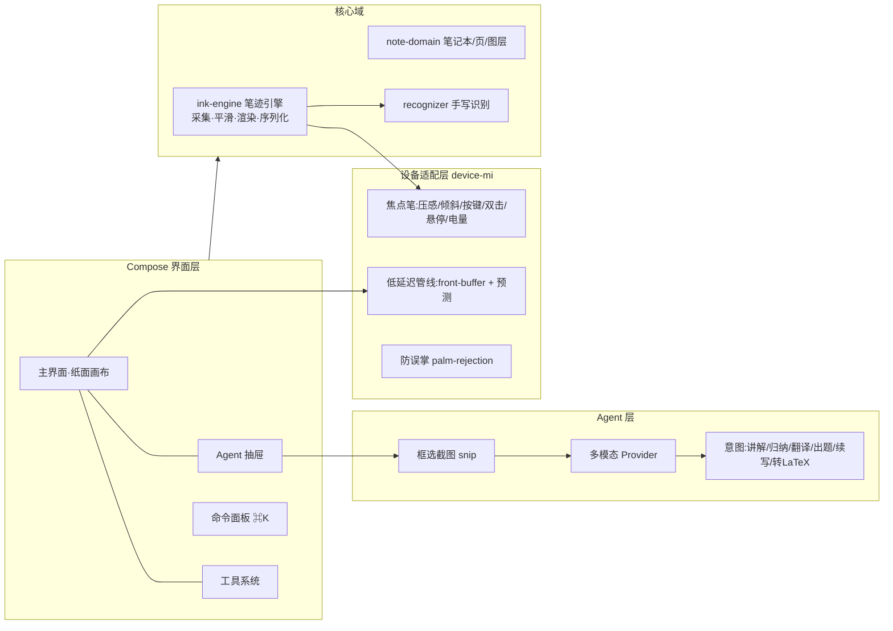
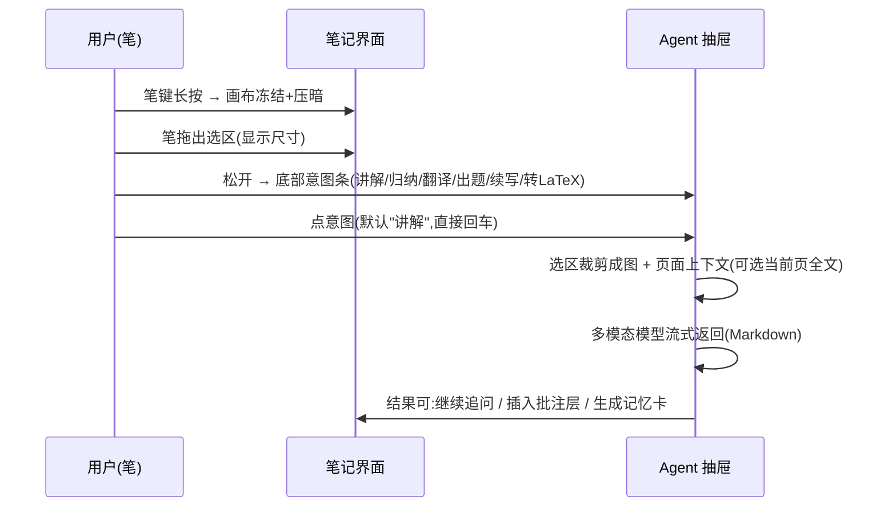
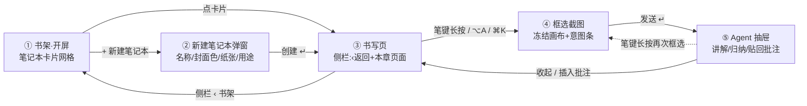

# 牛奶笔记 MilkNote · 初版设计方案(V0)

> **一句话定位**:为小米平板 + 小米焦点触控笔打造的低延迟手写笔记应用,内置 Codex 风格的 Agent 窗口,长按笔键框选屏幕任意区域,随写随问、随选随讲。

- 版本:V0(初版设计,2026-10-30)
- 状态:设计定稿 → 进入 M1 开发
- 仓库:`D:\Repositories\MilkNote`

---

## 1. 产品定位与目标设备

| 维度 | 内容 |
|---|---|
| 目标用户 | 大学生 / 考研考证人群;习惯手写记笔记、又希望"笔记能被 AI 讲解和归纳"的人 |
| 核心场景 | 课堂手写笔记 → 课后圈选题 → 笔键长按框选 → Agent 讲解/归纳/出题 → 贴回批注层复习 |
| 目标设备 | 开发主力机:小米平板 8 Pro(HyperOS 3.0+);备用测试机:小米平板 7 Pro;产品向下兼容小米平板 7 / 6S Pro |
| 系统基线 | Android 14+(HyperOS);`minSdk 31`、`targetSdk 35`,焦点笔完整能力要求 Android 14 |
| 配件 | 小米焦点触控笔(一代,2024):8192 级压感、倾斜识别、三实体键(主键/副键/焦点键,带系统级双击/长按手势)、磁吸无线充电、蓝牙电量上报;焦点触控笔 Pro(无实体键,触控区手势)为前瞻适配 |
| 差异化 | ① 毫秒级出墨的笔体验;② Agent 框选截图(应用内 + 跨应用);③ 笔键/手势**完全自定义**——千本笔记等主流笔记应用均不支持改笔键,这是本项目的直接动因;④ Codex 式极简界面与命令面板 |

### 设计原则

1. **纸感优先**:界面永远比纸面退后一步;工具栏可隐,纸不可动。
2. **笔是第一公民**:所有高频操作映射到笔身按键与双击,手指只做导航与缩放。
3. **界面退后(Codex 风)**:单色调、细边框、等宽字体细节、无装饰;一个强调色只属于 Agent。
4. **Agent 唤手即得**:从框选到出结果 ≤ 3 次交互,默认动作"讲解"。

---

## 2. 总体架构

### 2.1 技术选型

| 层 | 选型 | 理由 |
|---|---|---|
| 语言/UI | Kotlin 2.x + Jetpack Compose | 单代码库、Canvas 与 Compose 互操作成熟 |
| 笔迹渲染 | `androidx.graphics-core` 的 `FrontBufferedRenderer`(GL 前置缓冲) | Google 官方低延迟出墨方案,<10ms 首笔可见 |
| 输入 | `MotionEvent` 原生流(`requestUnbufferedDispatch`)+ Android 14 `MotionPredictor` | 免缓冲派发 + 官方轨迹预测,再砍一截延迟 |
| 笔迹数据 | 自研 stroke 格式(protobuf 增量) | 压感/倾斜全量保留,文件小、可增量保存 |
| 识别 | ML Kit Digital Ink Recognition(中/英) | 端内免费,手写转可检索文本 |
| 存储 | Room(元数据)+ 笔记本目录 `.milk` 文件(数据) | 本地优先,文件可直接备份 |
| Agent | Provider 抽象(云端多模态 GLM-4V 系 / 可换任意 OpenAI 兼容端点;预留端侧小模型) | 用户自填 Key,不绑定厂商 |
| 截图 | 应用内:自绘遮罩区域裁剪;跨应用:`MediaProjection`(一次授权) | 覆盖"笔记内讲解"与"全网内容讲解"两类需求 |

### 2.2 模块划分



模块边界规则:`device-mi` 与 `agent` 均为接口化(`PenInputPort` / `AgentProvider`),换笔、换模型不动核心。

---

## 3. 小米焦点触控笔深度适配(重点)

> 实现规格见 [PEN-ADAPTATION.md](./PEN-ADAPTATION.md):笔按键三通路(实体键 KeyEvent/MotionEvent + 焦点笔 Pro 小米 SDK 触控手势)、压感采样与映射、小米手写笔引擎 SDK 集成、真机验证计划。

### 3.1 输入与低延迟管线

```
触控笔硬件 → 触控采样(240Hz 笔报点率)
  → MotionEvent 流(requestUnbufferedDispatch 免缓冲)
  → MotionPredictor 预测未来 ~12ms 轨迹点
  → FrontBufferedRenderer 前置缓冲直接出墨(GL)
  → 笔抬起后 合成进正式图层(离屏纹理,可撤销)
```

- **出墨目标**:<10ms(前置缓冲);常规重绘路径 <32ms。
- **压感**:`event.pressure`(0–1,映射焦点笔 8192 级)→ 笔宽按 S 型曲线映射,轻触 0.3mm、重按 2.2mm;记录原始值用于回放。
- **倾斜**:`orientation + tiltX/Y` → 钢笔模式笔锋偏移 + 软阴影;荧光笔模式加宽笔迹并降不透明度。
- **悬停**:`HOVER_MOVE` 显示笔尖光标(小圆环 + 当前笔宽预览),悬停 600ms 弹出迷你工具气泡。

### 3.2 笔身手势映射(可自定义)

| 手势 | 默认动作 | 交互细节 |
|---|---|---|
| 笔身双击 | 切换 笔 ⇄ 橡皮 | 双击间隔 <350ms,系统级监听,任何界面状态生效 |
| 笔键长按(>400ms) | **进入框选截图(核心卖点)** | 冻结画布 → 笔拖出选区 → 松开弹出意图条 |
| 笔键单击 | 套索选择 | 圈选笔迹后可拖动/删除 |
| 笔尖悬停 + 按住笔键 | 激光笔(讲课模式) | M3 实现 |
| 手指 | 仅导航:滚动、缩放、点选 | `TYPE_STYLUS` 存在时手掌与手指写入全部拒绝(防误掌) |

### 3.3 电量与连接

- 蓝牙 GATT 读取焦点笔电量,顶栏常驻胶囊:`🪶 82%`;低于 20% 变琥珀色,磁吸吸附充电时显示充电动画与"约 1 分钟可用 10 分钟"提示。
- 蓝牙未连接时自动降级:压感按中等值模拟,笔键/双击不可用,首次用笔弹引导页提示连接。

### 3.4 兼容降级策略

| 能力 | 焦点笔 + 平板7 | 通用触控笔 | 手指 |
|---|---|---|---|
| 低延迟出墨 | ✅ front-buffer | ✅ | ✅(笔宽固定) |
| 轨迹预测 | ✅ MotionPredictor | 视机型 | ✅ |
| 压感/倾斜 | ✅ | 视机型 | — |
| 笔键/双击 | ✅ | ❌(界面按钮替代) | ❌ |
| 防误掌 | ✅ | ✅ | — |

---

## 4. Agent 框选截图(核心功能)

### 4.1 触发方式(三选一)

1. **笔键长按**(主路径,任意界面);
2. 顶栏 Agent 按钮 / 快捷键 `⌥A`;
3. 命令面板 `⌘K` → "框选讲解"。

### 4.2 流程



### 4.3 能力与落点

| 意图 | 输出形态 |
|---|---|
| 讲解 | 分步思路 + 关键概念链接 |
| 归纳 | 结构化要点列表 + 考点标签 |
| 翻译 | 中英对照 |
| 出题 | 3 道递进题(选择/填空/解答) |
| 续写 | 按笔迹风格续写大纲(文本层) |
| 转 LaTeX | 手写公式 → LaTeX,可贴回 |

- **跨应用框选**:授权 `MediaProjection` 后,长按笔键在任意 App 上框选(悬浮窗/快捷磁贴触发),结果进入同一 Agent 抽屉。首次授权后创建前台服务常驻会话。
- **隐私**:裁剪在本机完成;默认仅上传选区图;提供"脱敏开关"(自动涂黑疑似个人信息);"云端/端侧"可切换,端侧走本地小模型(质量降级可用)。

---

## 5. 界面设计系统(Codex 风)

### 5.1 色彩

| Token | 亮色(奶白) | 暗色 | 用途 |
|---|---|---|---|
| `paper` | `#FAF9F5` | `#1B1C20` | 纸面/主背景 |
| `chrome` | `#F3F1EA` | `#232429` | 侧栏/顶栏 |
| `surface` | `#FFFFFF` | `#26272D` | 卡片/输入框 |
| `ink` | `#23221E` | `#E8E6E0` | 主文字 |
| `muted` | `#8B867A` | `#9B978D` | 次要文字 |
| `line` | `#E5E1D6` | `#33343B` | 细边框(1px) |
| `accent` | `#3B5BEC` | `#7D92FF` | **仅** Agent 与激活态 |
| `highlight` | `rgba(255,214,90,.45)` | 同 | 荧光笔默认 |
| `red-pen` | `#D2483C` | `#E06558` | 批注红笔 |

- 单一强调色纪律:蓝色只出现在 Agent 相关元素与当前激活工具;其余一律灰阶。
- **视觉语言(V0 定稿:柔和连贯)**:Codex 的骨架(等宽元数据、单强调色、⌘K、信息密度)+ 柔和的皮——双层软阴影、顶部内高光、胶囊控件(999px)、卡片 hover 上浮、封面淡彩与色点呼应、纸面四周暗角、全按钮 0.18–0.24s 过渡;圆角比例统一(卡片/弹窗 1.6–2cqi,缩略图 1cqi,小控件全胶囊)。
- 纸面点阵:`#D8D4C8` / `#2C2D33`,26px 网距,可切换 横线/方格/空白。

### 5.2 字体

| 用途 | 字体 |
|---|---|
| 界面 | Inter + MiSans / PingFang SC / 微软雅黑 回退 |
| 数字·状态·命令 | JetBrains Mono(页码、⌘K、尺寸标注、模型名) |
| 笔迹 | 非字体渲染,矢量笔迹(压感变宽),界面 mock 中以手写体示意 |

### 5.3 信息架构与页面关系



导航规则:
- **层级只有两层**:书架(笔记本集合)→ 笔记本内书写页;无深层菜单,全局动作走 ⌘K 命令面板。
- 书写页侧栏**只放当前笔记本的页面缩略图**(不再放笔记本列表——与书架重复),顶部固定「‹ 书架」返回行。
- 顶栏在书写类页面(③④⑤)保持同一组件:撤销重做 / 工具 / 墨色粗细 居中,右侧 笔电量胶囊 + ⌘K + Agent;④ 框选时工具组整体进入禁用态(半透明、不可点),⑤ Agent 打开时按钮语义变「收起」。
- 底部状态条横贯窗口:③ 笔连接+手势提示+页码;④ 变为「书写已暂停 · 截图模式」并浮于遮罩之上;⑤ 提示结果可贴回批注层。

### 5.4 布局(平板横屏 3:2)

```
┌───────────────────────── 顶栏 ──────────────────────────────┐
│ ③④⑤: 牛奶笔记·面包屑 | 撤销重做·工具·墨色 | 笔电 ⌘K [Agent]   │
│ ①②: 牛奶笔记 MILKNOTE | 搜索⌘K | 笔电 [+ 新建笔记本]         │
├──────────┬──────────────────────────────────┬──────────────┤
│ 侧栏 220px│            纸面画布              │ ⑤Agent 抽屉   │
│ ‹ 书架    │      (点阵纸 + 手写笔迹)         │  360px 浮层   │
│ 本章页面  │                                │  (右缘滑入)   │
│ 缩略图×6  │      底部状态条(横贯全窗)         │              │
└──────────┴──────────────────────────────────┴──────────────┘
```

- 书架页:笔记本卡片网格(封面 = 迷你点阵纸 + 笔迹示意 + 与色点呼应的淡彩渐染;「最近」徽标;页数/最近编辑 mono;用途小标签)+ 虚线新建卡;卡片双层软阴影 + hover 上浮;搜索框全局可搜手写识别文本。
- 新建笔记本:居中模态(名称 / 封面色 6 色 / 纸张模板 点阵·横线·方格·空白 / 用途标签),「创建 ↵」直接进入第 1 页。
- 顶栏/侧栏均可自动隐藏(书写模式双击空白处),只剩纯纸。
- **命令面板 ⌘K**:Codex 式居中搜索框,统一入口:新建、切换笔记本、意图(讲解本页/归纳本章/全部导出)、设置。

### 5.5 组件清单(V0)

书架列表行与新建行、新建笔记本模态(输入框/色点/纸张模板/用途 chips)、黑白主按钮、顶栏工具组(裸图标)、笔电量指示、返回行 + 页面缩略图侧栏、纸面(点阵/横线/方格)、笔迹悬浮光标、框选遮罩 + 选框(角手柄 + 尺寸标注)、意图条(底部深色胶囊)、Agent 对话(上下文 chips、用户/助手消息、附件缩略图、操作 chips)、命令面板、批注插入卡、记忆卡生成提示、底部状态条(按模式切换文案)。

---

## 6. 数据模型与存储

### 6.1 笔迹 stroke(protobuf)

```protobuf
message Point { float x=1; float y=2; float p=3; float tx=4; float ty=5; uint64 t=6; } // 位置/压感/倾角/时间戳
message Stroke {
  string tool=1;        // pen|ball|highlighter|eraser
  string color=2;       // hex
  float base_width=3;   // mm
  repeated Point pts=4; // 增量追加,落笔即 flush
}
message Layer { string id=1; int32 z=2; repeated Stroke strokes=3; } // 笔迹层/图片层/文本层
message Page  { string id=1; string paper=2; /* dot|line|grid|blank */ int32 rotation=3; repeated Layer layers=4; }
```

### 6.2 存储与导出

- 一个笔记本 = 一个 `xxx.milk` 目录:`notebook.json`(元数据)+ `p0001.pb`…(每页一个文件,追加写)。
- 自动保存:每笔抬起后 300ms 防抖 flush;崩溃恢复靠 WAL。
- 导出:PDF / PNG / Markdown(识别文本 + 笔迹图);分享单页长图。
- 检索:ML Kit 识别文本入 Room FTS,支持中文模糊搜"上次写特征值的那页"。

---

## 7. 里程碑

| 阶段 | 周期 | 交付 |
|---|---|---|
| **M1 书写核心** | 4–6 周 | 低延迟出墨、压感/倾斜、笔键/双击、防误掌、笔记本/页面管理、撤销重做、导出 PNG/PDF |
| **M2 Agent 框选** | +3–4 周 | 应用内框选截图、意图条、Agent 抽屉对话、命令面板、批注插入、Provider 设置(GLM-4V 系,自填 Key) |
| **M3 增强** | +4 周 | 跨应用 MediaProjection 框选、手写识别检索、记忆卡、LaTeX 转换、云同步(可选)、讲课激光模式 |

## 8. 权限与外部依赖清单(哪些能力要「申请」)

> 结论:**真正卡开发者申请的只有 PenEngine 一处(且已规划免申请的路径 A,仅影响 Pro 笔手势);其余均为用户级授权或用户自备账号,不需要开发者向任何平台申请。** 详见 [PENENGINE-APPLY.md](./PENENGINE-APPLY.md)。

| 功能(里程碑) | 依赖 | 需要什么 | 性质 |
|---|---|---|---|
| Pro 笔触控手势(M1 通路③) | PenEngine SDK 触控按键/悬浮预览 | 路径 A:免鉴权、无需申请(运行时校验待验证);路径 B:企业实名认证 + 服务申请 | 平台申请(仅 B) |
| 笔迹预测(M1) | MotionPredictor(androidx) | 无 | ✅ 无 |
| ~~SDK 笔迹预测~~(已弃) | MiuiStrokeEstimate 鉴权 | 企业认证 + 签名指纹登记 | ❌ 个人不可得,已弃 |
| 笔电量/低延迟模式(M1) | 蓝牙 GATT + 磁吸配对 | `BLUETOOTH_CONNECT` 运行时权限(用户弹窗) | 用户授权 |
| Agent 对话(M2) | GLM-4V 系 / OpenAI 兼容端点 | 用户自填 API Key(用户在模型平台注册) | 用户自备账号 |
| 应用内框选截图(M2) | 自绘遮罩裁剪 | 无 | ✅ 无 |
| 跨应用框选截图(M3) | MediaProjection | 用户运行时授权 + 前台服务(Android 14 须先授权再启动 FGS) | 用户授权 |
| 手写识别检索(M2/M3) | ML Kit Digital Ink | 免费无需申请;⚠️ 模型下载依赖 Google Play 服务,国行无 GMS 大概率不可用 | 依赖风险(§9) |
| 导出 PNG/PDF/分享 | 标准 API | 无 | ✅ 无 |
| 上架小米商店(未来) | 应用分发 | 企业主体(个人/个体户 2024 底起受限,待核实);GitHub 直发不受影响 | 平台资质 |

---

## 9. 风险与对策

| 风险 | 对策 |
|---|---|
| 焦点笔私有协议(笔键/双击/电量)无公开 SDK | 以通用 `MotionEvent`(按键码 `STYLUS_BUTTON`)先行;反查蓝牙 HID 报文;必要时联系小米开发者支持;全部能力接口化,失败则降级为界面按钮 |
| ML Kit 数字墨水识别的模型下载依赖 Google Play 服务,国行小米平板(无 GMS)手写检索不可用 | M2/M3 检索功能在主力机可能失效 | 真机验证 GMS 影响;备选:第三方 OCR / 轻量自研模型(SDK 文字识别需企业认证,不可作为个人开发者备选) |
| `MotionPredictor` 机型差异 | 运行时探测,预测量自适应;关闭预测仅留 front-buffer |
| 跨应用截图权限(后台限制) | 前台服务 + 用户显式授权;拒绝授权时应用内框选不受影响 |
| 云端多模态成本/隐私 | 选区最小上传、脱敏开关、端侧降级模型、Key 用户自持 |
| Compose 大画布性能(千笔以上) | 分块纹理 + 视口裁剪渲染,离屏合成;必要时笔迹层迁 Native Skia |

---

*配套界面渲染见会话内初版 UI(书写 / 框选截图 / Agent 归纳 三状态)。*
